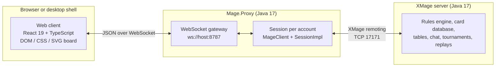
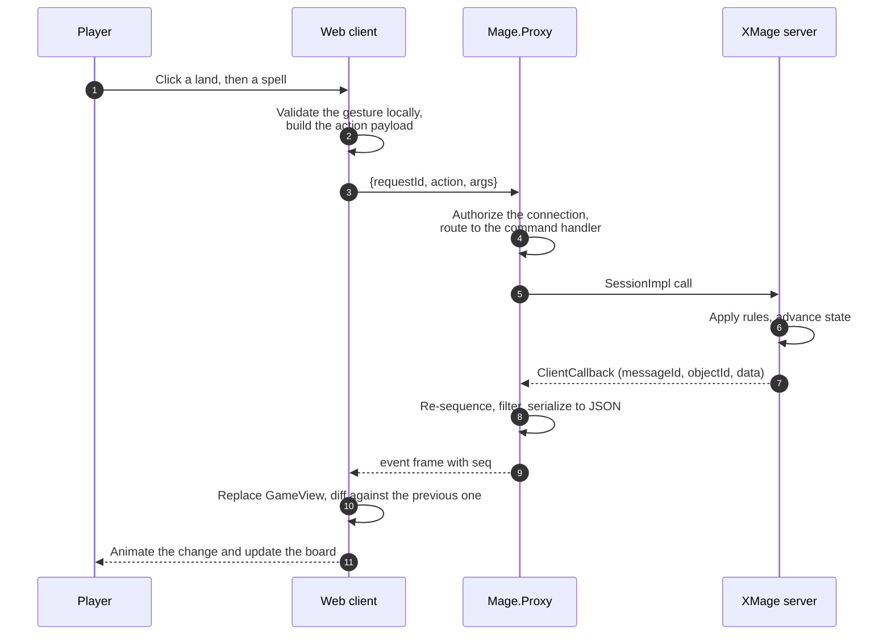

# Architecture

XMage Nexus is three processes and one optional desktop shell. A browser renders the game, a Java proxy translates between two protocols, and an XMage server owns every rule. This page shows how the pieces fit, how an action travels through them, and which layer owns each kind of state, so you can change one tier without breaking the assumptions of the others.

> **Who this is for:** developers who need the system shape before changing the proxy, the web client, or the test harness.

## The three tiers

| Tier | Owns | Never does |
|---|---|---|
| XMage server | Card rules and legality, priority and turns, card database, table and tournament state, chat routing, replay persistence | Render anything, know about JSON or browsers |
| Mage.Proxy | Session lifecycle, JSON translation, reconnect and stream resume, capability probing, deck pre-validation | Apply game rules, store card images, mutate game state |
| Web client | Application state, rendering, input, animation, deck building, card art, translations, audio | Open a socket to the XMage server, decide whether a play is legal |
| Desktop launcher | Downloading and verifying a JRE, a server and a proxy, starting them, updating itself | Change the protocol or the UI |

The proxy exists because a browser cannot speak the XMage remoting protocol: the server exchanges serialized Java objects over a binary channel, and the browser speaks JSON. The proxy opens a real XMage session for each account, receives the server's callbacks, writes them as JSON, and forwards client actions back. It deliberately performs no state transformation, so a field added to a Java view class reaches the client without a proxy change.

One proxy process serves many independent players. A static web build plus one proxy is a complete deployment; players point the client at that proxy and at the XMage server they want to play on. A deployment can also pin the server target, and optionally hide it from players.

## What a click does

Every player action takes the same path. The client treats an action as an intent and waits for the server's next frame to learn what actually happened.

Two consequences follow from this shape. First, the client never guesses the outcome of an action: it may highlight what looks playable, but the next full `GameView` is the truth. Second, a dropped frame is recoverable, because the proxy numbers every broadcast frame and can replay the gap when the same client comes back.

## State model

The client keeps one application state object split into slices. Each slice has a single responsibility and a narrow update path.

| Slice | Holds |
|---|---|
| `session` | Connection details, phase (`idle`, `connecting`, `lobby`, `spectating_pending`, `staging`, `game`), link health, login retry progress, server capabilities, probed deployment config |
| `lobby` | Tables, room users, chat channels, finished matches, deck gallery state |
| `game` | Current `GameView`, playable objects, pending prompt, combat selection, sideboard and draft state, action feed |
| `limited` | Draft and sealed pools, picks, tournament brackets and standings |
| `replay` | Loaded replay, playback position, perspective, playback errors |
| `settings` | Gameplay, board, appearance, audio, language and accessibility preferences |

State is protocol-first. A `GAME_UPDATE` replaces the stored `GameView` wholesale; views are not patched field by field in response to local input. The client derives everything else — which cards are playable, which prompt is open, what moved where — from that snapshot plus the prompt frames that accompany it.

Event order is part of the contract. The server numbers callbacks per session, the proxy restores their order before forwarding, and the client keeps a per-game ordering guard so a late frame from an old game cannot overwrite the current one. When a connection opens a new XMage session rather than attaching to a live one, the server restarts its callback numbering at 1, and the client resets its ordering state to match.

Persistence is intentionally small: the connection form and the last active game (bounded by age) live in local storage, and the stream resume token lives in session storage. Card art and Scryfall lookups are cached in IndexedDB; the offline image index ships as static files. A reload restores the board by rejoining the game through the proxy, not by rebuilding state from scratch.

## Rendering pipeline

The board is React DOM with CSS and SVG overlays. There is no canvas game renderer; canvas appears only for preparing a custom card image and for the tab attention icon. That choice keeps text crisp, makes every element inspectable, and lets the test suite assert on real DOM rather than pixels.

`GameScreen` is the layout router. It selects the board layout from the table's shape and the player's preference:

| Board | Used for |
|---|---|
| `GameBoard` | Standard two-player and free-for-all games with an opponent switcher |
| `PodBoard` | Multiplayer pods where every opponent is visible at once; it delegates team games to `TwoHeadedBoard` |
| `TwoHeadedBoard` | Two-Headed Giant teams |
| `ArenaBoard` | Compact, art-crop tile presentation |

Inside a board, `BoardZone` lays out the shared zones, `PlayerZone` and `OpponentZone` place the seats, and `CardSlot` renders an individual permanent in classic or compact form. Stack, hand, command zone, graveyard, exile and library each have a dedicated component; targeting arrows, combat arrows and flying-card overlays sit above the board in SVG or transformed DOM layers.

Animation is derived, not scripted per event. When a new `GameView` arrives, the transition engine compares it with the previous one and emits declarative effects: a card flying from hand to battlefield, a permanent tapping, a spell slamming onto the stack, a life total dropping as combat damage resolves. The same diff feeds the sound dispatcher and the action feed, so visuals, audio and the textual log describe one consistent sequence.

Motion respects two opt-outs: the `html.fx-off` class disables decorative animation globally, and `prefers-reduced-motion` does the same at the operating-system level. Board effects use `translate` and `scale` so they compose with the tap transform instead of replacing it.

For tests, `sceneBridge` publishes a compact description of the board on `window.__mageScene`: card positions, playable ids, targeting state and combat state. End-to-end specs assert against that object and against the DOM, never against screenshots.

Prompts take a separate path from board rendering. `FeedbackDialog` parses each interaction frame into a typed feedback record, and the per-mode components (`AskBar`, `ManaBar`, `TargetBar`, `CombatBar`, `GenericDialog`) render the controls for that kind of question. Adding support for a new server prompt means teaching the parser and one mode component, not editing the board.

## Fake server, recorded frames and demo mode

The web client is developed and tested without Java. A fixture server implements the same WebSocket contract as the proxy, answers the same actions and emits the same event envelopes, driven by declarative scenarios. The Node `FakeServer` and the browser `DemoSocket` share one core, so a scenario behaves identically in a Playwright test and in the demo build.

Three layers keep that substitute honest:

- The contract schema describes every serializable view field, and the generated TypeScript types come from it.
- Runtime frames are validated with generated zod schemas, so a fake frame or a recorded frame cannot drift silently.
- Real frames captured from a live game are committed as fixtures, validated against the schema and replayed through the fake server.

Demo mode is a separate build (`npm run build:demo`) in which the WebSocket constructor is replaced by the in-browser fake socket, a demo session and starter decks are seeded, and a guided tour runs over scripted scenarios. It is a showcase and a UI test vehicle, not a way to play a real game: no proxy and no server are involved.

## Internationalization

The interface ships in nine languages. English is loaded eagerly and serves as the fallback for every lookup; the other eight load as their own chunks when selected, so a player downloads one dictionary rather than all of them. Translation keys are typed, and a coverage guard fails when a key is missing, unused or left untranslated in a locale.

Card text is a separate concern from interface text. The client can show card names and rules in a chosen card language using its offline card data, independently of the language used for buttons and dialogs.

## Audio

Sound is synthesized at runtime with the Web Audio API rather than shipped as sample files. A sound manager builds a small graph with master, effects, interface and music gains, unlocks the audio context on the first user gesture, and throttles repeated cues. The game sound dispatcher maps view changes and prompt types to cues, while the music engine varies intensity with the state of the match.

## Deployment shapes

The same three tiers appear in three packages:

- Browser: a static build served by any web server, talking to a proxy over WebSocket.
- Container: one image that serves the built client from the proxy's HTTP port and runs the proxy next to it.
- Desktop: a launcher that downloads a JRE, an XMage server and a proxy, verifies their checksums, starts them as local child processes and opens the bundled client in a native window.

The operator guide covers configuration, ports and process supervision. The proxy and protocol pages go one level deeper into the bridge itself.

## Related

- [Code map](code-map.md)
- [The proxy](proxy.md)
- [The WebSocket protocol](protocol.md)
- [Web client internals](web-client.md)
- [Deployment](../operator-guide/deployment.md)
- [Architecture (inherited upstream page)](../architecture.md) — older upstream-authored description; this guide is authoritative.
