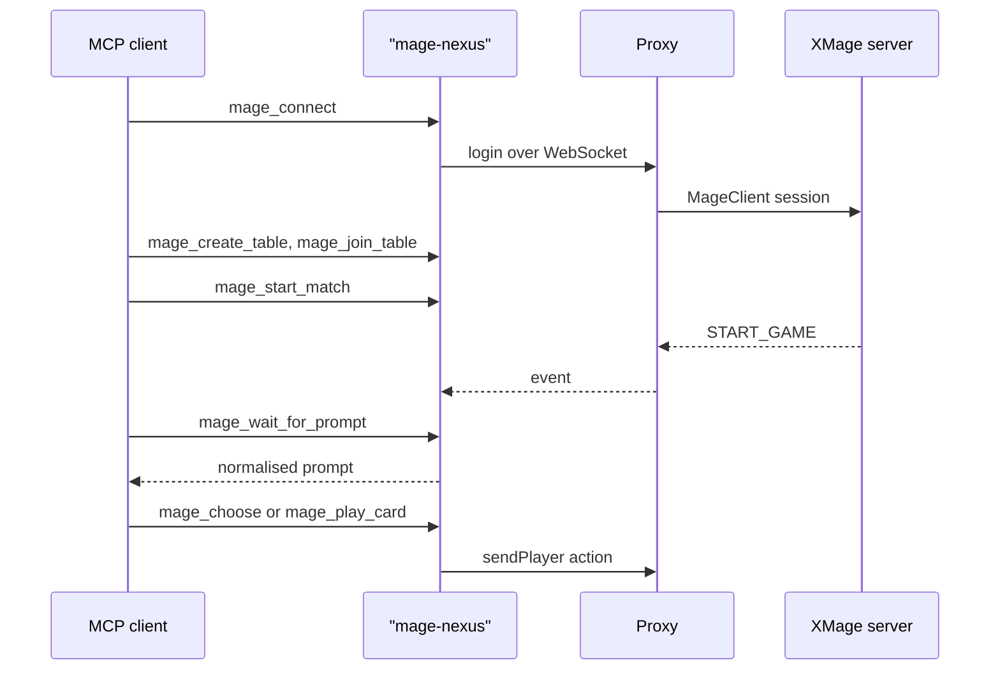

# MCP server

`mcp/` contains a Model Context Protocol server that exposes an XMage Nexus stack to an agent. It has two jobs: operate the development stack (start it, read logs, run tests) and play XMage headless through the proxy's WebSocket protocol. This page covers setup, the tool groups, the gameplay loop, and the limits you should know before building automation on it.

> **Who this is for:** Developers and automation engineers driving a Nexus stack from an MCP client.

## What it is

The server speaks MCP over stdio. A client starts it as a child process and exchanges JSON-RPC on stdin and stdout. Diagnostics go to stderr; stdout carries the protocol and nothing else.

It runs TypeScript directly on Node 24 or newer, with no build step. That runtime strips types instead of compiling them, so the code avoids `enum`, `namespace`, and constructor parameter properties, which do not survive stripping.

The tools fall into two families:

- **Stack operations** call the repository's own scripts (`scripts/ctl.mjs`, `test.mjs`, `build.mjs`, `record.mjs`) and read their logs. They need no Java themselves, but the stack they control does.
- **Gameplay** speaks the proxy protocol directly from `mcp/src/xmage/`. It needs a running proxy and a reachable XMage server.

The MCP server is a developer and automation tool. A player never needs it, and it renders nothing: it returns structured state and expects the agent to decide.

## Setup

Requirements: Node 24 or newer for the server, plus a running stack for the gameplay tools.

```bash
npm --prefix mcp install
```

Register the server in your MCP client. The exact key differs between clients; the shape below is the common one:

```json
{
  "mcpServers": {
    "mage": {
      "command": "node",
      "args": ["mcp/src/index.ts"],
      "cwd": "<path-to-xmage>"
    }
  }
}
```

Set the working directory to the repository root: the stack tools resolve the `scripts/` directory from it. Restart the client after editing its configuration. To check the server by hand, run `node mcp/src/index.ts` from the repository root; it waits for JSON-RPC on stdin and prints a ready line on stderr.

## Tool groups

There are 38 tools. Most gameplay tools accept an optional `session` argument that pins them to a named session; see [Multiple sessions](#multiple-sessions). Per-tool argument lists and signatures live in [the MCP readme](../../mcp/README.md); the tables below describe what each group does.

### Stack and build

| Tool | Purpose |
|---|---|
| `mage_stack` | Status, start, stop, or restart the server, proxy, Vite, or all; waits for ports to converge |
| `mage_logs` | Tail a component's log, optionally filtered by a regular expression |
| `mage_run_tests` | Run test layers through the orchestrator and return a per-layer result |
| `mage_build` | Build the proxy or the full stack |
| `mage_e2e` | Run Playwright specs, by file or by tag, against the fake or real backend |
| `mage_record_fixture` | Capture a real protocol frame for a mechanic |
| `mage_validate_generated` | Run the validators for every generated artifact |

A cold server start scans the card database and can take minutes; give `mage_stack` a long wait for that case. `mage_build` with the proxy target requires a proxy restart afterwards, which `mage_stack` performs.

### Session and lobby

| Tool | Purpose |
|---|---|
| `mage_connect` | Open the proxy socket and log in; generates a short account name when none is given |
| `mage_disconnect` | Close one session or the active one |
| `mage_reconnect` | Reopen the socket with saved credentials and resynchronise the current game |
| `mage_session` | Show the session's connection, table, game, and turn state |
| `mage_sessions` | List every named session |
| `mage_use_session` | Change which session is active |
| `mage_lobby` | List tables and summarise the users in the room |
| `mage_create_table` | Create a table and return its id |
| `mage_join_table` | Join a table with a deck |
| `mage_start_match` | Start the match and wait for the game id |
| `mage_leave_table` | Leave a table, or remove it when you own it |

The default target is a local stack: proxy on `ws://127.0.0.1:8787`, XMage server on `127.0.0.1:17171`. Point `proxyUrl`, `host`, and `port` elsewhere to use another deployment. Generated account names stay within the server's 14-character limit.

### Playing

| Tool | Purpose |
|---|---|
| `mage_game_state` | Compact state: turn, phase, priority, life, hand, battlefield, stack, playable ids, combat, pending prompt |
| `mage_wait_for_prompt` | Block until the server asks for a decision or the game ends |
| `mage_action` | Answer with a raw kind: uuid, boolean, integer, string, mana type, or player action |
| `mage_choose` | Answer by option id or value; with no arguments it passes |
| `mage_play_card` | Play a card, source, or ability by id |
| `mage_pay_mana` | Pay from a source or from the mana pool |
| `mage_pass_priority` | Pass, confirm, or decline the current prompt |
| `mage_combat` | Declare attackers, then blockers one at a time with their block targets |
| `mage_auto_pass` | Automatic passing in empty priority windows; on by default |
| `mage_concede` | Concede the game |
| `mage_chat` | Send a line to the game chat |

Prompts arrive normalised, with one of nine modes: `select`, `boolean`, `uuid`, `string`, `integer`, `multiString`, `mana`, `combat`, or `order`. Each carries options with ids and labels, plus the minimum and maximum number of choices. `mage_action` validates the kind against the pending prompt; `force` bypasses that check for a deliberately unusual answer.

`mage_auto_pass` absorbs the empty priority windows that would otherwise produce dozens of prompts per turn. It never passes an ask or a mana payment. If the server repeats the same prompt more than five times, auto-pass switches itself off and records `AUTO_PASS_STOPPED`, which usually means the agent is looping.

### Tournaments

| Tool | Purpose |
|---|---|
| `mage_create_tournament_table` | Create a tournament table: constructed, sealed, or draft |
| `mage_join_tournament_table` | Take a seat; no deck is needed in a limited tournament |
| `mage_start_tournament` | Start it and wait for the tournament id |
| `mage_join_tournament` | Join the tournament panel; required before play advances |
| `mage_get_tournament` | Read the tournament view: state, players, rounds |
| `mage_submit_deck` | Submit a constructed deck or a sideboard |
| `mage_watch_tournament_match` | Spectate a tournament match |
| `mage_join_game` | Attach to a game by id, as a tournament or best-of series requires |

Joining the panel is not optional. A started tournament does not advance until its participants have joined it, and the tool is idempotent, so calling it again is safe.

### Test-only

| Tool | Purpose |
|---|---|
| `mage_cheat_setup` | Seed cards into zones on a local server running in test mode |

`mage_cheat_setup` exists for deterministic scenarios: it places cards by name into a player's hand, battlefield, library, graveyard, or exile. It works only against a local server started in XMage's test mode; other servers answer `ok:false`. Call it while you hold priority on your own turn, after at least one normal action. Calling it on the first priority of the first turn, or during an opponent's turn, can freeze the game thread.

## Resources

Five read-only resources expose repository state without a tool call:

| URI | Content |
|---|---|
| `mage://status/project` | Roadmap header, current state, pending items, and durable lessons |
| `mage://status/dashboard` | The published status document: test layers, coverage, phases |
| `mage://coverage/interactions` | The interaction coverage table |
| `mage://contract/schema` | The protocol contract schema |
| `mage://fixtures/manifest` | The recorded-frame manifest and its invariants |

## The gameplay loop



A full game follows the same shape every time:

1. `mage_connect`.
2. `mage_create_table` with a human seat and, optionally, an AI opponent.
3. `mage_join_table` with a deck in the proxy's deck JSON format.
4. `mage_start_match`.
5. Repeat: `mage_wait_for_prompt` with the last `promptSeq` as `afterSeq`, read `mage_game_state` when the prompt needs context, then answer with `mage_choose`, `mage_play_card`, `mage_pay_mana`, `mage_combat`, or `mage_pass_priority`.
6. Stop on `gameOver` in the prompt response.

Passing `afterSeq` matters after an action: without it, the next wait can return the prompt you already answered.

## Multiple sessions

`mage_connect` accepts a session name. Each named session owns its socket, game state, pending prompt, and auto-pass setting, and inactive sessions keep processing events in the background. That allows several accounts, or several matches, in one server process.

Tools without a `session` argument act on the active session, which `mage_use_session` changes. In parallel play, always pin the session: two agents that switch the active session will otherwise answer each other's prompts.

## Automation patterns

- **Agent playtesting.** Run a deck against the server's AI and collect the prompt and action sequence. The compact state keeps each turn small enough for a model's context.
- **Scenario setup.** Seed a board with `mage_cheat_setup`, then drive a specific interaction and assert the result.
- **Development loop.** Let an agent start the stack, run a layer, read the failing log, and rerun. `mage_run_tests` returns the per-layer verdict and the tail of the output.
- **Fixture capture.** `mage_record_fixture` turns a mechanic into a recorded frame that the browser tests replay.
- **Tournament checks.** Create, start, and spectate a tournament to validate a bracket end to end.

## Limitations

- **No rendering.** The server returns state, not pixels. Pair it with a browser automation server, or use `mage_e2e`, when the question is what the interface shows.
- **One process, one client.** Tools share state inside the process; two clients attached to the same server instance will interfere.
- **Test-mode seeding only.** `mage_cheat_setup` is unavailable on a normal server and can freeze a game if called at the wrong moment.
- **Simulator seats are a development facility.** The proxy must be started with its simulator enabled, and the seats are rejected otherwise.
- **Account names are capped at 14 characters** by the XMage server. Longer names fail at login.
- **Real games need a healthy stack.** A proxy that has been up for hours accumulates sessions and degrades; restart before a long run.
- **Tournaments need the panel join.** Skipping `mage_join_tournament` leaves the tournament waiting forever.

## Working on the server

```bash
npm --prefix mcp test          # serial: each test file starts a server over stdio
npm --prefix mcp run typecheck
MCP_E2E=1 npm --prefix mcp test  # adds a full game against a real local stack
```

The hermetic tests use the fake server from `web/fixtures/fake.ts`, so most of the suite needs no Java. Keep stdout clean: a stray `console.log` corrupts the JSON-RPC stream and the client disconnects. Test files run one at a time because every file starts its own stdio server.

## Related

- [Web client](web-client.md)
- [Testing](testing.md)
- [Contributing](contributing.md)
- [Architecture](architecture.md)
- [Protocol](protocol.md)
- [Glossary](../reference/glossary.md)
