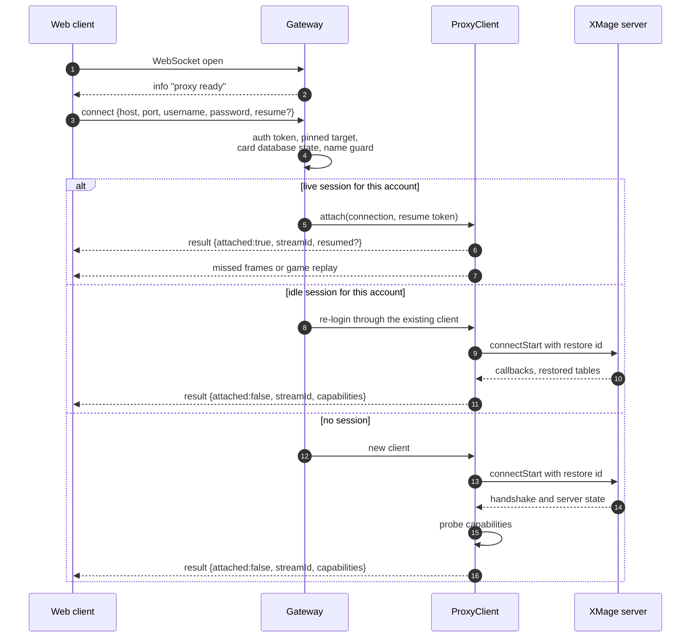

# The proxy

`Mage.Proxy` is the bridge between a browser and an XMage server. It opens a real XMage session for each account, turns the server's Java callbacks into JSON frames, and forwards client actions back into the server's client API. It contains no game rules: if the server sends it, the proxy forwards it; if a Java client can do it, the web client can ask for it.

> **Who this is for:** developers changing the Java bridge, debugging session behaviour, or operating a proxy and reading its diagnostics.

The proxy depends only on the stable client-facing part of the engine: the client interface, the remote session, the view classes, constants and player types. It does not use engine internals, so card and rules changes do not require proxy changes. A new view field arrives automatically because serialization is reflective.

## One process, many sessions

The gateway keeps two maps: WebSocket connection to session, and account key to session. The account key is `host|username` after normalizing `localhost` to `127.0.0.1`, so the same account reaching the same server through different spellings is still one account.

| Situation | Result |
|---|---|
| Same account, live session | The connection attaches; all windows share one login and one game |
| Same account, idle session not yet released | Re-login through the same client, restoring its tables |
| Different account | Separate session and separate events |
| Same anonymous name, different browser | Refused before the dial, so neither player is silently kicked |

A session is created lazily on `connect`, not when the socket opens, because the gateway must decide create-or-attach first. The connection is registered under its account key before the login finishes, so a second connect for the same account waits for that login instead of opening a second server session that would kick the first one out.

## Connection lifecycle



Three gates run before any session work:

- **Auth token.** When configured, every `connect` must present it, including a reload's re-attach. A wrong or missing token answers a typed `connect_error` and closes with code `4401`, which stops the client from retrying the same rejected frame.
- **Pinned target.** A pinned deployment forces its host and port for the dial, the account key and the attach match, so a client cannot bypass the pin.
- **Anonymous name guard.** The server identifies anonymous users by host, and every browser behind one proxy shares that host. The proxy compares the per-browser id on `connect` and refuses a name already held by a different browser, so two players picking the same name cannot repeatedly disconnect each other.

While the card index is still building, `connect` answers `WARMING_UP` and the client retries shortly.

## Attach, detach and grace

When the last WebSocket of a session closes, the proxy starts a grace timer so a reload, a network switch or a phone returning from the background can re-attach to the running game. The default is 180 seconds; if the page announced it was closing with `leaving` on `pagehide`, the shorter 45-second period applies, so an opponent does not wait three minutes for a player who closed the tab. When grace expires with nobody back, the session closes for good and the server removes the player from its tables. The proxy does not use the server's "keep my session active" option, which leaves a zombie session that blocks server threads until it expires. When the proxy process stops for a restart or deploy, it does not disconnect its sessions at all: the server sees a lost connection, keeps the tables, and the next login restores them.

Two mechanisms cover the gap between a returning browser and a live session:

- **Stream resume.** Every broadcast frame except the lobby snapshot carries a per-session sequence number. A `connect` naming the same stream and the last sequence the client processed gets every later frame replayed in order before the live stream, and the result reports `resumed: true`. A sideboard, the start of game two, a game-over or chat sent during the gap is not lost. A newer full game state replaces the older one in the log.
- **Game replay.** When the client did not resume, or the requested sequence was evicted, it rejoins the game and the proxy re-sends that game's last state and its still-open prompt to that connection only. The prompt stays cached until the player answers or the game ends.

## Losing the server link

If the connection to the XMage server drops while browsers are still attached, the proxy hides the failure and logs the session in again in the background, passing the session's restore id as the desktop client does. Clients see `serverLink` move through `lost`, `retrying` with an attempt count, and then `restored` or `failed`; only after `failed` does the session report `disconnected`.

Before relinking, the proxy probes the server with the session itself. The transport's own validator gives up after a short ping timeout that a busy server can exceed, and logging in again on such a false alarm would kick out a healthy session. The probe therefore allows up to 45 seconds; a server that answers is treated as alive and no relink happens. Afterwards the keep-alive probe watches the session, pinging every 20 seconds and relinking after two consecutive failures.

A session lost again within two minutes of a successful relink was taken over by another login of the same account — the server disconnects the older instance of a user, which looks exactly like a lost link — so the proxy reports `failed` with reason `superseded` instead of starting a login fight. Relinking is bounded by `--relinkSecs` (600 seconds by default) with exponential backoff capped at 15 seconds.

Restore ids make a re-login survive a proxy restart or an address change: the proxy remembers, per account, the id of the last live session and presents it on the next login, from memory and from a bounded on-disk store with ten-minute retention. An explicit logout clears the entry.

## Events

Server callbacks arrive on the remoting thread and are re-sequenced by their per-session message id, because delivery can be out of order; a gap not filled within 400 milliseconds is skipped so the stream never stalls.

Each callback then goes through three filters: pending message callbacks are held until the handshake completes, and late callbacks older than the highest message id are dropped when their type requires it; game events for a game this session never joined or watched are dropped, because a user switch can re-send another user's running games; and the last state and pending prompt of each game are cached, with replay frames updating the tracker that gates player actions.

The callback is then serialized and broadcast to every authorized connection of the session. The one exception is the fork-specific client-key LLM prompt, sent as its own typed frame rather than a generic event.

## Actions

Client commands run in order on a single executor per session. Before dispatch, the router enforces three rules: `connect` and `ping` are the only public actions; game-scoped actions require a `gameId` or answer `GAME_ID_REQUIRED`; and every action must be claimed by a domain handler or it answers `UNKNOWN_ACTION`. `ping` is answered directly on the WebSocket thread, so a busy command queue cannot make a live socket look dead.

When a server call fails, the reply carries the server's real detail. Login failures poll for the server's user-message callback, which arrives after the anti-bruteforce delay; command failures do the same for a short window and then fall back to the session's last error. A classifier maps the detail to a stable code such as `CARD_NOT_FOUND`, `INVALID_DECK` or `VERSION_MISMATCH`, so the client can react without parsing English text.

## Serialization

`JsonUtil` walks objects by reflection and writes one JSON field per Java field, in camelCase.

| Java value | JSON |
|---|---|
| String, UUID, enum, `Class` | String |
| Numbers, booleans | Number, boolean |
| `Date` | Epoch milliseconds |
| `Optional` | Unwrapped, `null` when empty |
| List, array, iterable | Array |
| Map | Object with stringified keys |
| Other objects | Object of their non-static, non-transient fields |
| Nulls, loggers, `Throwable`, reflection internals | Omitted or `null` |
| Re-entered object on the same path | `null` |

Field metadata is cached per class because one game update can walk a thousand objects. A view class that extends a map while declaring its own fields is written with those fields at the top level and its entries under `cards`, so declared fields are not silently dropped. Non-finite floating-point values become `null`, so a future numeric field cannot emit JSON the browser refuses to parse.

## Thread model

Each session owns a fixed set of executors. All are non-daemon, which is why a client that can never serve a session must be disposed explicitly.

| Executor | Work |
|---|---|
| Command executor | Client actions, in order |
| Callback executor | Server callbacks, in order; recreated on a new session |
| Lobby timer | Tables, users and server news |
| Ping timer | Keep-alive and grace-expiry scheduling |
| Keep-alive timer | The server probe that can block on a busy server |
| Sequencer timer | The 400 ms gap budget |
| Relink executor | The lost-link retry loop, created lazily |

Shared across sessions: WebSocket server threads, one scheduled roster thread (SIM roster touch and watchdog), a cached daemon pool for link probes, and a four-thread HTTP pool.

Locking follows three rules. A connection's sends are serialized on a private per-connection lock, because the compression context is not thread-safe and every thread writes to the same socket. A session's broadcast is serialized on its connection registry, so a frame is numbered, kept and sent to the same connections in one order and an attach cannot lose or duplicate a frame. A session's monitor is never taken on the WebSocket selector thread, and the send lock is never the connection object itself, because the WebSocket library holds that monitor while closing.

## Watching the proxy

The watchdog prints one line per minute:

```text
watchdog: threads=54 (peak 79), openConns=0, accounts=0, clientsAlive=0 (created=3 disposed=3),
          wsErrors=0, cardDb=READY
```

Read `clientsAlive` across ticks. It is `clientsCreated - clientsDisposed`: one live session accounts for one, a client released after a rejected login for none. A number that climbs while `openConns` and `accounts` stay flat is a client nothing can reach, and the line warns once it exceeds the reachable count by more than five. The line goes to stderr, because the engine routes Java logging through log4j.

`GET /admin/status` exposes the same counters plus per-session detail when an admin token is configured. It accepts only `GET` and a bearer token in the `Authorization` header; without a token the route does not exist. The body has an activity snapshot (last 500 events), runtime counters (threads, heap, GC, clients created and disposed, accounts, WebSocket errors, card-database state) and one entry per connection with its user, link state, grace remaining, games in progress, pending gap events, outbound buffer, replay cache, failed keep-alives, relink attempts and live SIM seats.

`GET /health` is liveness: the process answers. `GET /ready` is readiness: 503 until the card database is ready, then 200. Gate traffic and launcher startup on readiness, not on the port being open — a proxy with a failed card database still accepts logins, which is the usual cause of a confusing login failure during a deploy.

## SIM seats are development-only

The proxy can run deterministic bot seats with their own server sessions. This is a test and demo harness, not a product feature.

> **Development/test only.** SIM seats exist for the test layers, the recorder and the local dev stack. `--sim` defaults to `off`; the container image and the desktop launcher start the proxy without it.

With SIM off, `createTable` and `createTournamentTable` reject a player-type list containing a SIM seat with `INVALID_ARGUMENT`, and no bot is restored. With it on, the proxy keeps a roster of playing bots on disk so a restarted proxy can log them back in and the server hands them their games. The web client never offers a SIM seat: bot opponents in the product are the server's own AI types.

## Configuration

The proxy is configured with `--key value` flags; defaults are local-first (loopback binding, localhost origins, no auth token, SIM off). The operator guide lists every flag, its environment fallback and deployment examples.

## Related

- [The WebSocket protocol](protocol.md)
- [Architecture](architecture.md)
- [Code map](code-map.md)
- [Configuration](../operator-guide/configuration.md)
- [Operations](../operator-guide/operations.md)
- [Ports reference](../reference/ports.md)
- [Protocol (inherited upstream page)](../protocol.md) — older upstream-authored description; this guide is authoritative.
