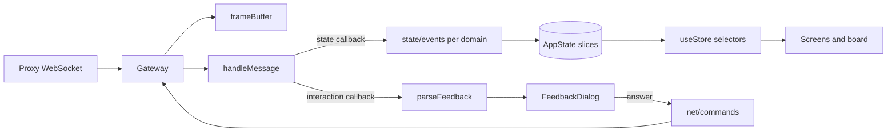

# Web client

The browser client in `web/` renders the login screen, the lobby, the deck builder, and the game board. It speaks exactly one protocol: the proxy's JSON WebSocket. This page describes how the client is organised, how a server frame becomes a rendered board, and which hooks exist for tests. Read it before adding a screen, a prompt, or a board effect.

> **Who this is for:** Developers extending or debugging the browser client.

## What the client is

`web/` is a React 19 single-page application built with Vite and TypeScript. It contains no Java and never talks to the XMage server directly. The proxy is its only peer, and the wire format is defined once, in `web/schema/contract.schema.json`; the TypeScript view types and the zod validators used by fixtures are generated from that schema.

Two rules explain most of the code:

- **The server view is the truth.** The client sends intents and waits for the next full `GameView`. There is no optimistic mutation of the board.
- **Rendering is DOM and CSS.** Cards, zones, arrows, and card flights are elements and transforms. There is no canvas renderer, and the tests never compare pixels.

The runtime dependencies stay small: React, `lucide-react` for icons, and `idb-keyval` for deck storage.

## Repository layout

| Path | Responsibility |
|---|---|
| `src/net/` | WebSocket gateway, action wrappers, hand-written protocol types, generated view types |
| `src/state/` | The `AppState` store, its slices, the event router, persistence |
| `src/game/` | Game screen, prompt parsing, feedback dialogs, draft/construct/tournament panels |
| `src/board/` | Board layouts, zones, cards, overlays, transitions, scene bridge |
| `src/lobby/` | Login, lobby, tables, chat, leaderboard, deck gallery |
| `src/decks/` | Deck model, storage, import/export, builder |
| `src/cards/` | Scryfall client, offline image index, card rendering helpers |
| `src/i18n/` | Translation function, language store, nine locale files |
| `src/audio/` | Sound manager and the dispatcher that maps game events to sounds |
| `src/appearance/` | Sleeves, playmats, custom art, zoom and CJK scaling |
| `src/demo/` | In-browser demo transport, seeded session, guided scenarios |
| `src/dev/` | Development-only state gallery |
| `src/ui/`, `src/system/` | Shared controls, dialogs, error capture, attribution |

Tests sit next to the code they cover, as `*.test.ts` or `*.test.tsx`. Browser tests live in `web/e2e/`; the fake backend and its scenarios live in `web/fixtures/`.

## Boot and screen routing

`src/main.tsx` installs the error capture, starts loading the saved language, and schedules the heavy warm-up (the offline card-image index and the bundled decks) for idle time. In a demo build it also seeds the demo session before rendering.

`src/App.tsx` is a phase router. The phase lives in the session slice, and each value maps to one screen:

| Phase | Screen |
|---|---|
| `idle` | Login form |
| `connecting` | Connection splash with a retry hint |
| `lobby` | Lobby, tables, chat, deck gallery |
| `spectating_pending` | Spectator staging |
| `staging` | Player staging before a match starts |
| `game` | Game screen |

Dialogs that must survive a phase change are mounted outside the router: the draft screen, the construct screen, the end-of-game dialog, the elimination dialog, the confirm host, and the deck-issues dialog. The setup wizard and the demo tour are conditional mounts.

On mount, `App` probes the proxy's `GET /config` endpoint for deployment settings: name, authentication requirement, and any locked target server. A proxy that does not answer leaves every default in place, so an older proxy still works. The deployment name also becomes the document title.

A reload can log in again on its own when a saved connection exists and the deployment's authentication mode allows it. That path rewrites the saved target when the deployment locks the server, then calls the same connect action as the form.

## State model

There is no state library. `src/state/state.ts` holds one `AppState` object, merges partial updates through `setState`, and notifies a set of listeners. `src/state/store.ts` is the public facade: components import `useStore`, `usePhase`, `useLobby`, `useGame`, and `useSettings` from it, plus the actions. `src/state/selectors.ts` implements those hooks with React's `useSyncExternalStore`, so a component re-renders only when its selected value changes.

`AppState` is the union of six slices:

| Slice | Holds |
|---|---|
| `session` | Connection details, phase, socket liveness, link banner, server capabilities, proxy config, login retry state |
| `lobby` | Lobby envelope (tables, users), room/table/tournament chat ids, chat messages, event log, deep link, staging table |
| `game` | Current `GameView`, pending prompt, playable ids, combat selection, sideboard, card viewer, user request, rollback state |
| `limited` | Draft state, sealed/construct pool, tournament panel view |
| `replay` | Replay frame, playback position, LLM frames, game log |
| `settings` | Gameplay, board, appearance, audio, and accessibility settings |

Screens read from the store; actions write intents to the proxy and, where the UI needs immediate feedback (a typed chat line, a dismissed dialog), update the slice directly. Board content is never written locally: the next `GAME_UPDATE` replaces it.

Persistence is split by lifetime. The connection record lives in `localStorage`; the active game id expires after a few hours; decks and card art live in `IndexedDB`, with a `localStorage` fallback for decks.

## From frame to board

Every inbound frame passes through the gateway and the event router before any component sees it.

`src/net/Gateway.ts` owns the socket. It reconnects with a backoff that starts at one second and doubles to a ten-second cap, except after close code `4401`, which means the proxy rejected the connection and a retry would be rejected again. An idle socket is probed with a `ping` after fifteen seconds without traffic, and a probe with no answer within ten seconds is treated as dead. Every `send()` carries a thirty-second timeout so a dropped reply cannot leave a dialog spinning. On reconnect the gateway presents the stream id and the last sequence number it saw, and the proxy replays only the frames missed. Frames at or below that sequence number are dropped as duplicates.

`src/state/eventHandler.ts` switches on the envelope type. Results and errors update the error banner; lobby envelopes replace the table list; events are dispatched by method to a module under `src/state/events/` (`chat`, `game`, `prompts`, `sideboard`, `draft`, `tournament`, `replay`, `views`). Keeping the `case` order stable matters: some handlers assume an earlier one has already run for the same frame.

Interaction callbacks (`GAME_ASK`, `GAME_TARGET`, `GAME_SELECT`, `GAME_PLAY_MANA`, `GAME_CHOOSE_MODE`, and the rest) are parsed by `src/game/feedback/parse.ts` into a `FeedbackPrompt`. `src/game/FeedbackDialog.tsx` routes that prompt to the component for its mode. State-only callbacks write to the slices and never open a dialog.

## Board rendering

`src/game/GameScreen.tsx` chooses one of three layouts from the number of opponents and the board-layout setting:

| Layout | Component | Used for |
|---|---|---|
| Standard | `GameBoard` | Duels and large free-for-alls; one opponent on top, with a switcher when there are more |
| Pod | `PodBoard` | Three- and four-player pods; two-headed giant pairs render through `TwoHeadedBoard` |
| Arena | `ArenaBoard` | Multiplayer with the local player's half at full width and opponents in compact mirrored columns |

All three share `BoardShell`, which supplies the zone frame, the hand bar or hand row, the floating card preview, and the card-flight overlay. Zones are separate components (`PlayerZone`, `OpponentZone`, `StackZone`, `CommandZone`, `HandBar`, `HandRow`), and every card is a `CardSlot`.

`useBoardPresenter` gives the three layouts identical behaviour. Click priority is combat, then target, then playable, so the same click means the same thing in every layout. Hovering publishes a floating preview unless a full-screen dialog is open. Each rendered card carries `data-card-id`; the flight animation and the scene bridge both use that attribute to find it.

There is no canvas. `gameTransitionEngine.ts` diffs consecutive `GameView`s and derives enter, leave, tap, and move transitions. `flightManager.ts` and `FlyingCardOverlay.tsx` animate a card that changes zone by cloning it into a fixed layer, moving the clone, and revealing the destination. Combat arrows, impact effects, and the low-life vignette are independent overlay layers. Decorative motion is disabled by the reduced-motion preference and by the `fx-off` class on the document root.

## sceneBridge and test hooks

`src/board/sceneBridge.ts` publishes `window.__mageScene` for the browser tests. It is a development-only hook: production builds publish nothing, and neither the timer nor the raw view dump exists there.

| Field | Content |
|---|---|
| `cards` | Card id to centre point, relative to the board wrapper |
| `playable` | Ids the server currently offers as playable |
| `crossZone` | Ids playable from a zone other than the battlefield |
| `click(id)` | Clicks the element with that `data-card-id`; returns false when it is absent |
| `targeting` | Active flag, legal ids, chosen ids, and the target zone declared by the server |
| `combat` | Active flag, mode (attack or block), selectable ids, chosen ids |
| `game` | Turn, phase, step, and whether the local player holds priority |
| `gameView` | The full `GameView`, for diagnostics |

The bridge recomputes positions every 500 ms and skips a tick while a card flight is in progress, so a test never measures a card mid-animation.

`src/state/store.ts` adds a second development hook, `window.__mageStore`, exposing `getState`, `setState`, `setSetting`, `handleMessage`, and `subscribe`. Tests use it to drive a state the UI cannot reach quickly, such as a settings change or a replayed frame.

Both hooks are read-only contracts for tests. Changing a field name means changing the specs that read it.

## Fake server and demo mode

The client can run without a proxy in two ways, and both use the same scenario engine.

The **fake server** is a Node WebSocket server in `web/fixtures/fake.ts` built on `fakeCore.ts`. It answers the actions from `src/net/commands.ts` with result envelopes and emits scripted callbacks. A test starts it on a free port, points the page at that port, and gets a deterministic match. The core also enforces server rules that would otherwise drift, such as the user-name length limits. Scenarios under `web/fixtures/scenarios/` are declarative: starting hands, lands, prompt sequences, and resolution effects. They are typed against `src/net/types.ts`, so the typecheck fails when the fake and the client disagree.

The **demo build** replaces the network with the same core inside the page. `npm run build:demo` sets the `__DEMO__` build flag and writes `dist-demo/`. At runtime `Gateway` constructs `DemoSocket` instead of a real `WebSocket`; the socket attaches to the fake core and presents frames with demo data. Boot seeds a demo account and a starter deck set, and `?scenario=<id>` selects one of the guided scenarios. Because the demo bundle imports the scenario files into the browser, scenario code must stay free of Node APIs.

`node scripts/verify-demo.mjs dist-demo` serves the build and walks every scenario in a headless browser, failing on page errors.

## Internationalisation

The interface ships in nine languages: Spanish, English, German, French, Italian, Portuguese, Russian, Japanese, and Simplified Chinese. English is the base and the fallback; it is bundled eagerly so the first render always has strings. The other eight are separate chunks loaded on demand, and the language store notifies subscribers when a chunk arrives.

`t()` accepts either a dotted path (`t('game.concede')`) or a category and key (`t('game', 'concede')`), plus an optional parameter map that replaces `{name}` placeholders. A missing key falls back to English and then to the key path itself, so a missing translation is visible without breaking the screen.

The selected language is stored in `localStorage` and defaults to the browser language on a first visit. Server errors go through `translateError`, which maps known phrases and error codes to localised messages and leaves unknown text as it arrived. `switchLanguage` sets the language and waits for its chunk, which is what a test needs; `setLanguage` is the fire-and-forget version the UI uses.

User-visible numbers are formatted with `toBcp47Locale`, because the game's `zhs` code is not a valid `Intl` tag.

## Where to change what

| Task | Start here |
|---|---|
| Add a screen | A new phase in `src/App.tsx` plus a component under the matching area |
| Add a protocol field | `web/schema/contract.schema.json`, then regenerate types and validators |
| Add a prompt | `src/game/feedback/parse.ts`, a mode component under `feedbackModes/`, and the coverage table |
| Change board behaviour | `src/board/`, starting with the presenter and the layout component |
| Add a test hook | `sceneBridge.ts` or the store hook, then the spec that reads it |
| Add a string | All nine files under `src/i18n/locales/` |

After any change under `web/`, run the `unit` and `typecheck` layers. Regenerate protocol types instead of editing `types.generated.ts`, and keep `web/fixtures/` type-clean, because the typecheck includes it.

## Related

- [Architecture](architecture.md)
- [Code map](code-map.md)
- [Protocol](protocol.md)
- [Testing](testing.md)
- [MCP server](mcp.md)
- [Board and controls](../player-guide/board-and-controls.md)
- [User manual (inherited upstream page)](../user-manual.md) — older upstream-authored description; this guide is authoritative.
