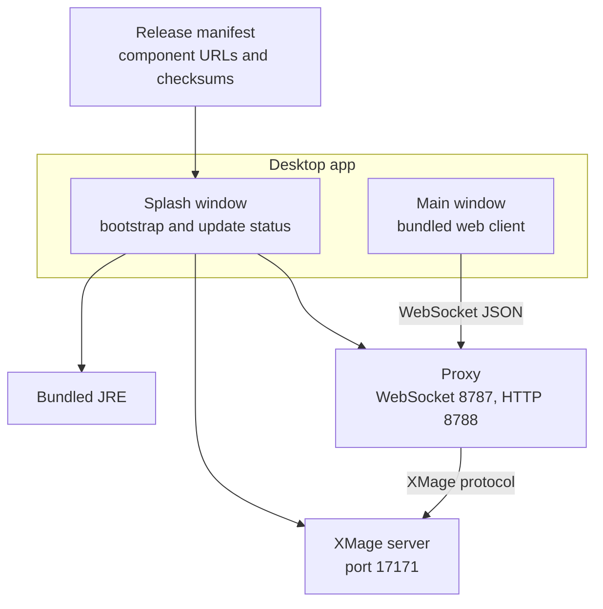

# Desktop app

The desktop app is a native window around the same web client, packaged with everything it needs: a Java runtime, an XMage server, and the proxy. You install one file, launch it, and play — no JDK, no Maven, no terminal. On first launch it fetches its runtime components; after that it starts the whole stack on your machine and keeps itself updated.

> **Who this is for:** A player who wants Nexus as an installed application, including local games that do not depend on someone else's server.

## What the app contains

The installer ships the launcher shell. The heavy parts — the Java runtime, the XMage server, and the proxy — are separate components that the launcher downloads once and then reuses.



| Part | Role |
|---|---|
| Launcher shell | Window, tray icon, update check, component download, process supervision |
| Splash window | Shows each startup step and any error, with `Retry` and `Quit` |
| Bundled JRE | Runs the server and the proxy; nothing is installed system-wide |
| XMage server | The rules engine and card database, listening on `17171` |
| Proxy | Bridges the window to the server on `8787`, and serves the client over HTTP on `8788` |
| Web client | The same React client a browser would load, rendered in the app window |

The app is single-instance: launching it again focuses the running window instead of starting a second copy.

## Download and install

Take the artifact for your platform from the project's Releases page.

| Platform | Architecture | Artifact |
|---|---|---|
| Windows | x64 | `.msi` or `.exe` installer |
| macOS | Apple Silicon (arm64) | `.dmg` |
| Linux | x64 | `.AppImage`, `.deb`, or `.rpm` |

There is no build for Intel Macs. The launcher detects that platform and stops with a clear message rather than downloading the wrong runtime; use the browser client on an Intel Mac.

**Windows.** Run the installer and follow it. If Windows shows a SmartScreen warning for an unsigned build, open `More info` and choose `Run anyway`.

**macOS.** Open the `.dmg` and drag the app to `Applications`. The build is ad-hoc signed, so the first launch needs confirmation: right-click the app and choose `Open`, or allow it under `System Settings → Privacy & Security`.

**Linux.** For the AppImage, mark it executable and run it:

```bash
chmod +x <file>.AppImage
./<file>.AppImage
```

The `.deb` and `.rpm` packages install through your distribution's package manager and add a menu entry.

## First run

The splash window opens first and reports each step as it happens.

| Splash message | What is happening |
|---|---|
| `Checking for updates…` | Asking the release channel whether a newer app exists |
| `Checking components…` | Comparing the installed component set with the release manifest |
| `Downloading <component>…` | Fetching the JRE, server, or proxy archive |
| `Verifying <component>…` | Checking the archive against its SHA-256 checksum |
| `Installing <component>…` | Extracting the component into the data folder |
| `Starting server…` | Launching the XMage server and waiting for port `17171` |
| `Starting proxy…` | Launching the proxy and waiting for its HTTP port |
| `Preparing card database…` | Waiting for the proxy to finish loading card data |
| `Ready` | Opening the main window |

The first run needs an internet connection because the runtime is not inside the installer. It can take several minutes: the download is followed by a server start and a card-database build. Later launches skip the download and go straight to starting the stack.

The launcher waits up to four minutes for the server, two minutes for the proxy, and up to ten minutes for the card database. If a step fails, the splash shows the error code and the path to the log folder, with `Retry` and `Quit`.

Once the window opens, the login form is already set to `Local`: proxy `localhost:8787`, server `localhost:17171`. Choose `Connect & Play` and you are in the lobby.

## Updates

The app has two update paths, and they are independent.

**The app itself.** At startup, and at most once every 24 hours, the launcher asks the release channel for a newer version. The check has a short timeout; if it fails because you are offline or the release host is unreachable, startup continues with what is installed. When a new version exists, the splash offers `Update` or `Continue`. `Update` downloads the new build, installs it, and restarts the app; `Continue` starts the current version.

**The runtime components.** Each release names a component set (JRE, server, proxy) with checksums. When the installed set does not match, the launcher downloads the missing release into its own versioned folder. The previous set stays on disk, so an interrupted update still leaves you with a working stack, and an offline start uses the newest complete set it finds.

Your configuration survives both paths. The server's `config` directory is seeded once from the bundled server and then left alone, while the `plugins` directory is refreshed on every start.

## Where your data lives

Everything the app owns lives in one data folder. Its exact location follows your platform's conventions for local application data (the folder is named `today.xmage.nexus`). The tray menu's `Open data folder` takes you straight there.

| Path | Contents |
|---|---|
| `components/<release>/jre` | The bundled Java runtime |
| `components/<release>/server` | The XMage server build and its starting configuration |
| `components/<release>/proxy` | The proxy jar |
| `data/server/config` | The server configuration, seeded once and then preserved |
| `data/server/plugins` | Server plugins, refreshed on each start |
| `data/server/saved` | Games saved by the local server |
| `data/server/gamesHistory` | Match history |
| `logs/server.log` | Server output, rotated on each start |
| `logs/proxy.log` | Proxy output, rotated on each start |
| `logs/bootstrap.log` | Launcher steps and errors |
| `updater-last-check` | Timestamp of the last app update check |

Start the app with the `NEXUS_DATA_DIR` environment variable set to keep the data folder somewhere else, for example on a larger drive:

```bash
export NEXUS_DATA_DIR=<path-to-data>
```

Then launch the app as usual. On Windows, set the variable in the system environment before launching.

## The tray menu

The app keeps a tray icon while it runs.

| Item | Effect |
|---|---|
| `Launch at login` | Starts the app when you sign in |
| `Open data folder` | Opens the folder described above |
| `Restart` | Restarts the app and its local stack |
| `Quit` | Stops the server and proxy, then exits |

Closing the main window also stops the local server and proxy. If you want the stack to keep running, leave the window open.

## Playing

The local stack is a complete game server, so you can play alone against the server's AI without touching a network:

1. Choose `Connect & Play` on the preconfigured `Local` target.
2. Choose `New Table`.
3. In the wizard, pick a format, then fill the open seats with AI opponents.
4. Choose `Create Table`, then `Start Match`.

To play with other people, switch the server target to `Official Beta`, or to `Custom` and enter the proxy and server addresses you were given. The rest of the flow is identical to the browser; [Play in a browser](play-in-browser.md) covers the login fields and the table list.

Card images are fetched from Scryfall and cached by the app, so the first view of a card needs a connection. The rules engine, card database, and deck validation are local.

## Ports

| Port | Used by |
|---|---|
| `17171` | The bundled XMage server |
| `8787` | The proxy WebSocket, which the app window connects to |
| `8788` | The proxy HTTP server, which serves the client |

If another XMage server, a second proxy, or a development stack already holds one of these ports, the launcher cannot bind it. It waits 15 seconds for `17171` to free up before giving up with `ERR_SERVER_START`; a proxy that cannot bind its ports fails the startup, usually as `ERR_PROXY_START` or a card-database timeout. Quit the other program (or the other app instance) and choose `Retry`.

## Uninstall

Remove the app the way your platform expects:

- **Windows** — `Settings → Apps → Installed apps → XMage Nexus → Uninstall`.
- **macOS** — drag the app from `Applications` to the Trash.
- **Linux** — remove the package with your package manager, or delete the AppImage file.

Uninstalling removes the application, not the data folder. The downloaded runtime, saved games, and logs stay behind. To reclaim the space, copy out anything you want to keep, then delete the folder.

## First-run problems

| What you see | Cause | What to do |
|---|---|---|
| `No connection and no components downloaded yet` | First launch without internet access | Connect to the network and choose `Retry` |
| `This version only supports Apple Silicon (arm64): no components for Intel Macs` | Intel Mac | Use the browser client, or a different machine |
| `The XMage server did not start (crash or busy port)` | Port `17171` is taken, or the server crashed | Quit any other XMage instance, then read `logs/server.log` |
| `The proxy did not start` | Port `8787` or `8788` is taken | Quit the other process and retry |
| `The card database did not finish preparing` | The proxy could not build its card index | Read `logs/proxy.log`, then retry |
| `Downloaded runtime is incomplete` | An interrupted download left a partial component set | Choose `Retry`; the launcher re-fetches missing components |
| The app is blocked on first launch (macOS) | Ad-hoc signature, not notarized | Allow it under `System Settings → Privacy & Security` |
| The window opens but the client cannot reach the proxy | The login target is wrong, or the proxy stopped | Check that the target is `Local`; read `logs/proxy.log` |

## Related

- [Play in a browser](play-in-browser.md)
- [Self-hosting quickstart](self-hosting-quickstart.md)
- [Desktop launcher](../operator-guide/desktop-launcher.md)
- [Troubleshooting](../reference/troubleshooting.md)
- [Ports](../reference/ports.md)
