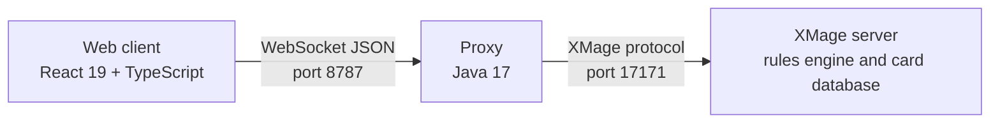

# XMage Nexus overview

XMage Nexus is a client for XMage, the open-source Magic: The Gathering rules engine. It offers an alternative to the stock desktop client: a live lobby, a deck builder that searches card data as you type, and a board that animates combat and targeting. You can play in a browser tab without installing anything, or install a desktop app that carries its own Java runtime, XMage server, and proxy.

> **Who this is for:** A new player who has never run XMage and wants to know what Nexus is, how its parts fit together, and which way to start.

## The rules engine belongs to XMage

Nexus does not decide what a card does. The XMage server does: it owns the card database, the turn structure, priority, triggers, and every legality check. Nexus sends your intentions to that server and renders the state it sends back. A card implemented in XMage behaves here the same way it behaves in any other XMage client.

That split has two consequences:

- Card coverage, format legality, and rules behavior come from XMage. The upstream wiki at [github.com/magefree/mage/wiki](https://github.com/magefree/mage/wiki) documents the game itself.
- The interface can change without touching the engine, so client features and server releases move at different speeds.

XMage Nexus is an independent project. It is not affiliated with Wizards of the Coast. Card images are provided by Scryfall.

## The three tiers

Every way of playing Nexus uses the same three programs. What changes is which machine runs each one.

| Tier | What it does | Runs where |
|---|---|---|
| Web client | Renders the lobby, deck builder, and board. Sends actions and draws the next state. Holds no authoritative game state. | Your browser, or the desktop app's window |
| Proxy | Translates between WebSocket JSON and the XMage protocol. Keeps one server session per connected browser. Can also serve the built web client over HTTP. | A server you or someone else operates, or your own machine |
| XMage server | Runs the game: cards, rules, priority, pairings, chat, saved games. | A host reachable from the proxy |

The proxy is multi-tenant: one process serves many players, and each browser connection gets its own XMage session. That is why a single small deployment can host a group, and why the login screen asks for two addresses instead of one — the proxy's WebSocket port and the XMage server the proxy should reach.

## Two ways to play

| | Browser | Desktop app |
|---|---|---|
| Install | None. Open a URL. | Installer per operating system |
| What runs on your machine | Only the browser | The app, a bundled Java runtime, an XMage server, and the proxy |
| First start | Immediate | Downloads the runtime components once, then starts the local stack |
| Updates | Arrive with the next page load from the deployment | The app checks for its own updates and installs them |
| Works without internet | No | Yes, for local games against AI, after setup |
| Good for | Trying the client, playing on a machine you do not control | Regular play, a stable local setup, offline games |

Both ways show the same interface and connect to the same kind of server. A game started in the browser and a game started in the desktop app use the same rules engine.

## What you can do

| Surface | What it gives you |
|---|---|
| Lobby | Live table list with filters, room chat, online users, finished matches, and a rating leaderboard |
| Tables | Create a table with a wizard, join an open seat, spectate, or run a tournament bracket |
| Deck builder | Live Scryfall search with full syntax, mana curve and color charts, main deck and sideboard, import and export, server-side deck validation |
| Board | Hand, battlefield bands, stack, graveyards, command zone, turn order, visual targeting, automatic or manual mana payment |
| Formats | Constructed, Commander, draft and sealed, Swiss and bracket tournaments, free-for-all up to ten players — whatever the connected server offers |
| Replay | Watch saved matches with playback controls |
| Interface | Nine languages, sound effects, and board appearance settings |

## Hosted, self-hosted, local

| Setup | Who runs the proxy | Who runs the XMage server | Start with |
|---|---|---|---|
| Hosted instance | The operator who published the URL | The same operator, or a server they point at | [Play in a browser](play-in-browser.md) |
| Your own deployment for a group | You | You, or an XMage server you already have | [Self-hosting quickstart](self-hosting-quickstart.md) |
| Desktop app | Your machine, started by the app | Your machine, or a remote server you choose | [Desktop app](desktop-app.md) |

A hosted instance is the shortest path: someone else already solved ports, TLS, and server upkeep. Self-hosting gives you control over who can connect and which server you play on. The desktop app removes the network entirely for local games.

## Relationship to the upstream project

Nexus tracks XMage at the server level. The current target is XMage `1.4.62-V1`; the proxy is built against that release and refuses a server running a different one, with a version message at login rather than a silent failure.

Upstream XMage supplies the rules engine, the card database, the game formats, and the original desktop client. Nexus supplies the web client, the WebSocket proxy, and the desktop launcher. For questions about card behavior or format legality, the upstream wiki and issue tracker are the right places; for the interface, the lobby, or the proxy, this documentation is.

## License and attribution

The web client, proxy, and launcher are released under the MIT License. `LICENSE.txt` holds the grant, and `THIRD-PARTY-NOTICES.md` lists the dependencies, fonts, card data, and artwork that carry their own terms. The XMage engine and card database remain the XMage project's work under its own MIT license. Card images come from Scryfall.

## Where to go next

| Page | Answers |
|---|---|
| [Play in a browser](play-in-browser.md) | How to log in, what the server fields mean, and how to reach a first game |
| [Desktop app](desktop-app.md) | How to install the launcher, what it downloads, and where it keeps data |
| [Self-hosting quickstart](self-hosting-quickstart.md) | How to run the proxy and web client yourself |
| [Lobby and tables](../player-guide/lobby.md) | What every panel in the lobby does |
| [Deck builder](../player-guide/deck-builder.md) | How to build, import, and validate a deck |
| [Board and controls](../player-guide/board-and-controls.md) | How to play a game once the table starts |
| [Deployment](../operator-guide/deployment.md) | The full operator path: containers, TLS, tunnels, scaling |
| [Architecture](../developer-guide/architecture.md) | How the three tiers exchange data |
| [Troubleshooting](../reference/troubleshooting.md) | Symptom-to-fix tables for login, decks, images, and ports |
| [Glossary](../reference/glossary.md) | The terms this documentation uses |

## Related

- [Play in a browser](play-in-browser.md)
- [Desktop app](desktop-app.md)
- [Self-hosting quickstart](self-hosting-quickstart.md)
- [Architecture](../developer-guide/architecture.md)
- [Enhancements (inherited upstream page)](../enhancements.md) — older upstream-authored description; this guide is authoritative.
