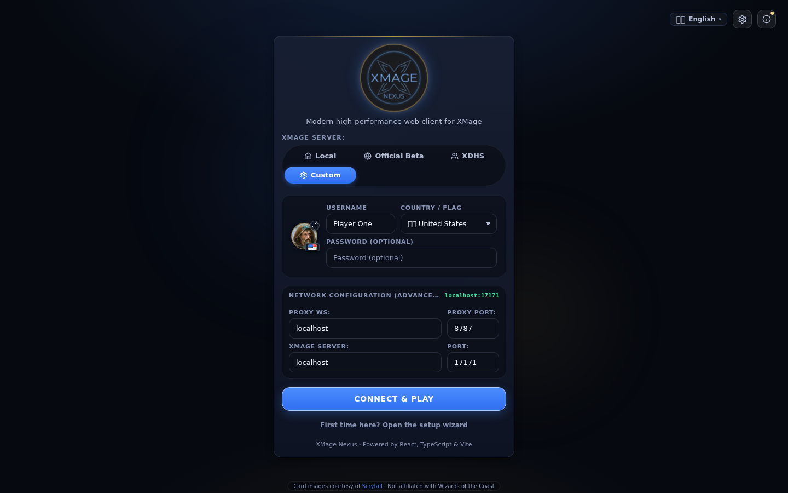

# Play in a browser

You can play a complete game of Magic in a browser tab with nothing installed. This page takes you from a URL to your first game: what the login screen asks for, what anonymous and registered play mean, and how to get from the lobby into a match.

> **Who this is for:** A player who wants to start playing now, using a browser and an existing Nexus deployment.

## Open the client

Open the URL you were given. A deployment serves the web client from the proxy's HTTP port, which is `8788` by default, so a self-hosted instance usually looks like `http://<proxy-host>:8788/`.

These addresses are useful to know:

| Address | What it is |
|---|---|
| `http://<proxy-host>:8788/` | The built web client, served by the proxy |
| `http://localhost:5173` | The development server, if you are running the stack from source |
| `ws://<proxy-host>:8787` | The WebSocket endpoint the client connects to |

If you do not have a URL, a hosted instance may be linked from the project page, or you can run your own stack with the [self-hosting quickstart](self-hosting-quickstart.md). Use a current browser with WebSocket support and local storage enabled; the client keeps your saved connection and decks there.

## The first visit

On a browser with no saved connection, Nexus opens a short setup wizard instead of dropping you straight onto a login form. It walks through:

1. **Language** — interface language and card language.
2. **Your identity** — name, country flag, and avatar, which is how other players see you at a table.
3. **Where to play** — a server preset, or your own addresses.
4. **Table** — board style and interface density.
5. **Sound & gameplay** — audio and automatic helpers.

`Save & exit` closes the wizard without saving a connection; fill in the login form to connect. `Enter` saves the connection and connects to the chosen server. Once a connection is saved, later visits restore it automatically, so a reload puts you back in the lobby or back into a running game.

To revisit the wizard later, use `First time here? Open the setup wizard` at the bottom of the login form.

## The login screen

The login form has four parts: the server target, your identity, an optional advanced network box, and the connect button.

| Field | Default | Notes |
|---|---|---|
| Server target | Local | Presets: `Local`, `Official Beta`, `XDHS`, `Custom` |
| Avatar | A default portrait | Click the portrait to pick another |
| Username | Empty | Maximum 14 characters |
| Country / Flag | Guessed from your browser locale | Shown next to your name at tables |
| Password | Empty | Optional; disabled on the `Official Beta` preset, which does not use passwords |
| Proxy WS | `localhost`, port `8787` | In `Network Configuration (Advanced)` |
| XMage Server | `localhost`, port `17171` | In `Network Configuration (Advanced)` |
| Auth token | Empty | Only shown when the deployment requires one |

The presets fill both addresses for you:

- **Local** — proxy `localhost:8787`, server `localhost:17171`. Use it when the proxy and the XMage server run on your own machine, which is what the desktop app sets up.
- **Official Beta** — a public server running the release this client is built for.
- **XDHS** — a second public server that uses a different engine release. Choose it only if that is where you play.
- **Custom** — type the proxy and server addresses yourself.

A hosted deployment can pin its server: the server choice disappears and a read-only line shows the target instead. Deployments that take players from the open internet can also require an auth token, in which case the form shows one more field.

## Anonymous and registered play

XMage servers run in one of two modes, and the login form adapts to the one you reach.

**Anonymous.** Most public servers accept a name and nothing else. There is no account and no sign-up: the name you type is your identity for that session, and it is held at the server while you are connected. Two players cannot use the same name on the same server at the same time. If someone already holds it, the login is refused with `This name is already in use on that server — pick another name or wait`. Disconnecting frees the name.

A name is also how Nexus recognizes you after a reload. Refreshing the page with the same name in the same browser reattaches to your session, including a game in progress, instead of starting a second one.

**Registered.** A server can require accounts instead. Type the account name and its password. Account creation is handled by the server's operator; the Nexus client has no registration form. On the `Official Beta` preset the password field is disabled, with a hint that the public server ignores passwords.

**Proxy auth token.** Some deployments gate the proxy itself with a shared token, separate from any game account. It appears only when the proxy asks for it, and you get it from whoever runs the deployment. It is not your XMage password.

## The 14-character username limit

The XMage server rejects any username longer than 14 characters. The form caps input at 14 for that reason, but a name carried over from an older saved connection can still be too long.

A refused login can look like a connection fault: the client reports `Can't receive server state before other data` because it never receives a server state after a rejected login. If you see that message, shorten the name before you investigate the network.

## Pick a table

After connecting, the lobby opens on the **Tables** tab. Each entry in the list is a table:

- The table name, game type, and format.
- Seat count and the players already seated, with their ratings.
- Tags for rated or unrated play, spectators allowed, minimum rating, and quit ratio.
- A state badge such as `Waiting` or `Dueling`.

The buttons on a table depend on its state and your relation to it:

| Button | When it appears | What it does |
|---|---|---|
| `Join (Human)` | The table has an open human seat | Opens the join flow and seats you |
| `Spectate` | The table allows spectators | Watches the match without a seat |
| `Start Match` | You own the table and everyone is ready | Begins the game |
| `Return to table` | You have a seat but left the table view | Goes back to the waiting room |

The header carries the `Tables`, `Decks`, `History`, and `Ranking` tabs, plus `New Table`, the online player count, your avatar and rating, settings, and the client news. The side panel lists online users and the room chat.

## Your first game

There are two ways in. Joining someone else's table is faster; creating your own table is the reliable way to play alone against the server's AI.

### Join an open table

1. Find a table with a free human seat and choose `Join (Human)`.
2. Pick a deck in the join dialog. It ranks the decks you own that fit the table's format.
3. If the deck contains printings the server will reject, a **Deck problems** dialog lists them with the reason and offers a suggested printing, `Auto-resolve`, or `Remove N and play`. The server matches cards by set and collector number, not by name.
4. Wait in the waiting room. The owner starts the match when the seats are filled.

### Create a table

1. Choose `New Table`.
2. **General** — table name, game type, and format or deck type.
3. **Timers & Rules** — clock, mulligans, and multiplayer match rules.
4. **Restrictions** — table password, spectators, and rating or quit-ratio limits.
5. **Multiplayer** — your seat and deck, plus the other seats. Fill empty seats with the server's AI to play immediately, or leave them open for other players.
6. Choose `Create Table`, then `Start Match` in the waiting room.

If you own no decks yet, the deck picker offers a set of ready-to-play starter decks; add them in one click and replace them later in the deck builder.

When the game begins you keep or mulligan under London rules, then play with the board controls: click a card to select it, click a target to aim, and use the action button or `Space` to pass priority. The [board and controls](../player-guide/board-and-controls.md) page covers the rest.

## If the first login fails

| What you see | Likely cause | What to do |
|---|---|---|
| Nothing happens after `Connect & Play` | Wrong proxy address, or the proxy is not running | Check the Proxy WS host and port; try `Local` if you run your own stack |
| `This name is already in use` | Another player holds the name on that server | Choose a different name, or wait for the other session to end |
| `Can't receive server state before other data` | The login was refused, most often for a name longer than 14 characters | Shorten the username and retry |
| A version mismatch message | The server runs a different XMage release than the proxy | Connect to another server, or ask the operator to rebuild the proxy |
| `WARMING_UP` | The proxy is still building its card database after a start | Wait a few seconds and connect again |
| The page loads but every connect fails on an HTTPS deployment | An HTTPS page cannot open a plain `ws://` socket | The deployment needs a TLS-terminated proxy; see [Deployment](../operator-guide/deployment.md) |

## Related

- [Lobby and tables](../player-guide/lobby.md)
- [Creating a game](../player-guide/creating-a-game.md)
- [Joining a game](../player-guide/joining-a-game.md)
- [Desktop app](desktop-app.md)
- [Troubleshooting](../reference/troubleshooting.md)
