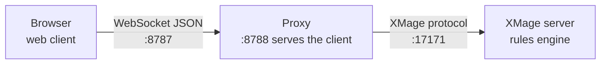

# Self-hosting quickstart

Running Nexus yourself takes two pieces: the proxy, which serves the web client and bridges browsers to an XMage server, and an XMage server for it to talk to. You can run both on one machine, or put the proxy in front of a server that already exists. This page gets a working stack up with the fewest steps; the [deployment guide](../operator-guide/deployment.md) covers TLS, tunnels, and running it for a group.

> **Who this is for:** A technical user who wants their own Nexus endpoint and is comfortable with a terminal.

## What you are building



There are two shapes to choose from:

| Shape | What runs on your machine | When to use it |
|---|---|---|
| Full stack | XMage server, proxy, and a Vite dev server | A first working game, or a private server for a small group |
| Proxy only | Proxy, serving the built client | You already run an XMage server, or you point at one you can reach |

Both shapes use the same proxy and the same web client. Only the first one starts an XMage server for you.

## Before you start

| Requirement | Version | Needed for |
|---|---|---|
| JDK | 17 | Running the proxy and the XMage server |
| Maven | 3.9 or newer | Building the proxy and the server modules |
| Node.js | 20 or newer | The web client build and the helper scripts |
| npm | 10 or newer | Web dependencies |
| Docker Engine with Compose v2 | Current | The container path only |
| XMage engine checkout | Matching release | Building the proxy |

The proxy compiles against the XMage engine, so the build needs an engine checkout whose root contains `Mage/pom.xml`. Keep it next to this repository as `../xmage-fork`, or point `NEXUS_FORK_DIR` at it from wherever it lives.

On macOS and Linux, raise the open-file limit before starting the stack. The default is often too low for a server with several sessions:

```bash
ulimit -n 65536
```

## Option 1 — the full stack from source

```bash
git clone <repo-url> nexus
cd nexus
export NEXUS_FORK_DIR=<path-to-engine>
npm --prefix web install
node scripts/build.mjs
node scripts/ctl.mjs start all
node scripts/ctl.mjs status
```

On Windows PowerShell, set the variable like this instead:

```powershell
$env:NEXUS_FORK_DIR = "<path-to-engine>"
```

`node scripts/build.mjs` compiles the engine modules, installs the server plugins, and packages the proxy jar. It is the step that produces `Mage.Proxy/target/mage-proxy-1.4.62.jar`, which the start script expects.

`node scripts/ctl.mjs start all` returns immediately and starts three processes in the background:

| Process | Address | What it is |
|---|---|---|
| `server` | `127.0.0.1:17171` | The XMage server, bound to loopback |
| `proxy` | `ws://127.0.0.1:8787` | The WebSocket bridge |
| `vite` | `http://localhost:5173` | The web client's development server |

Open `http://localhost:5173`. The login form already points at `localhost:8787` and `localhost:17171`, so `Connect & Play` should land in the lobby.

`node scripts/ctl.mjs status` prints the state of all three. If the proxy or Vite is still starting, wait a few seconds and run it again — the proxy needs to load card data before it accepts logins.

The helper scripts cover the rest of the day-to-day work:

```bash
node scripts/ctl.mjs restart proxy     # after a proxy change
node scripts/ctl.mjs stop all          # stop everything
node scripts/tail.mjs proxy 40         # last 40 lines of the proxy log
```

Logs are written to `.run/*.log` in the repository.

The Vite server is a development server: it rebuilds on change and is not meant to face the internet. For a permanent deployment, build the client with `npm --prefix web run build` and serve `web/dist` from the proxy (`--webDir`) or a reverse proxy. The [deployment guide](../operator-guide/deployment.md) covers that setup, TLS, and tunnels.

> `node scripts/install.mjs` is an alternative setup step for the Maven modules, plugins, and web dependencies, but it does not package the proxy. Run `node scripts/build.mjs` after it, or use `build.mjs` on its own as shown above.

## Option 2 — the container for the client and proxy

The container image contains a Java 17 runtime, the proxy jar, and the built web client. It does not contain an XMage server, so this path always points at a server elsewhere — your own, or one you can reach.

The Dockerfile copies the proxy jar from the build output, so build it first:

```bash
node scripts/build.mjs proxy
```

If you are not building from source, take the proxy component from a published release and place its jar at `Mage.Proxy/target/mage-proxy-1.4.62.jar`, which is the path the image expects.

Then start the stack:

```bash
docker compose up -d --build
```

Open `http://localhost:8788`. The same process serves the web client and accepts WebSocket connections on `8787`.

The compose file reads these variables, with defaults:

| Variable | Default | Meaning |
|---|---|---|
| `XMAGE_HOST` | A public XMage server | Hostname of the server the proxy connects to |
| `XMAGE_PORT` | `17171` | Port of that server |
| `ALLOWED_ORIGINS` | `http://localhost:8788` | Exact browser origin allowed to open the WebSocket |
| `ADMIN_TOKEN` | Empty | Enables the admin status endpoint when set |

The image also understands `WS_PORT`, `HTTP_PORT`, `BIND`, and `JAVA_OPTS`. The compose file publishes `8787` and `8788` and keeps proxy state in the `nexus-data` volume, mounted at `/data`.

To point the container at your own server, save these values in a `.env` file next to `docker-compose.yml`:

```ini
XMAGE_HOST=<server-host>
XMAGE_PORT=17171
```

Then recreate the container with `docker compose up -d`.

## Point the client at your stack

Where you opened the client decides which addresses to enter in `Network Configuration (Advanced)`.

| Client page | Proxy WS | XMage Server |
|---|---|---|
| `http://localhost:5173` (Vite) | `localhost` `8787` | `localhost` `17171` |
| `http://localhost:8788` (container) | `localhost` `8787` | `<server-host>` `17171` |
| `http://<proxy-host>:8788` (another machine) | `<proxy-host>` `8787` | `<server-host>` `17171` |

The `Local` preset fills the first row. For anything else, choose `Custom` and type the addresses.

## Let other people connect

The proxy's defaults are local-first: it binds to `127.0.0.1`, and only `localhost` origins are accepted. To open it to a group:

1. Bind the proxy to an interface other machines can reach. The container sets `BIND=0.0.0.0`; when you start the jar yourself, pass `--bind 0.0.0.0`. The helper scripts start it on loopback only.
2. Set `ALLOWED_ORIGINS` to the exact origin players will see in the address bar, including scheme and port — for example `http://<proxy-host>:8788`. Several origins are comma-separated. An origin that does not match exactly is refused.
3. Publish both ports: `8787` for the WebSocket and `8788` for the page.
4. Keep `17171` private unless you intend players to reach the XMage server directly.

If the page is served over HTTPS, the WebSocket must also be encrypted (`wss://`); a browser will not open a plain `ws://` socket from a secure page. Terminate TLS in front of the proxy and forward both ports. Deployments that take players from the open internet should also set an auth token and pin the target server — both are covered in [Configuration](../operator-guide/configuration.md).

## Check that it is healthy

The proxy exposes two unauthenticated endpoints on its HTTP port:

```bash
curl -s http://localhost:8788/health
curl -s http://localhost:8788/ready
```

`/health` answers as soon as the process is up. `/ready` answers `200` only after the card database has finished loading; before that, logins are refused with `WARMING_UP` and clients should retry. Use `/ready` for a load balancer or container health check.

## Stop and clean up

```bash
node scripts/ctl.mjs stop all        # source install
docker compose down                  # container
docker compose down -v               # container, and delete the data volume
```

`stop all` leaves the build output and logs in place. `docker compose down` keeps the volume unless you add `-v`; the volume holds proxy state, including the ids it uses to restore sessions after a restart.

## Common first-run problems

| Symptom | Cause | Fix |
|---|---|---|
| A missing-jar error when the stack starts | The proxy was never packaged | Run `node scripts/build.mjs` |
| The build exits saying it cannot find the XMage fork | `NEXUS_FORK_DIR` is unset and no `../xmage-fork` exists | Point the variable at a checkout containing `Mage/pom.xml` |
| `MAGE_VERSION_RELEASE_INFO_MUST_BE_SAME` or a version refusal at login | Proxy and server are built against different XMage releases | Rebuild the proxy against the server's release |
| `Port already in use` on `17171`, `8787`, or `5173` | Another stack or the desktop app is running | Stop the other process, then `node scripts/ctl.mjs start all` |
| The page loads but the WebSocket is refused | Origin not in `ALLOWED_ORIGINS`, or plain `ws://` from an HTTPS page | Add the exact origin; terminate TLS for the socket |
| `connect` answers `WARMING_UP` | Card database still loading | Wait and retry; check `/ready` |
| Docker build fails at the `COPY` of the proxy jar | Jar not built or the version in its name differs | Build the jar, or fix the path in the Dockerfile for your release |

## Related

- [Deployment](../operator-guide/deployment.md)
- [Configuration](../operator-guide/configuration.md)
- [Play in a browser](play-in-browser.md)
- [Ports](../reference/ports.md)
- [Commands](../reference/commands.md)
