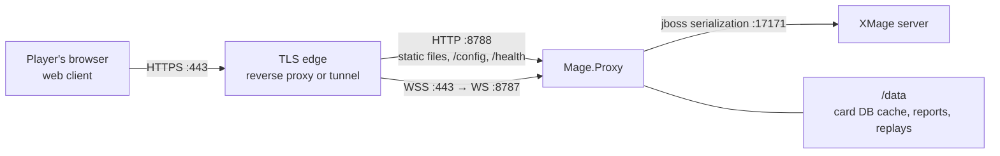

# Deploying XMage Nexus

This page takes you from a source checkout to a stack that players reach in a browser: an XMage
rules server (yours or a public one), one `Mage.Proxy` process, and the static web client. It
covers the Docker image, the native process, TLS termination, public tunnels, and the checks that
tell you the deployment is healthy.

> **Who this is for:** an operator standing up a Nexus instance for other people to play on.

## What you are deploying

Nexus has three tiers. A hosted deployment runs one of them — the proxy — and points it at an
XMage server you either run yourself or reach as a service.



`Mage.Proxy` holds no game logic. It opens one real XMage session per browser connection, forwards
server callbacks as JSON over WebSocket, and forwards player actions back. Every rule decision
happens in the XMage server, which can be a local build or a public server — the proxy only has to
match its release.

The web client is a static bundle. The proxy can serve it (`--webDir`), or you can host it on any
static host as long as the browser can reach the proxy's HTTP port for the pre-connect probe.

## Before you build

| Component | Version | Why |
|---|---|---|
| JDK | 17 | The proxy and the XMage server run on 17 and need `--add-opens` flags |
| Maven | 3.9 | Builds the proxy jar against the engine artifacts |
| Node.js | 20 or newer (24 in the container build) | Builds the web client and runs the repository scripts |
| XMage engine | 1.4.62 (`1.4.62-V1`) | The proxy is compiled against one release, and a server on another release refuses its login |

The proxy talks to the engine through JBoss Remoting, which needs reflective access on JDK 17.
Every launch path in this page passes:

```text
--add-opens=java.base/java.io=ALL-UNNAMED
--add-opens=java.base/java.util=ALL-UNNAMED
--add-opens=java.base/java.lang=ALL-UNNAMED
--add-opens=java.base/java.lang.reflect=ALL-UNNAMED
--add-opens=java.base/java.text=ALL-UNNAMED
```

## Build the two artifacts

The proxy compiles against `org.mage` artifacts from the matching engine release, installed in your
local Maven repository. Install those first (from an engine checkout of the same release), then
build the jar:

```bash
mvn -q -f Mage.Proxy/pom.xml clean package -DskipTests
```

The result is `Mage.Proxy/target/mage-proxy-1.4.62.jar`. To target a different server release,
build against its artifacts with `-Dmage.version=<version>`; the jar name follows that version. A
server on another release refuses the login with `VERSION_MISMATCH`, so keep the two in step.

Then build the web client:

```bash
npm --prefix web ci
npm --prefix web run build
```

The result is `web/dist`. It is a plain static bundle: HTML, fingerprinted JS/CSS, and the splash
assets. Build-time `VITE_*` variables are baked into it — see
[Configuration](configuration.md) before you build for a public hostname.

> **Shortcut.** `node scripts/build.mjs proxy` wraps the Maven step and stops a running proxy first
> (the jar is locked on Windows). It expects an engine checkout beside this repository. The
> command list lives in [Commands](../reference/commands.md).

## Run it with Docker

The image is built locally; the compose file does not pull from a registry. It is a two-stage
build: Node 24 compiles the web client, and a Temurin 17 JRE runs the proxy as an unprivileged
`nexus` user.

The Dockerfile copies `Mage.Proxy/target/mage-proxy-1.4.62.jar` from the build context, so build
the jar first. `.dockerignore` keeps the rest of `target/` out of the context but explicitly allows
that one file.

```bash
docker compose up -d --build
docker compose logs -f nexus
```

| Environment variable | Default in the image | Effect |
|---|---|---|
| `XMAGE_HOST` | `beta.xmage.today` | Target XMage server host |
| `XMAGE_PORT` | `17171` | Target XMage server port |
| `WS_PORT` | `8787` | WebSocket gateway port |
| `HTTP_PORT` | `8788` | Static files, `/config`, `/health`, `/ready`, `/admin/status` |
| `BIND` | `0.0.0.0` | Interface both ports bind to |
| `ALLOWED_ORIGINS` | empty (localhost only) | Exact browser origins allowed to open the socket |
| `ADMIN_TOKEN` | empty (endpoint absent) | Bearer token for `GET /admin/status` |
| `JAVA_OPTS` | `-XX:MaxRAMPercentage=60 -XX:+UseSerialGC` | JVM flags |

The compose file overrides `ALLOWED_ORIGINS` with `http://localhost:8788` — the origin of the page
the container serves itself — so a fresh checkout works on the host without extra configuration.
Replace it with your public origin before you expose the service.

The compose file publishes `8788` and `8787`, mounts the `nexus-data` volume at `/data`, sets
`restart: unless-stopped`, and caps the container at 1536 MB. If a reverse proxy runs on the same
host, publish on loopback instead so the ports are not reachable directly:

```yaml
    ports:
      - "127.0.0.1:8788:8788"
      - "127.0.0.1:8787:8787"
```

Two container details matter:

- **The entrypoint forwards a fixed set of variables.** It maps the table above onto proxy flags
  and ignores extra container arguments. To use the access token, a pinned target, or a custom
  deployment name, add the flags to `docker/entrypoint.sh` (or override the entrypoint) — passing
  them after the image name has no effect.
- **The image declares no `HEALTHCHECK`.** Gate traffic on `/ready` from your orchestrator or
  reverse proxy, and install an HTTP client in the image if you want a container-level check.

## Run it as a native process

The host only needs a JRE 17, the proxy jar, and `web/dist`. The repository ships
`scripts/deploy/start-proxy.sh` (and a `.bat` equivalent) which reads its settings from the
environment and execs Java with the required `--add-opens` flags:

```bash
JAR=/opt/nexus/mage-proxy-1.4.62.jar \
WEB_DIR=/opt/nexus/web-dist \
XMAGE_HOST=<server-host> XMAGE_PORT=17171 \
WS_PORT=8787 HTTP_PORT=8788 \
BIND=127.0.0.1 \
ALLOWED_ORIGINS=https://nexus.example.com \
/opt/nexus/start-proxy.sh
```

A systemd unit keeps it alive and restarts it on failure:

```ini
[Unit]
Description=XMage Nexus proxy
After=network-online.target

[Service]
User=nexus
WorkingDirectory=/opt/nexus
EnvironmentFile=/etc/nexus/proxy.env
ExecStart=/opt/nexus/start-proxy.sh
Restart=always
RestartSec=5
NoNewPrivileges=true

[Install]
WantedBy=multi-user.target
```

Keep `WorkingDirectory` stable: the proxy resolves `--webDir`, `--replayDir`, `--reportsDir` and
its card database (`db/`) relative to the process working directory.

## Ports

| Port | Service | Exposure |
|---|---|---|
| `17171` | XMage server | Only the proxy needs to reach it |
| `8787` | Proxy WebSocket gateway | Must be reachable by browsers (usually via TLS on 443) |
| `8788` | Proxy HTTP: web client, `/config`, `/health`, `/ready` | Must be reachable by browsers |
| `8790` | Optional status dashboard | LAN only, never exposed |
| `8797` / `8798` | Second proxy flavour (WS / HTTP) | Only if you run two server builds |

## Put it behind TLS

Browsers on an HTTPS page cannot open a `ws://` socket, so terminate TLS in front of both proxy
ports. The client sends the WebSocket to the origin root, so the edge has to route by the upgrade
header: normal requests to the HTTP port, upgrades to the WebSocket port.

```nginx
map $http_upgrade $connection_upgrade {
    default upgrade;
    ''      close;
}
map $http_upgrade $nexus_backend {
    default   "127.0.0.1:8788";
    websocket "127.0.0.1:8787";
}

server {
    listen 443 ssl;
    server_name nexus.example.com;

    location / {
        proxy_pass http://$nexus_backend;
        proxy_http_version 1.1;
        proxy_set_header Upgrade $http_upgrade;
        proxy_set_header Connection $connection_upgrade;
        proxy_set_header X-Forwarded-For $remote_addr;
        proxy_read_timeout 3600s;
    }
}
```

Four rules make this work:

- **Set `ALLOWED_ORIGINS` to the exact origin** players see, scheme included and no trailing
  slash (`https://nexus.example.com`). A mismatch closes the socket with code 1008.
- **Overwrite `X-Forwarded-For`** rather than appending to it. The proxy takes the first value in
  the header and records it as the client address, so anything a client injects would be logged
  and shown as its own address.
- **Keep `/config` reachable.** When the page is served over HTTPS and the socket port is `443`,
  the client probes `/config` on its own origin. Behind a single-port edge the request lands on the
  HTTP backend through the default branch above, which is exactly what you want.
- **Do not idle-timeout the socket.** The proxy sends keep-alives, but a 60-second reverse-proxy timeout
  still drops players mid-game.

If the browser cannot reach the HTTP port at all, the pre-connect probe fails and the client falls
back to defaults: no access-token field, no pinned target, stock branding. On a token-protected
proxy that means every login is rejected. Publish the HTTP port, or set `VITE_PROXY_HTTP_BASE` at
build time to the base URL the browser should probe.

## Publish through a tunnel

If you cannot open ports, run a tunnel agent that forwards two public hostnames: one to `8788`
for the page and one to `8787` for the socket. An edge that routes by upgrade header can publish
both on a single hostname instead.

Two consequences follow from tunnelled hostnames:

- **Short-lived hostnames rotate.** A free quick tunnel mints a new hostname every time the agent
  restarts. The socket URL is baked into the JavaScript bundle, so a rotation means rebuilding
  `web/dist` with the new `VITE_DEFAULT_PROXY_HOST`, updating the deployed bundle, and updating
  `ALLOWED_ORIGINS`. Plan for it, or use a tunnel with a stable hostname.
- **The tunnel agent must survive logout.** Run it as a user service with lingering enabled
  (`loginctl enable-linger <user>`) or as a system service; otherwise it dies with your SSH session
  and the hostnames change on every reconnect.

Verify a public deployment from outside:

```bash
curl -s -o /dev/null -w '%{http_code}\n' https://nexus.example.com/
curl -s https://nexus.example.com/config
node -e "new WebSocket('wss://nexus.example.com').onopen=()=>{console.log('socket ok');process.exit(0)}"
```

## Verify before you invite players

```bash
curl -fsS http://127.0.0.1:8788/health
curl -fsS http://127.0.0.1:8788/ready
curl -fsS http://127.0.0.1:8788/config
```

`/health` answers `200` as soon as the process is up. `/ready` answers `503` until the card
database finishes building, which takes a few seconds on first boot and again after an upgrade.
`/config` shows the deployment the browser will see:

```json
{"authRequired":false,"hideServerTarget":false,"pinnedTarget":null,
 "deploymentName":"XMage Nexus","llmRelay":false}
```

A player who logs in while `/ready` is still `503` is refused with `WARMING_UP` instead of a clear
"starting" message, and a proxy whose card database failed accepts the login and then fails the
first deck action. Gate traffic on `/ready`, not on the port being open.

## Where to go next

Configuration of the proxy, the deployment gates, and the web build is on
[Configuration](configuration.md). Health monitoring, the status dashboard, backups and upgrades
are on [Operations](operations.md). If you only want the shortest working path, start from
[Self-hosting quick start](../getting-started/self-hosting-quickstart.md).

## Related

- [Configuration](configuration.md)
- [Operations](operations.md)
- [Desktop launcher](desktop-launcher.md)
- [Ports](../reference/ports.md)
- [Self-hosting quick start](../getting-started/self-hosting-quickstart.md)
- [Deployment (inherited upstream page)](../deployment.md) — older upstream-authored description; this guide is authoritative.
- [Deploy tunnels (inherited upstream page)](../deploy-tunnels.md) — older upstream-authored description; this guide is authoritative.
