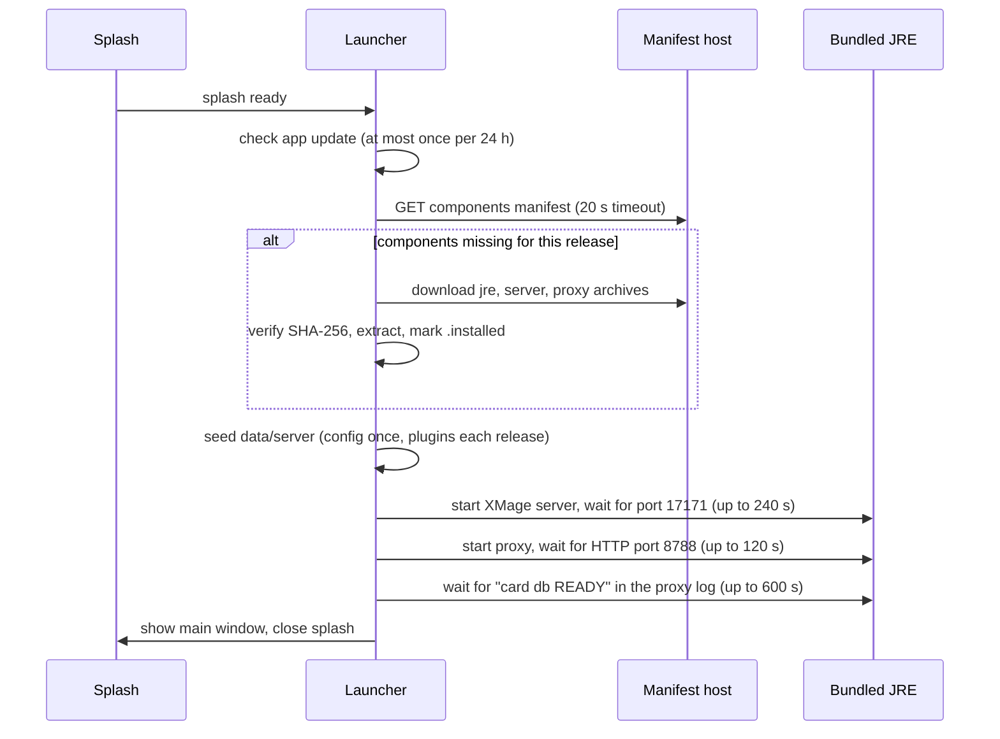

# Desktop launcher

The desktop app wraps the same three tiers as a hosted deployment — web client, proxy, XMage
server — in a single installable program that starts everything on the player's machine. This page
explains what the launcher contains, how it decides what to download, how updates arrive, how the
installers are built, and what to check when a start-up fails.

> **Who this is for:** an operator or packager responsible for the desktop build.

## What the launcher is

Two Rust pieces and the web bundle:

- **The shell** is a Tauri 2 application. Its window loads `web/dist` (the same bundle a browser
  would load) and it runs the bundled JRE, XMage server, and proxy as child processes.
- **The bootstrap library and CLI** (`nexus-bootstrap`) handle components: read the manifest,
  download missing archives, verify their SHA-256, extract them, and mark a release installed. The
  CLI exposes `check` and `fetch` for scripted installs:

  ```bash
  nexus-bootstrap check --data-dir <data-dir> --manifest <manifest-url-or-file>
  nexus-bootstrap fetch --data-dir <data-dir> --manifest <manifest-url-or-file> --target linux-x64
  ```

The app does not need Java, Maven, or Node on the machine. It ships a trimmed runtime, so the only
external requirement is a working graphics stack for the webview.

## Start-up sequence



The splash reports each phase and translates known failures into stable codes. Nothing is shown
until the card database is ready, because a proxy that is still warming up rejects deck work with
`WARMING_UP`.

Offline starts work as long as one release is already installed: a failed manifest fetch falls
back to the newest installed release. With no network and no installed components the app stops
with `ERR_OFFLINE`.

## Components and the manifest

A release is a set of archives, one per component per platform. The manifest is a small JSON file
published next to the release assets:

```json
{
  "schema": 1,
  "release": "<release-tag>",
  "xmage": "1.4.62-V1",
  "git_sha": "<short-sha>",
  "min_launcher": "0.1.0",
  "components": {
    "jre": {
      "linux-x64": { "url": "https://example.com/releases/<release>/nexus-jre-linux-x64.tar.gz",
                     "sha256": "<hex>", "bytes": 0 }
    },
    "server": { "linux-x64": { "url": "...", "sha256": "<hex>", "bytes": 0 } },
    "proxy": { "linux-x64": { "url": "...", "sha256": "<hex>", "bytes": 0 } }
  }
}
```

| Component | Contents | Updated when |
|---|---|---|
| `jre` | Trimmed Java 17 runtime | Launcher release changes the runtime |
| `server` | XMage server classes, libraries, plugins, seed `config/`, and `version.json` | Engine release changes |
| `proxy` | `mage-proxy-<version>.jar` | Proxy release changes |
| `proxy-xdhs` | Second proxy jar built against another engine fork | Optional; absence is not an error |

Supported platform tags are `linux-x64`, `win-x64`, and `mac-arm64`. Intel Macs are refused at
start-up with `ERR_MAC_INTEL`: no components are published for `mac-x64`. Each component archive
extracts flat into its own directory, and every download is verified against the manifest's
SHA-256 before extraction.

`server/version.json` is the start contract: main class, classpath entries, JVM system properties,
`--add-opens` flags, the server port, and the proxy jar name with its two ports. The launcher reads
it instead of hard-coding a command line, so a release can change its own layout.

## Where files live

The data root is the platform's application-data directory for the app, or `NEXUS_DATA_DIR` when
set.

| Path | Contents |
|---|---|
| `components/<release>/<component>/` | Extracted archives, plus a `.installed` marker |
| `data/server/config/` | Server `config.xml`; seeded once and then left alone |
| `data/server/plugins/` | Plugin jars; replaced on every release |
| `data/server/saved/` | Saved games and replays |
| `data/server/gamesHistory/` | Match history |
| `logs/bootstrap.log` | Phase log with elapsed times |
| `logs/server.log`, `logs/proxy.log`, `logs/proxy-xdhs.log` | Child process output |
| `updater-last-check` | Timestamp of the last successful update check |

Logs rotate on start: the previous file is kept as `<name>.previous.log`, so a crash from the last
run is still readable after a restart. The second proxy flavour runs in `proxy-xdhs/` so its card
database never collides with the first one.

Seeding has one rule worth knowing: `config.xml` is copied only when `data/server/config` does not
exist yet, while `plugins/` is replaced on every release. Player settings survive an upgrade;
plugin jars always match the running release.

## Ports and overrides

| Setting | Default | Environment override |
|---|---|---|
| Server port | `17171` | `NEXUS_SERVER_PORT` |
| Proxy WebSocket port | `8787` | `NEXUS_WS_PORT` |
| Proxy HTTP port | `8788` | `NEXUS_HTTP_PORT` |
| Second proxy WS / HTTP | `8797` / `8798` | from `version.json` |
| Data root | platform app-data dir | `NEXUS_DATA_DIR` |
| Manifest | release manifest URL | `NEXUS_MANIFEST` |
| Platform tag | detected at runtime | `NEXUS_TARGET` |

The server port is also written into the seeded `config.xml`, so a port override and the server
agree. If something already listens on `17171`, the launcher waits 15 seconds for it to free and
then fails with `ERR_SERVER_START` rather than starting a second server on top of it.

## Updates

There are two independent update paths.

**The application** updates through the Tauri updater: an updater manifest (`latest.json`) next to
the release assets, with a signature for each platform bundle. It is checked at most once every
24 hours with an 8-second request timeout and a 12-second hard cap. When an update is offered, the
splash shows the version and release notes and waits for the player to accept or skip. A failed
check is logged and start-up continues — an offline machine still plays.

**Components** update through the manifest. A new engine or proxy release publishes a manifest
with a new `release` value; the launcher sees no `.installed` marker for it, downloads the
components it needs, and seeds the data directory again. Components can be reused across app
releases, so a launcher fix does not re-download a few hundred megabytes of engine.

## Building the installers

Packaging is a local, scripted process. The first step stages the server, proxy, and start
contract; the second builds the web bundle with the desktop flag; the third builds the shell and
its installers.

```bash
node scripts/assemble-modules.mjs
TAURI_BUILD=1 npm --prefix web run build
cargo tauri build
```

`assemble-modules.mjs` copies the engine classes, libraries, and plugin jars into `staging/server`,
the proxy jar into `staging/proxy`, writes `version.json`, and seeds a `config.xml` bound to
loopback (the launcher patches the port into it at start). The JRE is packaged separately with
`jlink`, one archive per platform, because a trimmed runtime is platform-specific.

| Platform | Artifacts |
|---|---|
| Windows | `.msi` and NSIS `.exe` |
| macOS (Apple Silicon) | `.dmg` and `.app` |
| Linux | `.AppImage`, `.deb`, `.rpm` |

Updater artifacts are produced alongside the installers (`createUpdaterArtifacts` is on). Signing
uses the Tauri key pair: set `TAURI_SIGNING_PRIVATE_KEY` and, when the key is encrypted,
`TAURI_SIGNING_PRIVATE_KEY_PASSWORD` before `cargo tauri build`. The matching public key is
compiled into the app, so an installer built with a different key cannot update an existing
install.

Two signing facts to plan around:

- **macOS bundles use ad-hoc signing**, not a Developer ID identity. Gatekeeper treats a
  downloaded build as unidentified, and players need an explicit first-open.
- **Windows installers are unsigned** unless you add a certificate to the build. SmartScreen warns
  on first run.

Publish the installers, the component archives, `components-manifest.json`, and `latest.json` in
the same release, then regenerate the manifest and the updater file:

```bash
node scripts/gen-manifest.mjs --tag <release-tag> --repo <org>/<repo> --dir <tarball-dir> \
  --out components-manifest.json
node scripts/gen-latest.mjs --tag <release-tag> --repo <org>/<repo> \
  --target-key darwin-aarch64 --bundle-dir target/release/bundle --out latest-darwin.json
```

## Running the app

The tray icon is the control surface: **Launch at login**, **Open data folder**, **Restart**, and
**Quit**. A left click brings the main window back. Only one instance runs; launching the app again
focuses the existing window. Closing the main window stops the child processes, so a game in
progress ends with the window.

## Troubleshooting

| Symptom | Cause | Fix |
|---|---|---|
| `ERR_MAC_INTEL` | Intel Mac; no components are published for `mac-x64` | Use an Apple Silicon machine or the browser client |
| `ERR_PLATFORM` | Unknown OS/architecture | Use a supported platform |
| `ERR_OFFLINE` | No network and no installed release | Connect once to install components |
| `ERR_INCOMPLETE` | Downloaded runtime is missing `bin/java` | Delete `components/<release>` and restart to re-download |
| `ERR_SERVER_START` | Port `17171` busy, or the server exited | Read `logs/server.log`; stop the process holding the port |
| `ERR_PROXY_START` | Proxy exited or never opened `8788` | Read `logs/proxy.log`; check the jar exists in the component directory |
| `ERR_WARMING` | Card database did not finish within ten minutes | Check disk space and `logs/proxy.log` |
| Splash closes instantly | A child process died during start | `logs/bootstrap.log` records the phase and the failure code |
| Second proxy missing | `proxy-xdhs` component absent or broken | Expected on builds without that flavour; local and public play still work |
| Update never offered | Check ran less than 24 hours ago | Delete `updater-last-check` in the data root |

## Related

- [Configuration](configuration.md)
- [Operations](operations.md)
- [Deployment](deployment.md)
- [Desktop app](../getting-started/desktop-app.md)
- [Troubleshooting](../reference/troubleshooting.md)
