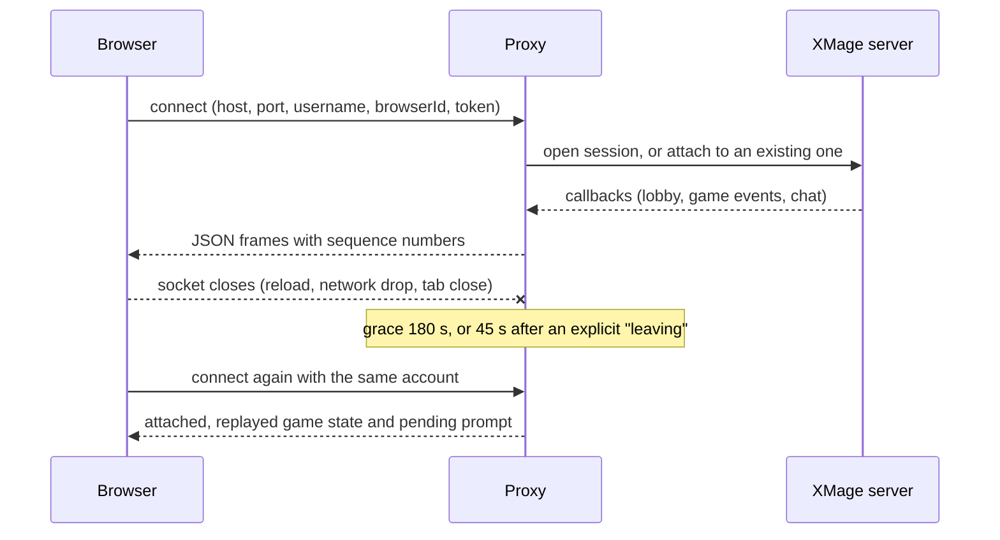

# Operations

This page is the day-two view of a running Nexus deployment: the endpoints that report health, the
status dashboard, what the logs contain, how sessions behave when players disconnect, and how to
size, back up, upgrade, and troubleshoot the service.

> **Who this is for:** an operator running a live deployment day to day.

## Health endpoints

`/health` and `/ready` are unauthenticated, carry no session data, and answer on the HTTP port.

| Endpoint | Meaning | Response |
|---|---|---|
| `GET /health` | Liveness: the process answers | `200` always; same JSON shape as `/ready` |
| `GET /ready` | Readiness: the card database is built | `200` when ready, `503` while building or failed |
| `GET /config` | Deployment configuration for the web client | `200`, `Cache-Control: no-store` |
| `GET /admin/status` | Operational snapshot | `200` with a bearer token; absent without one |

```json
{"ok":true,"liveness":false,"ready":true,"cardDb":"READY","sessions":3,"threads":41,"uptimeSeconds":3600}
```

`cardDb` moves through `NOT_STARTED`, `BUILDING`, `READY`, and `FAILED`. A proxy with a `FAILED`
card database still accepts logins and then fails deck validation, which is why `/ready` and not
the port is the right gate for a load balancer or reverse proxy. The build takes a few seconds on
first start and again after an engine upgrade.

`GET /admin/status` needs `Authorization: Bearer <admin-token>` in the header — never a query
string, which would land in access logs and browser history. It reports uptime, open and total
connections, live sessions, per-user detail (server, address, open windows, action count, last
action), thread counts, and the last 500 events. Without `--adminToken` the route does not exist.

## Status dashboard

`ops/status/` is a small Node service that renders what the host already records. It needs
Node 22.13 or newer (it uses the built-in SQLite module) and has no other dependencies. It never
talks to the proxy and never restarts it.

| Source | Feeds |
|---|---|
| The proxy service journal | `[activity]` logins, sessions, tables, games; warnings and errors; service start/stop lines |
| Game start/end activity lines | How matches ended: won, lost, draw, quit, conceded, unfinished |
| Refused logins with a version mismatch | The version alarm: a red banner naming both releases |
| Socket-open activity lines with forwarded addresses | Public visitor counts |
| `systemctl show`, `/proc`, filesystem statistics | Service state, restarts, CPU, memory, disk, load, proxy RSS |
| TCP and HTTP probes | Connect time to the XMage server and to the local web client |

The journal is followed from a stored cursor into a SQLite database, so a restart of the dashboard
does not lose history; the live player list is rebuilt by replaying activity events since the last
proxy start. Samples are taken every 30 seconds and kept for 180 days by default.

The page has five tabs: **Now** (players online with a 24-hour sparkline, service pills for proxy,
tunnel, XMage server and web client, and how games end), **Statistics**, **Players**, **Logs**
(clean, all, activity, or problems, with a search box), and **System**.

| Variable | Default | Effect |
|---|---|---|
| `STATUS_PORT` | `8790` | Listen port |
| `STATUS_BIND` | `0.0.0.0` | Listen address |
| `STATUS_ALLOW` | private IPv4 ranges | Comma-separated CIDRs allowed to connect |
| `STATUS_DB` | `./data/status.db` | SQLite file (WAL mode) |
| `PROXY_UNIT` | `xmage-proxy` | systemd unit whose journal is read |
| `XMAGE_HOST` / `XMAGE_PORT` | public server / `17171` | Target probed for connect time |
| `PROXY_HTTP` | `http://127.0.0.1:8788/` | Local web client probe |
| `STATUS_SAMPLE_SECS` | `30` | Metric sampling interval |
| `STATUS_SAMPLE_RETENTION_DAYS` | `180` | Sample retention |
| `STATUS_JOURNAL_FILE` | unset | Ingest a `journalctl -o json` dump instead of following the journal (development) |

Access control is by source address, not by login. Requests from outside `STATUS_ALLOW` get
`403`; only `GET` and `HEAD` are accepted; `X-Forwarded-For` is ignored and a strict content
security policy is sent. Keep the port off any tunnel — a tunnel that forwards to `8790` exposes
the dashboard to everyone it serves. The default allowlist contains private ranges only, and
adding loopback logs a warning at start: loopback is not a meaningful restriction once a tunnel
forwards to it.

Set `TUNNELS_USER` to the account that owns your tunnel services. The tunnel card counts that
account's agent processes; with a different agent or account the count stays at zero and the card
is informational only.

The service must be able to read the journal (membership in `adm` or `systemd-journal`). Its API
is plain JSON if you want to scrape it:

```text
GET /api/health
GET /api/live
GET /api/stats?range=24h|7d|30d|90d|all
GET /api/players?range=...
GET /api/system?range=24h|7d|30d|90d
GET /api/logs?source=proxy&view=clean|all|activity|problems&q=<text>&after=<cursor>
```

## Logs

The proxy writes one line per meaningful event to standard output:

```text
[activity] <timestamp> login ok user=Player One ip=<client-ip> server=<server-host>:17171 windows=1
```

Every socket open and close, every login (success, failure, attach), every lifecycle action
(create table, join table, watch game), and every session end is recorded. High-frequency input
and polling actions are counted but not logged, and passwords, chat text, and deck contents are
never written.

Once a minute the proxy also prints a watchdog line:

```text
watchdog: threads=54 (peak 79), openConns=0, accounts=0, clientsAlive=0 (created=3 disposed=3), wsErrors=0, cardDb=READY
```

Read `clientsAlive` across ticks. It is `created` minus `disposed`: one live session accounts for
one, a client released after a rejected login for none. A number that climbs while `openConns` and
`accounts` stay flat is a client nothing can reach, and the line turns into a warning once it
exceeds the reachable count by more than five.

Where the output goes depends on how you run the proxy:

| Deployment | Command |
|---|---|
| Docker | `docker logs -f <container>` |
| systemd | `journalctl -u xmage-proxy -f` |
| Repository scripts | `node scripts/tail.mjs proxy` |

Java logging is routed through log4j in this build, so JUL warnings and the watchdog lines land on
standard error rather than standard output. With the repository scripts they appear in
`proxy.err.log`, not `proxy.out.log`.

## Session behaviour

The proxy is multi-tenant: every browser socket owns its own XMage session, and one process serves
many players.



| Behaviour | What happens |
|---|---|
| Same account, second window | Attaches to the existing session; both windows share one game |
| Different accounts | Fully isolated sessions; events reach only that session's sockets |
| Reload or network drop | Session survives the grace period; the client re-attaches and receives the cached game state and pending prompt |
| Tab closed | The page announces `leaving`, so the shorter leave grace applies and the opponent waits less |
| Proxy loses the server | The session re-logs in for up to `--relinkSecs`; clients see `lost`, `retrying`, `restored`, or `failed` |
| Re-login after a restart | A stored restore id lets the same account take its old session back instead of being refused as already connected |
| Same anonymous name, two browsers | Refused before the dial with a 4401 close, so the two players cannot kick each other in a loop |

When a session is superseded by another login of the same account, the proxy stops relinking and
reports `failed` with reason `superseded` instead of fighting the newer login.

## Capacity and scaling

One proxy process handles many concurrent sessions; the limits you will meet first are threads,
memory per session, and the XMage server's own tolerance for concurrent callbacks.

| Resource | Guidance |
|---|---|
| Memory | The compose file caps the container at 1536 MB with `MaxRAMPercentage=60`; watch RSS against session count |
| Threads | The watchdog line reports current and peak thread counts; a steady climb without a session rise is a leak |
| Server link | A long-lived stack with dozens of sessions can degrade the server callback channel; restart during a quiet window |
| Engine release | One proxy build serves one XMage release; a second release needs a second proxy |
| Multiple proxies | Sessions live inside the process that created them, so route a player to the same instance for the life of the session (sticky routing) |

Horizontal scaling works, but each instance keeps its own sessions, restore-id store, and card
database. A player who lands on a different instance gets a new session, not the old game.

## Backups

The proxy owns almost no durable state. Game state lives in the XMage server. Paths below use the
container layout; on a native install they resolve against the process working directory.

| Path | Contents | Backup? |
|---|---|---|
| `/data/db` | Card database cache | No — rebuilt on start |
| `/data/reports` | Player-submitted reports | Optional |
| `/data/saved` | Saved replays, if shared with a server | Yes, if you keep replays |
| Restore-id file | Session ids, ten-minute lifetime | No |
| Server data directory | `config.xml`, plugins, saved games, history (bundled server only) | Yes |

For a proxy-only deployment, back up the configuration (flags or environment file) and the reports
directory if you use it. For the desktop app, the data root holds the server's `config.xml` and
`saved/`; copy that directory while the app is closed.

## Upgrades

Upgrade the proxy and the web bundle together: the socket contract and the client are released as
a pair.

1. Build the new proxy jar and the new `web/dist`.
2. Copy both to the host; keep the jar path stable or update the service unit.
3. Restart the proxy.
4. Watch `/ready` until it reports `200`, then confirm a login.

What to expect during the restart:

- Existing sockets close. Sessions survive on the server for its own reconnect window, and stored
  restore ids let players log back into the same games.
- `/ready` answers `503` while the card database rebuilds. Players who arrive too early are refused
  with `WARMING_UP`.
- If you changed the engine release, the proxy must be rebuilt against it. A server on another
  release refuses logins with `VERSION_MISMATCH`, and no retry helps.

If a release misbehaves, put the previous jar and bundle back and restart; the card database
rebuilds for the older release automatically.

## Monitoring checklist

- `/ready` returns `200` and `cardDb` is `READY`.
- The status dashboard shows the proxy up and the XMage server reachable.
- No version alarm: refused logins with a client-version mismatch mean the proxy build and the
  server release have drifted apart.
- `clientsAlive` tracks sessions across watchdog ticks.
- Thread count is flat at idle.
- Disk has room for the card database and reports.

## Common failure modes

| Symptom | Likely cause | Action |
|---|---|---|
| Login hangs, then fails | Stale session on the server after a partial restart | Restart the whole stack, not only the proxy |
| `already connected or your IP address changed` | The server still holds the account's old session | Wait for the server timeout, or keep restore ids enabled so a re-login takes it back |
| `VERSION_MISMATCH` on every login | Proxy built against another XMage release | Rebuild the proxy against the server's release |
| `WARMING_UP` right after a restart | Card database still building | Retry in a few seconds, or gate on `/ready` |
| Every login rejected with 4401 | Access token configured, but the client cannot reach `/config` to learn about it | Fix the HTTP port reachability or `VITE_PROXY_HTTP_BASE` |
| Socket closed with 1008 | Browser origin not in `--allowedOrigins` | Add the exact origin, scheme included |
| `cardDb` is `FAILED` | Engine classes missing from the classpath | Check the jar and the working directory |
| Login works, deck validation always fails | Card database `FAILED` or still building | Check `/ready` and the proxy log |
| Dashboard returns 403 | Client outside `STATUS_ALLOW` | Add the client's subnet, or reach it from the LAN |
| Port already in use at start | Another proxy or a stale process | Stop the other process; check for leftover children |

## Related

- [Deployment](deployment.md)
- [Configuration](configuration.md)
- [Desktop launcher](desktop-launcher.md)
- [Troubleshooting](../reference/troubleshooting.md)
- [Ports](../reference/ports.md)
