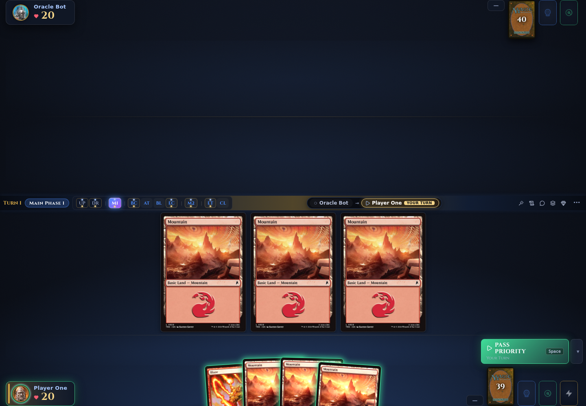
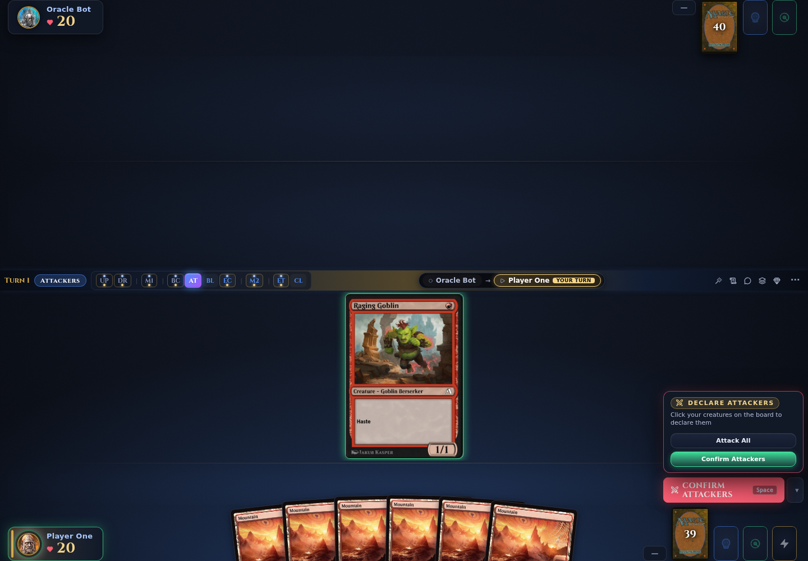

# Board and controls

The game screen is one board: the opponent above the divider, your side below it, your hand along the bottom edge, and the action button within reach of the hand. Every decision is answered on the board or in a bar just above your cards. This page maps the board and the controls you use during a game.

> **Who this is for:** a player who has joined a table and wants to know what every part of the game screen does.

## The board at a glance

Your side sits at the bottom and the opponent you are looking at sits at the top.

| Area | Where it sits | What it shows |
|---|---|---|
| Hand | Bottom edge, as a fan | Your cards. Hovering one lifts it into a readable preview. |
| Battlefield | Between the divider and your player bar | Two bands on your side: creatures above, lands and other permanents below. An empty band yields its height to the other, so a short board gets larger cards. |
| Player bar | Above your hand | Name, life, mana pool, counters, and the pile buttons at its right end: graveyard, exile, and library, each with a count and its top card. Click a pile to list it. |
| Command zone | Left end of the creatures row | Commanders and companions, with emblems beside them. |
| Stack | Right rail, **Stack** tab | Spells and abilities waiting to resolve, newest first, with a count badge. |

Above the board, the divider carries the turn number, phase name, and phase bar; its centre holds the turn-order ring, or an opponent switcher when the table has more players than the layout shows.

The right end of the strip holds the drawer tabs — **Stack**, **Log**, **Chat**, **Deck**, **Commander**, **Mechanics**, and **LLM** — plus the **⋯** game menu. One drawer panel opens at a time: rules log, table chat, deck tracker, commander damage, mechanics tray, or the LLM conversation when the game has an LLM seat. The menu holds concede, leave, rollback, the mana options, saved auto-answers, the rules wiki, and fullscreen.

## Board layouts

Three layouts paint the same game state. The default follows the number of opponents; you can force one in **Settings → Board**.

- **Standard** — one opponent on top, your full board below. The layout for duels and for large tables.
- **Pod (2×2)** — two opponents on the top row, you bottom-left, the third opponent bottom-right. The default for three or four players.
- **Arena** — your board across the full width, opponents in compact columns above.

A pod paints four seats, so five or more players always get the standard layout, with a switcher bar for the opponents it is not showing.

## Priority and the action button

When the server gives you priority, the action button at the bottom becomes live. Its label says what a click will do: **Pass priority** when the stack is empty (the sub-label says whose turn it is), **Resolve** with a count of the stack entries, and **Confirm attackers** or **Confirm blockers** during combat. When another player is deciding it reads **Waiting for …** with the elapsed time and any remaining clock. After you pass it reads **Pass sent — waiting…** until the server asks again: the button stays spent, which is what stops a second click from answering a window you never saw. The **▾** beside it opens the pass menu of one-shot skips, with the active one highlighted.

| Control | Effect |
|---|---|
| `Space` | Pass priority, or resolve when the stack is not empty |
| `Ctrl`/`Cmd`/`Shift` + click a card | Hold priority while playing it |
| `F4` | Pass until the next turn |
| `F3` | Cancel the active skip |

The pass menu lists the other skips — **Next main** (`F7`), **My turn** (`F9`), **Stack resolved** (`F10`), **End before mine** (`F11`), **End step** (`F5`) — with their destinations; [Keyboard shortcuts](../reference/keyboard-shortcuts.md) has the canonical table.

Phase stops are set on the phase bar. Click a phase to stop in it on your own turns; shift-click or right-click it to stop on your opponents' turns. A dot under the letter shows which side has a stop. Stops are saved in the browser and sent to the server, so they survive a reload and apply to the next table you join.

**Smart stops** in **Settings → Gameplay** passes priority for you unless you can play a land, cast a spell, activate an ability, or make a combat decision. That section also holds the mana options and the Simple, Balanced, and Manual presets. See [Settings](settings.md).

## Mana payment

The server sends no colour hints with a cost, so the client decides which sources to tap.

| Mode | How it works |
|---|---|
| Auto (default) | The client taps your sources for you as the cost is paid. |
| Smart (opt-in) | The client solves the exact cost from your board, then keeps the last producer of a colour you still need open for an instant in hand, weighted by the opponent's untapped mana. |
| Manual | Nothing is tapped for you. Tap your lands, then click the mana symbols in your pool to pay. |

Turn Smart mana payment on in **Settings → Gameplay**, or from the **⋯** menu during a game. It hands the rest of a payment back to you when it cannot match the cost exactly, and it skips sources it cannot model safely: Treasure-style permanents that sacrifice themselves, restricted mana such as Cavern of Souls, and convoke.

Clicking a source yourself during a mana prompt taps it and stops the automatic choice for that payment. Mana in the pool stays until you spend it: click a coloured pip in your player bar to pay with it, and expect a confirmation before priority passes while the pool is not empty.

X costs and "choose a number" effects open a stepper. Costs paid outside a spell — an echo upkeep, a tax to attack — use the same mana bar, and every legal permanent stays clickable during them.

## Targeting

When a spell or ability needs a target, every legal target lights up. Click one to choose it: a dotted animated arrow runs from the source, and an arrow aimed at a player points at that player's bar.

Multi-target prompts put a bar above the hand with the prompt, your progress, and a **Finish** button when the server marks the choice optional (you may stop before the maximum). The zone the choice lives in is ringed too: a graveyard, exile, or library prompt opens that pile automatically and closes it when targeting ends, and a prompt answered from hand highlights the hand instead of covering the board. When the target is on the stack, the stack drawer opens and legal entries are marked.

Card choices use a full-screen grid: search by name, type, or rules text, then click to select. Multi-select prompts show a counter and **Confirm (n/m)**. The grid hides cards the server did not offer, with **Show all** for the rest of the revealed set. When every legal choice is already in your hand, the grid is skipped: the hand highlights, a compact bar tracks progress, and **Open card grid** is one click away.

## Combat

Combat runs from a bar above the hand, with the board fully visible.

1. **Declare attackers.** Click each creature you want to attack with. Attackers tap and nudge toward the defender, with an arrow at the player, planeswalker, or battle they attack. When the server offers it, **Attack All** declares every legal attacker at once. **Confirm attackers** submits.
2. **Declare blockers.** Click a creature, then the attacker it blocks. Multi-blocks are allowed wherever the rules allow them. **Confirm blockers** submits.
3. **Damage order.** When several blockers gang-block one attacker, the order dialog opens with the blockers in the server's order; move rows with the arrows and confirm.

A creature that attacked stays visibly tapped in the combat group after the window closes, so you can read the attack from the board; vigilance attackers do not tap. First and double strike resolve as two damage steps, with the board updated between them.

## The mulligan

The opening hand is drawn raised above the fan, with a bar directly over it. The bar shows the hand size, who takes the first turn, and what the server offers — a free mulligan, or "down to N cards". **Keep hand** accepts, **Mulligan** draws again, and **Concede** leaves the game. Under the buttons the client evaluates the hand: land and spell counts, the colours it can produce, and the chance of a third land by turn three. The evaluation is advisory and does not change what the server deals.

Under London rules you then put cards on the bottom. Each click puts one card there and the dialog title counts how many are left, one server question per card. While other players decide, the action button reads **Mulligan — waiting for X**. **Auto-mulligan** in Settings answers the keep question and the starting-player choice for you, and never shows the bar; it is off by default.

## Between games: the sideboard

In a best-of-three or best-of-five match, the sideboard screen opens between games and closes when both players submit. It is a two-column editor — **Main Deck** one side, **Sideboard** the other — with a filter box and a swap control on every row. Drag a card across, or use the arrow on its row. Counters show the main-deck minimum and the fifteen-card sideboard maximum, and the deck is validated as you edit, so an illegal configuration cannot be submitted. A timer bar across the top turns urgent in the last thirty seconds and submits what is on screen at zero; until the opponent does too, the screen reads **Deck submitted — waiting for opponent…**. The same editor builds a sealed or drafted pool, with the pool in place of the sideboard.

## Dialogs that ask you to choose

Most decisions arrive in the dock above the hand, not in a window that hides the board. Plain yes/no questions — pay a cost, ward, cascade, an optional trigger — appear in a compact bar with the board still hoverable.

Card selection opens a full-screen grid with search; scry, surveil, Ponder, and Brainstorm open a two-list order dialog; blocker damage uses the same order dialog with only the blockers. A pile split, a vote, a planeswalker ability, a trigger order, and a name, type, amount, or X choice each get a dedicated small dialog.

Information the server reveals to you opens its own viewer: **Looked at**, **Revealed**, and **Companion** panels list the cards and stay open until you close them. A card there is clickable when it is playable from that zone, which is how a companion's pay-{3} and an exile-with-permission card are cast. A card peeked from the top of your library shows next to the library; hover to read it, click it when playable.

## Deck tracker

The **Deck** tab tracks the deck you registered against what is left in your library. The header shows remaining and initial counts, a stacked bar of lands, creatures, spells, and other cards, and the odds that your next draw falls in each group.

Every row is one card: remaining and initial copies, the chance it is your next draw, its mana cost, and a bar that shrinks as copies leave the library. A **TOP** marker follows a card whose top-of-library position is revealed to you, zeroed cards dim unless you hide them, and a chip counts face-down cards in exile. Search by name; sort by cost, name, remaining copies, or draw percentage.

## Commander damage

The **Commander** tab appears only when the game has commanders. It is a damage matrix: one row per commander, one column per player, each cell showing the damage that commander has dealt to that player. Twenty-one or more from one commander is lethal, and any commander at or above that number is flagged above the matrix.

A card view groups commanders under their owner with life totals; a compact table shows the same numbers. Damage is attributed to the commander object, so two players running the same commander keep separate totals. The command zone shows the commander tax as a badge once the commander has been cast from it, and a commander returning from the graveyard asks whether to move back.

## Spectating

A spectator watches through the same board with the hand bar removed. Both sides are visible — in a duel the bottom seat is the watched player, and in a pod every cell is an opponent — but a hand is only shown when the server reveals it to you. The game menu offers **Leave** instead of **Concede**, and the client sends no play, pass, or target action while you are only watching.

When the watched game ends and its table starts the next game of the match, the end-of-game dialog offers **Follow game** instead of returning you to the lobby. Finished games can be reviewed afterwards in the [replay viewer](replay-viewer.md).

## Related

- [Keyboard shortcuts](../reference/keyboard-shortcuts.md)
- [Settings](settings.md)
- [Game modes and formats](game-modes.md)
- [Replay viewer](replay-viewer.md)
- [Joining a game](joining-a-game.md)
- [User manual (inherited upstream page)](../user-manual.md) — older upstream-authored description; this guide is authoritative.
