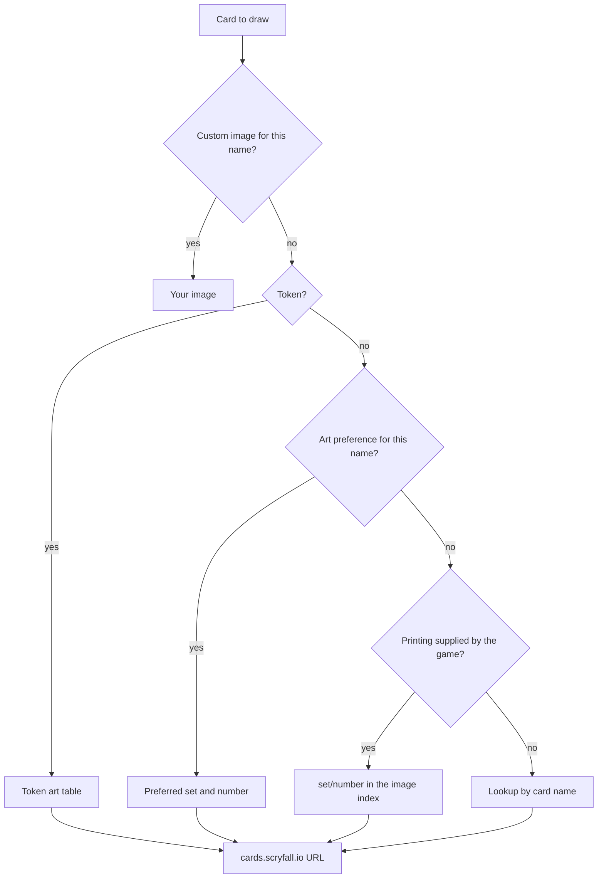

# Card images and art

Every card on the board, in your hand, in the deck builder, and in the sample hand gets its picture
from Scryfall by default. Nexus resolves the picture locally from a bundled index and then loads the
file from Scryfall's image CDN, so a full board does not depend on a burst of rate-limited API
calls. This page explains which picture wins when several are available, how tokens and
double-faced cards are handled, and how to replace any card's art with your own.

> **Who this is for:** a player who wants to understand or change how cards look.

## What is cosmetic and what is not

Art is cosmetic. Your art choices, custom images, sleeves, and playmats are stored on your device
and are never sent to the server. Opponents see the cards through their own settings.

The printing stored in a deck is a separate matter: the server matches cards by set and collector
number, and rejects a card it does not have. That is why the builder validates printings. Changing
only the art does not change what the server receives.

## How the client picks an image

For a permanent on the battlefield, the client tries these sources in order:

If the exact printing is missing from the index, the client retries by card name. If that also
misses, the board draws a text placeholder with the card's name rather than an empty frame.

A face-down card bypasses the chain and shows your sleeve back. A token consults the token art
table before any name lookup.

## The bundled image index

The index ships with the web client as three static files:

| File | Maps |
|---|---|
| Card index | Card name to a Scryfall card id |
| Printing index | Set code and collector number to a Scryfall card id |
| Token art index | Token name and set to a list of token artworks |

The client builds image URLs itself from those ids, using Scryfall's public CDN pattern for a card
id. The CDN is not rate-limited, unlike the card search API.

The index is generated from Scryfall's bulk data by a build script and shipped with the client; the
client does not call the Scryfall API to build it. It includes three details that matter in play:

- Names are also indexed without accents, so an engine name such as `Adewale` finds Scryfall's
  `Adéwalé`.
- Both faces of a double-faced card are indexed to the same entry, so the front-face name the game
  sends resolves correctly.
- Decorative art-series entries are excluded, so a real card never resolves to an art card with a
  similar name.

The three files load once per session, either during an idle moment after startup or on first use.
They total roughly ten megabytes before compression and are cached by the browser like any other
static asset.

## Sizes and where they are used

Scryfall serves each card at several sizes from the same id. Nexus asks for the size each surface
needs:

| Surface | Image variant |
|---|---|
| Battlefield, hand, stack, previews | Normal |
| Compact card style | Art crop |
| Card inspector | Large |
| Deck rows | Art crop from the card data |
| Search results | Normal |

The browser cache does the heavy lifting after the first view of a card. Within a session the
client also keeps a small in-memory map of resolved URLs, so scrolling a board does not repeat the
lookup.

## Tokens

The engine identifies a token by set, name, and image number. The token table uses that triple, so
a Goblin token printed in one set can use that set's art rather than a generic one. If the exact
triple is missing, the client falls back to the token's name.

Some tokens have many artworks, and the engine can pick a different one for each permanent. To keep
a board readable, Nexus pins the first artwork it sees for a given controller, set, name, and
power/toughness, and reuses it for that player's other copies. Fifteen Treasures look like fifteen
copies of one Treasure, not fifteen different cards.

## Face-down cards and back faces

A face-down card never reveals its identity through art: it shows your selected sleeve back. This
applies to morph, manifest, disguise, cloak, and foretell permanents.

Cards whose back face has its own image — transform and modal double-faced cards, battles,
reversible cards, and double-faced tokens — use the CDN's back path when the game shows that face.
A card with no back face keeps its front image.

## Alternate printings and showcase treatments

The palette button on a deck row opens **Select Edition & Art**. It lists every Scryfall printing
of the card, newest first, with set and collector number. Borderless, showcase, extended-art, and
retro treatments are separate printings, so they appear in this list as their own entries. A **Not
on server** badge marks a printing the connected XMage release does not have.

Selecting a printing stores an art preference keyed by card name. The preference applies to that
card in every deck on this device, at every printing, and on the board. It does not alter the
printing stored in the deck, so a card can look like a showcase printing while the server still
receives the plain one.

## Custom card art

You can replace any card's picture with your own image.

1. Open a deck and click the palette button on the card's row.
2. In **Select Edition & Art**, use **Your image**.
3. Choose a file or drag it onto the box.

The client accepts any image file up to 15 MB, crops it to the card proportions (488 × 680), and
stores it as a compressed JPEG in the browser's IndexedDB. Uploading another image replaces the
first; the trash button removes it.

Custom art follows the card name, not the printing. One upload for a card appears on every
printing of that card, in every deck, and on both faces of a double-faced card. It is used on the
battlefield, in hover previews, in the deck list, and in the sample hand.

Only you see the image. It is never uploaded, never sent through the proxy, and never shown to
opponents.

The **Your card images** block in **Settings → Board** lists everything you have uploaded, with an
approximate total size, a delete button per image, and **Remove all**. Clearing site data removes
them too.

## Sleeves and playmats

Custom sleeves and playmats use the same local-only approach. A sleeve image is cropped to
372 × 520 and stored in local storage; a playmat is scaled to fit within 1920 × 1080 and stored the
same way. Neither is sent to the server. The pickers and defaults are described in
[Settings](settings.md).

## Caching and rate limits

The client separates two kinds of traffic:

- **Images** go straight to the CDN and rely on the browser's HTTP cache. They never enter the
  Scryfall API queue.
- **Card data and searches** go through one shared queue: at least 150 ms between requests, at
  most three at once, and up to three tries for a rate-limited request. A rate-limit response
  pauses the whole queue for the delay Scryfall asks for, up to 30 seconds. The pause is shared
  across tabs of the same browser, so two open clients do not double the request rate.

Card data that the client has fetched for decks and inspectors is cached in the browser for seven
days. Search results are requested fresh each time.

## What happens offline

| Situation | What you see |
|---|---|
| No network, card image already viewed | The browser cache usually serves it |
| No network, image never viewed | The board draws the card-name placeholder |
| No network, deck building | Saved decks open and edit normally; Scryfall search fails with a **Retry** button |
| Proxy disconnected | Deck validation and the **Not in XMage** / **Not on server** badges are unavailable; the deck editor still works |
| Custom art uploaded earlier | Always available, because it lives in the browser |

A self-hosted instance can run on a local network without internet access, but card images still
come from Scryfall's CDN. Only images already in the browser cache, and your own uploads, appear
without a connection.

## Related

- [Deck builder](deck-builder.md)
- [Settings](settings.md)
- [Board and controls](board-and-controls.md)
- [Troubleshooting](../reference/troubleshooting.md)
