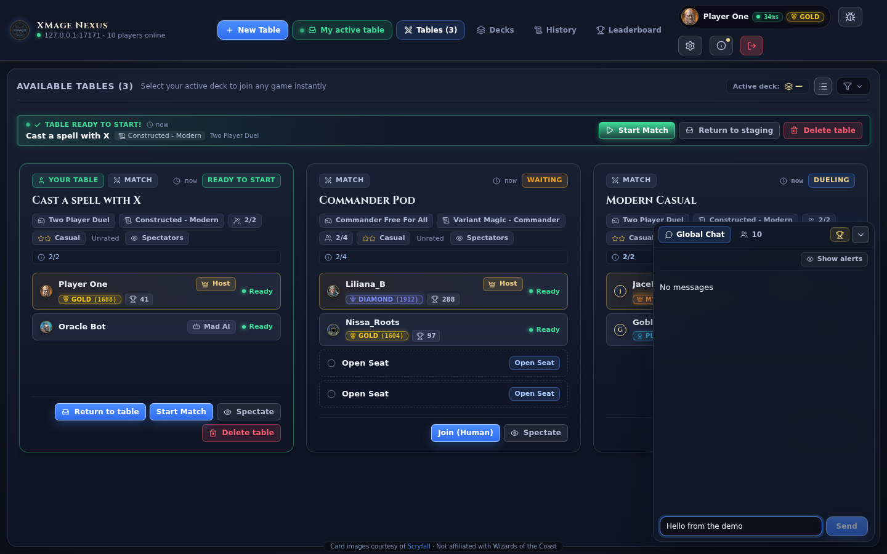

# Chat and social features

Nexus has four places to talk: the room chat that follows you through the lobby, the table chat of a waiting room, the game chat on the board, and private whispers. All of them run on the XMage server's chat channels, so the people you talk to are the people connected to the same server.

> **Who this is for:** a player who wants to talk at a table, message one person, keep a noisy player out of their chat, or share an invite link.



## Where chat appears

| Surface | Where it lives | Who reads it |
|---|---|---|
| Room chat | The floating panel in the lobby. | Everyone in the server's main room. |
| Table chat | The waiting room of a table. | The people at that table: its players and any spectator in its waiting room. |
| Game chat | A panel on the game board. | The players in the game, plus the room when you enable the lobby feed. |
| Whispers | Delivered into the room chat stream. | Only the sender and the recipient. |

## The room chat

The room chat is a floating panel, closed until you open it. A round button in the bottom-right corner opens it and carries a badge with the number of unread messages, capped at `9+`. The panel remembers whether it was open when you last used the lobby.

The panel has two tabs: **Global Chat** and a users tab labelled with the number of players online. On a desktop viewport you can drag the panel by its header, and it reopens where you left it; on a narrow screen it docks above the bottom edge instead. A trophy button in the header opens the room leaderboard, and the chevron collapses the panel back to the round button.

Messages show a timestamp, the sender, and the text. Your own messages and whispers are styled differently from ordinary messages, and a whisper also plays a sound. Card names in double brackets, such as `[[Lightning Bolt]]`, render as highlighted links, and hovering one shows the card image.

System notices — players connecting, losing the connection, disconnecting, and leaving — appear in the same stream with an icon. The **Show alerts** / **Hide alerts** toggle at the top of the panel removes those notices while keeping player messages. The setting lasts while the panel is open.

The input accepts up to 500 characters. A longer message is refused with **Message too long (max 500 characters)** instead of being truncated. Duplicate messages sent back to back are dropped by the server, so pressing send twice does not post twice.

Clicking a sender's name opens the user actions panel for that player.

## The users tab

The second tab lists everyone in the room. Each row carries a status dot, avatar, country flag, name, league badge, and latency; the right edge says **In Game** with a sword icon or **In Lobby**. The list is the same population the leaderboard ranks, and it refreshes with the lobby.

Clicking a row opens the same actions panel as clicking a name in chat.

## The user actions panel

The panel shows the player's avatar, flag, name, league badge, match history, latency, and current activity. It offers:

| Action | Effect |
|---|---|
| **Send Private Whisper** | Opens the chat with `/w <name> ` prefilled, so you only type the message. |
| **Spectate Game** | Appears when the player is at a table that allows spectators; opens that table's game. |
| **View Profile & League Rank** | Opens the leaderboard on that player's profile. |
| **Ignore / Mute User** | Adds the player to your local ignore list. The button becomes **Unblock User** for a player already on it. |

The panel hides the whisper, spectate, and ignore actions on yourself; the profile action still works.

## Table chat

A waiting room has its own chat, headed **Table Chat** with the hint **Only visible to this table**. It behaves like the room chat, with the same commands and the same 500-character limit, and it is shared by the players at the table and any spectator waiting with them. When the server cannot open a table channel, the panel falls back to the room chat and says so in the header.

Leaving the table also leaves its chat. Re-entering the table reconnects you to it.

## Game chat

During a game the board carries its own chat panel. It shows player talk for the game and, with the **Show lobby** toggle, the room messages that arrive while you play. The rules log and the action feed are separate from chat: the log records what the engine did, and the action feed records match events.

The board's chat, log, and action feed are covered in [Board and controls](board-and-controls.md).

## Talking to one player

Whispers use the server's chat command. Type `/w <player> <message>`, or `/whisper <player> <message>`, into any chat input. The server delivers the text to that player only, and their client shows it in the whisper style with a sound.

The fast path is the user actions panel: **Send Private Whisper** fills the input with `/w <name> ` and puts the cursor at the end.

Incoming whispers arrive in the same chat stream as everything else. There is no separate inbox and no way to whisper a player who is offline: the server can only deliver to a connected session.

## Chat commands

The server interprets text that starts with `/` (or `\`) as a command. These are the commands the chat understands:

| Command | Effect |
|---|---|
| `/w <player> <text>`, `/whisper <player> <text>` | Sends a private message. |
| `/card <name>` | Prints the oracle text, mana cost, and types of a card. |
| `/history <player>`, `/h <player>` | Shows that player's match and tournament history. |
| `/me` | Shows your own history. |
| `/list`, `/l` | Prints the command list. |
| `/ignore`, `/ignore <player>` | Lists your ignore list, or adds a player to it. |
| `/unignore <player>` | Removes a player from your ignore list. |

`/ignore` and `/unignore` are handled by the web client, not sent to the server: the names go into a list stored in this browser. Any other slash command the server does not recognise is answered with the command list, so a mistyped command explains itself.

## Ignoring players

Ignoring is local to your browser. It hides that player's messages in the lobby and table chat, and the lobby's **Hide ignored** filter removes tables they host. Joining a table hosted by an ignored player still works, but Nexus shows a warning first.

The list is managed in three places: the user actions panel, the `/ignore` command, and the leaderboard profile, which lists **Ignored & Muted Players** with an **Unblock** button for each. Clearing the browser's site data also clears the list.

An ignore is not a server-side ban. It changes what you see; it does not stop the other player from talking to other people or from joining a table you do not host.

## Invite links

A waiting room has two copy buttons: **Invite to play** and **Invite to spectate**. Each copies a URL to the clipboard and confirms with **Link copied!** for a moment; if the clipboard is blocked, the button says so and you can copy the address from the browser.

The link points at the web client with a fragment that names the table:

```text
https://<proxy-host>/#join=<table-id>
https://<proxy-host>/#watch=<table-id>
```

| Fragment parameter | Meaning |
|---|---|
| `join=<table-id>` | Open the join dialog for that table. |
| `watch=<table-id>` | Open the table as a spectator. |
| `pwd=<password>` | Fills the password field. The copy buttons do not add it; add it by hand for a private table. |
| `server=<server-host>:<port>` | The server the table belongs to, so the invitee can switch to it. |

What happens when someone opens a link:

1. Without a session, the login screen states that they were invited to a table.
2. After login, Nexus searches the room for the table. The lobby broadcast can lag behind the invitation, so it retries for about ten seconds and reports the search in the banner.
3. A join link opens the join dialog with the deck picker, and the password filled when the link carried one. A spectate link opens the game directly.
4. If the link names a different server, Nexus asks before switching. Declining keeps the current connection and says so.
5. If the table is gone, a notice says the invited table no longer exists or has finished.

A spectator link needs a game that is already running. An invitation to watch a table that has not started cannot open a board, because the server has no game to send yet.

## What Nexus does not have

There is no friends list, no presence subscription, no offline messaging, and no voice or video chat. Social features are the room, the table, the game, whispers, invites, and the local ignore list. A player is reachable while they are connected to the same server.

## Moderating your own table

A host controls access at creation time rather than through chat commands: a table password, a minimum ELO, a maximum quit percentage, and a comma-separated list of banned players. These options are described in [Creating a game](creating-a-game.md).

## Related

- [The lobby](lobby.md)
- [Joining a game](joining-a-game.md)
- [Creating a game](creating-a-game.md)
- [Board and controls](board-and-controls.md)
- [Troubleshooting](../reference/troubleshooting.md)
