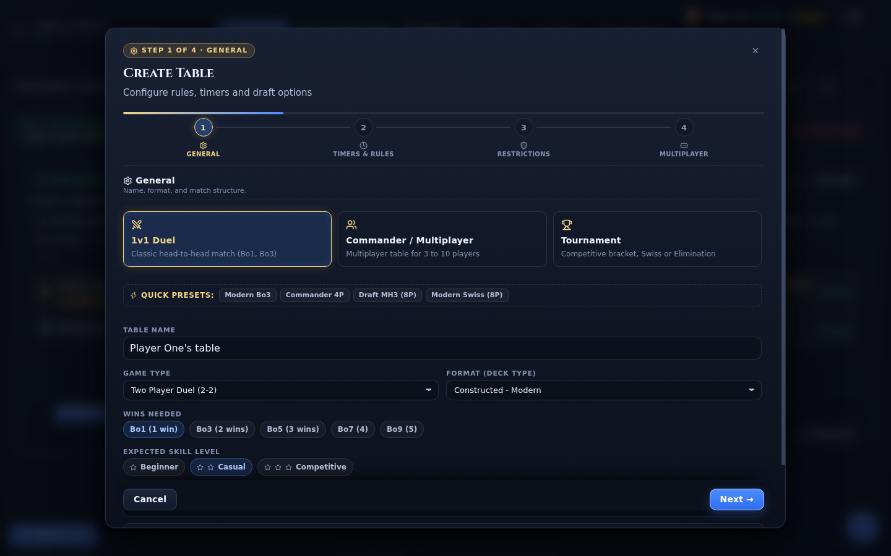

# Creating a game

**New Table** opens a four-step wizard: the match shape, the clocks and mulligans, the access restrictions, and the seats. The wizard reads the game types, formats, and tournament types from the connected server, so the choices match what that server can actually run. Nothing is created until you press the final button, and a summary strip at the bottom of the dialog always shows the shape you are about to submit.

> **Who this is for:** a player who wants to open a table for other people, for AI opponents, or for a tournament.

## Before you start

You need a deck for your own seat. Decks come from the **Decks** tab; if the browser has none, the seat step offers the bundled starter decks. The table also needs a name, which defaults to `<your username>'s table`. The name is fixed once created.

The step indicator at the top of the dialog shows **Step N of 4** and the name of the current step. You can jump back to any completed step; moving forward validates the current one first.

## Step 1 — General

The first step carries three mode cards. Choosing a card rewrites the game type, format, player count, and tournament flags for that mode; the fields below stay editable.

| Mode | What it sets |
|---|---|
| **1v1 Duel** | `Two Player Duel`, two players, no tournament. |
| **Commander / Multiplayer** | A multiplayer game type from the server (Commander Free For All when available), no tournament, four players by default. |
| **Tournament** | A tournament table: constructed or limited, with the tournament fields described below. |

**Quick Presets** sit above the fields and fill the whole form in one click: **Modern Bo3** (Modern, two players, first to two wins), **Commander 4P** (Commander Free For All, four players), **Draft MH3 (8P)** (booster draft tournament, eight players, three boosters), and **Modern Swiss (8P)** (constructed Swiss tournament, eight players). A preset replaces the current shape instead of layering onto it, so switching between presets never leaves a half-tournament behind.

The fields on this step:

| Field | Meaning | Default |
|---|---|---|
| **Table Name** | The name shown in the lobby. | `<username>'s table` |
| **Game Type** | The rules variant, with its player range in brackets. | `Two Player Duel` |
| **Format (Deck Type)** | The deck-legality format. The list is filtered to formats compatible with the chosen game type. | `Constructed - Modern` |
| **Wins Needed** | Bo1 (1 win), Bo3 (2 wins), Bo5 (3 wins), Bo7 (4 wins), Bo9 (5 wins). | Bo1 |
| **Number of Players** | Shown when the game type has a range, for example 3 to 10. | 2 |
| **Expected Skill Level** | Beginner, Casual, or Competitive. It is a label on the table card, not a filter on who may join. | Casual |
| **Rated Match** | Whether results count for ELO. Turn it off for casual play. | Off |

The server supplies the game-type list: two-player duels, free-for-all variants for 3 to 10 players, and the Commander, Brawl, Oathbreaker, Tiny Leaders, Momir, and Highlander families. The dropdown always shows the exact list for your server, including any custom game types it defines.

If the chosen format cannot be played with the chosen game type, the wizard shows the mismatch under the fields and refuses to advance. Changing the game type to something incompatible also resets the format to a compatible one.

### Tournament options

Tournament tables add a box with two tabs: **Draft / Limited** and **Constructed**.

| Field | Applies to | Meaning | Default |
|---|---|---|---|
| **Draft / Limited**, **Constructed** | All tournaments | The tournament family. Switching tabs changes the available types and the deck format. | Draft / Limited |
| **Create as Draft tournament** | Limited matches | Turns a limited table into a draft tournament instead of a normal table. | Off outside tournament mode; on inside limited tournament mode |
| **Limited — Draft / Sealed** | Limited | The tournament type: Booster Draft Elimination, Booster Draft Swiss, Sealed Elimination, Sealed Swiss, Jumpstart, and their cube, random, reshuffled, and rich-man variants. | `Booster Draft Elimination` |
| **Number of rounds (0 = auto)** | Swiss types | How many Swiss rounds to play. Zero lets the server decide. | 0 |
| **Tournament Players** | All tournaments | 2, 4, 8, 16, or 32 seats. | 2 |
| **Boosters** | Draft types | Three or six boosters per player. | 3 |
| **Construction time** | Draft and sealed | Time to build the deck after the card pool is dealt: 5, 10, 15, or 25 minutes. | 10 minutes |
| **Cube** | Cube types | A named cube, or a random one. | Random |
| **Draft Sets** | Draft and sealed | The set codes used for the boosters. Enter one code per booster, or one code for all of them. A picker lists popular sets and searches the rest; manual code entry is available. | One set code repeated three times |
| **Random packs** | Random and reshuffled types | Opens a pool selector: pick the sets the booster pool draws from. | All sets |
| **Draft pick time** | Draft types | Beginner (double time), Regular (1.5×), Professional (normal). | Regular |
| **Play as single game** | Multiplayer limited | Plays the rounds as one game instead of a series of matches. | Off |

Two tournament rules are worth knowing before you build one:

- A limited tournament cannot run with bot seats. The wizard refuses the submission and explains that bots never submit a built deck, so every seat must be human.
- A constructed tournament accepts bot seats; human players join it with their own constructed decks.

## Step 2 — Timers & Rules

| Field | Meaning | Default |
|---|---|---|
| **Priority Clock per Player** | Total clock for each player: no limit, 15, 20, 25, 30, 45, 60, or 90 minutes. | 25 minutes |
| **Time buffer** | Extra seconds granted before the player's clock starts counting down each turn: none, 5, 10, 15, 20, or 30. | None |
| **Free Mulligans** | How many mulligans cost nothing, from 0 to 5. The field notes that one is recommended for multiplayer and Brawl. | 0 |
| **Mulligan Type** | Format default, London, Vancouver, Paris, Smoothed London, or Canadian Highlander. | Format default |
| **Custom starting life** | Overrides the starting life total, 1 to 100. | Off, 20 |
| **Custom starting hand** | Overrides the opening hand size, 0 to 20. | Off, 7 |
| **Planechase** | Adds a shared planar deck and the planar die. | Off |

For multiplayer formats the step adds two more fields:

| Field | Meaning | Default |
|---|---|---|
| **Attack Option** | Attack to the left, attack to the right, or free for all. | Attack to the left |
| **Range of Influence** | Whole table, one player away, or two players away. | Whole table |

These two fields only appear when the selected game type supports range or attack direction; a hint explains that they show up with a multiplayer format.

## Step 3 — Restrictions

| Field | Meaning | Default |
|---|---|---|
| **Table Password** | A password required to join. The eye button reveals what you typed. Leave it blank for a public table. | Empty |
| **Minimum ELO Rating** | Rejects players below the value, 0 to 3000 in steps of 50. Zero means no limit. | 0 |
| **Allowed quit %** | Rejects players whose quit ratio is above the value, 0 to 100 in steps of 5. | 100 |
| **EDH Power Level** | A declared power level for Commander tables, 0 to 100. | 100 (no limit) |
| **Banned users** | A comma-separated list of player names that cannot join. | Empty |
| **Allow Spectators** | Lets other players watch the match. | On |
| **Allow Rollbacks (Undo)** | Lets players ask to roll back to an earlier turn. | On |

A password protects the table, but it is not a secret in the protocol. **Invite to play** copies a link without the password, so the join dialog still asks for it; a link you build yourself can carry a `pwd` parameter.

## Step 4 — Multiplayer

The last step holds your seat and the other seats.

Your seat has a toggle between **Player** and **Spectator**. As a player you pick the deck for the table from a tiered picker: your own decks or the built-in library, then the format, then the event, then the deck. **Edit deck** jumps to the builder and closes the wizard; the deck is saved, and the table settings are kept as a draft and restored when you reopen the wizard (only **Cancel** discards them). **My skill** is a number from 1 to 10 and defaults to 2.

If you switch your seat to spectator, the table is created without you; other players or bots fill the remaining seats.

Each additional seat has a type, a deck (for bots), and a skill value:

| Seat type | Behaviour |
|---|---|
| **Human — waiting for opponent** | The seat stays open until a player joins from the lobby. This is the default for new seats. |
| **Mad AI** | A server-side AI opponent. You choose its deck and skill. |
| **Monte Carlo AI** | A search-based server AI. You choose its deck and skill. |
| **Draftbot AI** | The server's draft bot. |
| **LLM AI** | An LLM-driven seat, offered only when the server supports LLM seats. It needs a provider endpoint and an API key per seat; the key stays in the browser. |

The seat header counts total seats and waiting humans. **Shortcut: apply to all seats** copies one seat type to every extra seat. When the server supports LLM seats, a **LLM AI vs LLM AI** preset appears: it makes you a spectator, fills both seats with LLM opponents, and lets you watch the result.

Bot seats need a deck. A seat with none falls back to the shared bot deck, and shows a warning chip when no deck can be resolved at all.

## The summary strip and the Create button

The strip under the steps repeats the shape you are about to submit: game type and player count, the format, the match length, the clock, the skill label, any custom rules, the draft configuration, the rating and quit limits, and whether the table is private or rated.

The final button changes its label with the shape: **Create Table** for a match, **Create Draft Tournament** for a limited tournament, **Create Constructed Tournament** for a constructed one. It stays disabled while the table has no name, and it is disabled with an explanation when the format and game type do not fit.

## Validation and common refusals

| What you see | Cause | What to change |
|---|---|---|
| The table needs a name | The name field is empty. | Type a name. |
| Deck type Commander needs also a Commander game type | A deck type and game type that the server does not combine. The message names the pair. | Pick a compatible format, or change the game type. |
| Add at least one occupant (your seat or a seat) | You are a spectator and there are no other seats. | Take your seat back, or add seats. |
| You need a deck: import or create one in My Decks | Your seat is a player seat and no deck is selected. | Pick a deck, import one, or add a starter deck. |
| Must provide at least one set code for draft | A draft or sealed tournament has no sets. | Enter at least one set code. |
| With N boosters provide N set codes | Fewer set codes than boosters, with more than one code entered. | Add codes, or use a single code for every booster. |
| Limited tournaments with bots never reach rounds | A limited tournament has a bot seat. | Make every seat human, or run a constructed tournament. |

Errors appear in a red box above the buttons, and the dialog stays open so you can fix the field.

## What happens after you press Create

The server creates the table, seats the bots, joins your seat with your deck, and closes the wizard. Joining moves you into the table's waiting room, where you can invite players, change your deck, and start the match once every seat is filled.

If the create call fails, the dialog stays open with the server's message. A failure while seating a bot deletes the half-built table instead of leaving it in the lobby.

## Related

- [The lobby](lobby.md)
- [Joining a game](joining-a-game.md)
- [Game modes](game-modes.md)
- [Deck builder](deck-builder.md)
- [Settings](settings.md)
