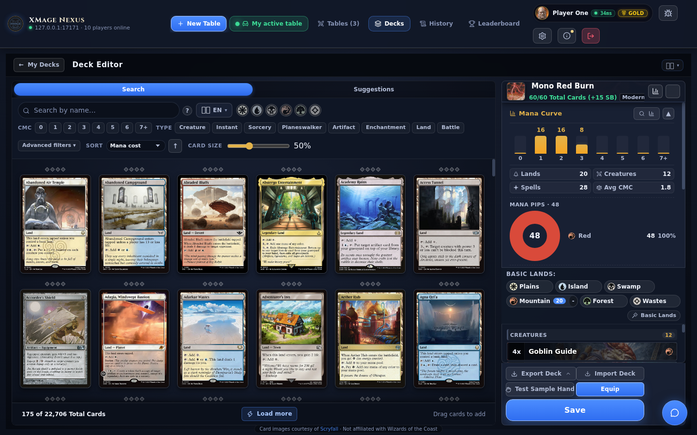
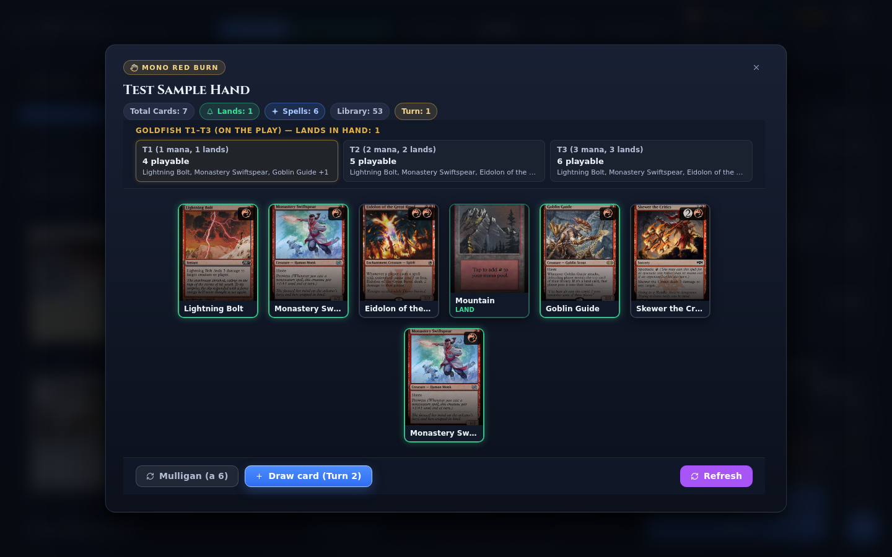

# Deck builder

The deck builder is the editor behind **My Decks**. It combines a live Scryfall search, a
main-deck and sideboard work area, format checks, a mana curve, and a goldfish hand tester, so you
can go from an empty list to a deck you trust without leaving the browser.

> **Who this is for:** a player creating, importing, or editing a deck in the Nexus web client.

## Opening a deck

Open **My Decks** from the lobby and choose **Create Deck**, or select an existing deck and choose
**Edit**. A new deck starts empty, named `Deck 1`, `Deck 2`, and so on, with the format set to
Freeform. Editing a bundled precon creates an editable copy; the original stays untouched.

Up to 75 custom decks are kept in this browser. Decks are not tied to your account, so another
browser or a private window starts with an empty list; use the export options below as your
backup.

Every change is saved as you work. The header shows **Saving…** and then **Saved ✓**. If a write
fails, the badge becomes **Save failed — tap to retry**; the deck stays open and you can retry
without losing the current edit.

## The editing screen

The screen is split in two:

- **Left:** a **Search** tab with the Scryfall browser, and a **Suggestions** tab with EDHREC
  recommendations for the current commander.
- **Right:** the deck header, an optional mana-curve panel, the basic-land bar, the main deck and
  sideboard lists, and the action footer.

The header holds the deck name, the format selector, and a count such as `60/60 Total Cards`. The
count turns red when the deck breaks a rule. The two icons on the right of the header toggle the
mana curve and switch the card list between two layouts:

| Layout | What it shows |
|---|---|
| Vertical (default) | Cards grouped by type: creatures, planeswalkers, instants, sorceries, artifacts, enchantments, lands, other |
| Horizontal | One column per mana value, from 0 to 7+ |

Double-click the header to open the **Deck Inspector**: the full list, the curve, a **Copy** button
that puts a plain-text decklist on the clipboard, and a shortcut back to editing.

## Searching with Scryfall

Search runs against Scryfall as you type, with a short pause after the last keystroke. The query
box accepts full Scryfall syntax; the **?** button lists examples and links to Scryfall's reference.

| Example | Finds |
|---|---|
| `t:creature` | Cards with the creature type |
| `c:red` | Red cards |
| `cmc<=3` | Cards with mana value 3 or less |
| `o:"haste"` | Cards whose rules text contains the phrase |
| `pow>3` | Creatures with power greater than 3 |
| `rarity:mythic` | Mythic rares |
| `set:mh3` | Cards from one set |
| `f:standard` | Cards legal in a format |
| `keyword:flying` | Cards with a keyword |

A bare word such as `haste` is matched by Scryfall's default behaviour. Combine terms with spaces
to narrow the result.

With an empty query the builder shows paper cards that are not basic lands. Selecting a format on
the deck header adds that format's Scryfall filter to every search, so a Standard deck does not
offer Modern-only cards. Freeform and the Highlander variants have no Scryfall filter.

### The filter bar

The controls below the query box build additional query terms. They combine with the text you
typed and with each other.

| Control | Effect | Added to the query |
|---|---|---|
| Colour orbs (W U B R G C) | Colour is within the selected colours | `c<=wu` for a selection, `c:c` for colourless |
| CMC chips 0–7+ | Exact mana value; the 7 chip means 7 or more | `cmc=3` or `cmc>=7` |
| Type chips | One card type | `t:creature` |
| Rarity chips | Any of the selected rarities | `rarity:rare OR rarity:mythic` |
| Keyword chips | All selected keywords | `keyword:flying keyword:ward` |
| Power / toughness | Comparison and a number | `pow>=4`, `tou<=2` |
| Set | One set code | `set:mh3` |

Rarity and keyword chips sit under **Advanced filters**, together with the power, toughness, and
set fields. **Clear** resets the text, every chip, and the sort.

The colour orbs and a colour term in the text box can contradict each other. When both are
present, the bar shows a note that the free text already filters by colour.

### Sorting, size, and language

Sort by mana cost, name, rarity, colour, EDHREC rank, or release date, and flip the arrow for
either direction. Mana cost ascending is the default. **Card size** scales the result grid from
0% to 150%.

The language button chooses which printing language the search asks for; **All** adds `lang:any`. A chosen language adds `lang:<code>` to the query. If it returns nothing on the
first page, the client retries across all languages.

Results show a small counter when the card is already in the deck. A **Not in XMage** badge means
the connected server does not implement that card and will reject it. Click a card to add one
copy; **Load more** fetches the next page.

If Scryfall rate-limits the client, the grid shows a retry notice. A failed search shows
**Scryfall search failed** with a **Retry** button; your deck is not affected.

## Placing and removing cards

Add cards by clicking them in the results, or by dragging them onto the deck list. Once a card is
in the deck:

| Action | Result |
|---|---|
| Click the row | Remove one copy |
| Shift-click the row | Add one copy |
| Right-click the row | Add one copy |
| `+` / `−` buttons | Add or remove one copy |
| `+` / `−` keys while the row has focus | Add or remove one copy |
| Drag the row onto the sideboard area | Move one copy to the sideboard |
| Drag the row onto the search panel | Remove one copy |
| Swap button on the row | Move one copy between main deck and sideboard |
| Remove all copies button | Remove every copy, with a confirmation when there is more than one |

The sideboard area is always visible. Drop cards on it, or use the swap button on any row.

Copy limits are not enforced while you edit. Adding a fifth copy is allowed, and the format check
marks it.

### Commander and cover card

In a Commander, Brawl, Oathbreaker, or Highlander deck, drag a legendary card onto the commander
slot or use the crown button on its row. The slot accepts a second commander when the pair is legal
(Partner, Partner with, or a Background when the commander can choose one). A card that cannot be
a commander has its crown button disabled. The star button marks any card as the cover art; the
cover has no effect on play.

### Basic lands and the curve

The basic-land bar has one button per basic land type. Click a button to add one land, or the small
`−` to remove one. The wand button opens a suggester that counts the coloured pips in your spells,
proposes a land split for a target count, and lets you choose the basic-land printing set. The
default target is 24 lands, or 36 for Commander. Applying a suggestion replaces the basic lands
already in the deck after a confirmation.

The curve panel can stay open while you edit. It shows:

- A bar per mana value from 0 to 7+, with counts.
- Lands, creatures, spells, and the average mana value of your spells.
- A colour-pip donut with the share of each colour.
- A mana-source donut that separates sources on lands from sources on other permanents.
- A basic-land breakdown.

The panel starts open on tall windows and remembers your choice.

## Format rules and server validation

The format selector offers Standard, Pioneer, Modern, Legacy, Vintage, Pauper, Commander, Brawl,
Oathbreaker, Penny Dreadful Commander (`PennyDreadfulCommander`), European Highlander
(`EuropeanHighlander`), Canadian Highlander (`CanadianHighlander`), Historic, Timeless, and
Freeform.

Two checks run while you edit.

**Local format check.** It verifies deck size, the sideboard maximum, the four-copy limit (one in
singleton formats), Scryfall legality, commander eligibility and pairing, and colour identity.
Errors turn the header count red; a deck below the minimum is only a warning. Click the count to
see the list.

**Server check.** When the proxy is connected, the deck is also checked against the target XMage
release. This catches a printing the server does not have and a card the server loads as a
different card. A banner lists every affected row with its set and collector number.

For a rejected printing, a suggestion button such as **Use DMU #277** switches that card to a
printing the server has, and **Auto-resolve (N)** applies every suggestion at once. A mismatch can
be accepted with **Got it**.
The banner is advisory and never blocks saving. The check when you join a table is the final one, and the pre-join
dialog repeats the check.

When the proxy can run the official XMage deck validator, its verdict appears as **XMage
(validator) reports this deck illegal**, with the validator's own message.

## Importing a decklist

**From the builder footer.** **Import Deck** opens a paste box with two modes: **Add to current
deck** merges the list into the open deck, and **Replace entire deck** swaps the main deck and
sideboard for the imported ones. Paste, drop a file, or read the clipboard. The accepted file
extensions are `.dck`, `.txt`, `.dec`, `.cod`, `.o8d`, `.dek`, `.mtga`, `.mwdeck`, `.draft`, and
`.json`. A preview confirms the counts before you commit.

**From My Decks.** **Import Deck** opens a three-step dialog:

1. **Source.** Paste a list, drop a file, or paste a Moxfield or Archidekt deck URL. Online URLs
   are fetched through the proxy; a pasted list is parsed locally.
2. **Setup.** Choose the format (the dialog suggests one from the deck's shape) and a printing
   strategy: Scryfall default, oldest printing, a specific set (falling back to the default when
   the card is not in that set), or keep as is.
3. **Review.** See how many cards matched a printing, which cards fell back, which were not found,
   and whether the deck is legal in the chosen format. Remove unresolved cards, then create the
   deck.

**Quick import** imports at once with the format detected from the list and the printings the list
carries, skipping setup.

The text parser accepts XMage `.dck`, Arena, MTGO `.dek`, Cockatrice, OCTGN, MWS, draft logs,
JSON, and plain lists. It recognizes main, sideboard, commander, companion, and maybeboard
sections in several languages, `SB:` lines, and the blank-line convention.

## Exporting

**Export Deck** appears in both footers. Each option downloads a file and copies the text to the
clipboard.

| Option | File | Contents |
|---|---|---|
| `.dck` | `<name>.dck` | `NAME:` line, `N [SET:NUM] Name` per card, `SB:` lines for the sideboard |
| Arena | `<name>.txt` | `Deck` and `Sideboard` headers, `N Name (SET) NUM`, a `Commander` section |
| Plain | `<name>-plain.txt` | `N Name`, a blank line, `SB: N Name`, a `Commander` section |
| `.dek` | `<name>.dek` | `N Name` per card, sideboard after a blank line |

The **Copy** button in the Deck Inspector always copies the plain-text form.

## Testing a sample hand

**Test Sample Hand** deals seven cards from the current main deck.

- **Mulligan** deals a new seven. Under London rules you then choose one card to put on the bottom
  for each mulligan taken; **Confirm** is enabled only when you have selected the right number.
- **Draw Card** moves the top card of the library to your hand and advances the turn counter.
- A three-turn projection shows your available mana, the lands you could have, and which cards in
  hand you could cast on turns 1 to 3.
- Chips count cards in hand, lands, spells, library size, and turn.

It uses the same art as the board, including custom images, and does not change the saved deck.

## Alternate printings and custom art

The palette button on a deck row opens **Select Edition & Art**. It lists every Scryfall printing,
newest first, with set and collector number. A **Not on server** badge marks printings the
connected XMage release does not have.

Choosing a printing changes the art for that card name in every deck on this device. It does not
change the printing stored in the deck or sent to the server; use the validation banner or
re-import for that. The same dialog holds **Your image**, where you can upload a custom picture.
See [Card images and art](card-images-and-art.md) for the pipeline, storage, and limits.

## Related

- [Lobby and tables](lobby.md)
- [Joining a game](joining-a-game.md)
- [Game modes and formats](game-modes.md)
- [Card images and art](card-images-and-art.md)
- [Settings](settings.md)
- [Keyboard shortcuts](../reference/keyboard-shortcuts.md)
- [User manual (inherited upstream page)](../user-manual.md) — older upstream-authored description; this guide is authoritative.
