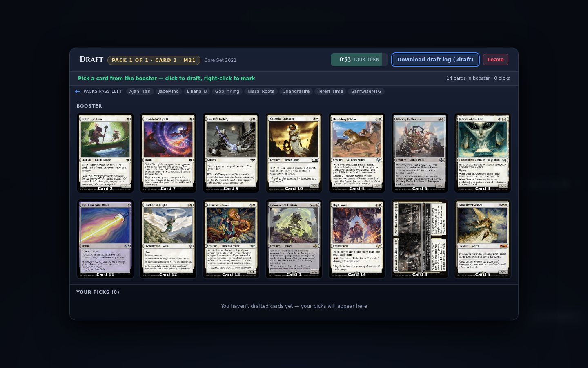

# Game modes and formats

A table's mode is fixed when it is created: the game type decides how many players sit down and how turns pass, the deck type decides which cards are legal, and the table category decides whether you are playing a single match or an event with rounds. This page covers what the create-table wizard offers, what each mode looks like once the game starts, and which formats the server behind Nexus actually supports.

> **Who this is for:** a player choosing a format, a table size, or an event type, and wanting to know what to expect before joining.

## Choosing a mode

The create-table wizard asks for three things, in this order:

1. **Table category** — Duel (two seats), Multiplayer (three or more), or Tournament (an event with rounds).
2. **Game type** — the server's own list, which sets the minimum and maximum number of seats.
3. **Deck type** — the format your deck must be legal in.

Seats are filled per player: a human seat waits for someone to join, an AI seat is played by the server's bot, and an LLM seat is played by a model when the connected server offers LLM play. A duel is always two seats; multiplayer tables take the game type's range; a draft table is capped at eight seats. The exact fields, defaults, and validation messages are in [Creating a game](creating-a-game.md).

## Constructed

Constructed is a match between pre-built decks. The server checks the deck on join — every card must exist in the printing you listed — and applies the format's banned and restricted lists. A deck that fails the check is listed card by card before you sit down, with suggestions for a legal printing; see [Joining a game](joining-a-game.md).

| Family | Formats offered |
|---|---|
| Premier | Standard, Pioneer, Modern, Modern without a banned list, Legacy, Vintage, Pauper |
| Extended and casual | Extended, Frontier, Historic, Historical Type 2, Super Type 2, Freeform, Freeform Unlimited |
| Singleton | Australian, Canadian, and European Highlander |
| Old frames | Old School 93/94 and its Italian, Channel Fireball, EudoGames, and EC rule sets; Premodern |
| Block | Block Constructed for the blocks the server ships, plus a custom Star Wars block |
| Limited | Sealed and booster draft (below) |

A match is best of one by default. Setting the wins needed to two or three produces a best-of-three or best-of-five, and the [sideboard screen](board-and-controls.md) then opens between games. Decks may carry a sideboard up to fifteen cards.

## Commander

Commander tables come in two shapes: a two-player duel and a free-for-all for three to ten players. Both put each deck's commander in the command zone, apply the commander tax on every cast from that zone, and end a player's game at twenty-one combat damage from a single commander.

| Game type | Seats | Notes |
|---|---|---|
| Commander Two Player Duel | 2 | One commander each |
| Commander Free For All | 3–10 | Four seats is the usual pod |
| Duel Commander, MTGO 1v1 Commander, Centurion Commander | 2 | Variant rule sets |
| Tiny Leaders | 2 | Variant deck restrictions |
| Brawl, Oathbreaker | 2 or 3–10 | Planeswalker-led variants |
| Momir Basic | 2 or 3–10 | A basic-land deck and random creature tokens |
| Penny Dreadful Commander, Freeform Commander, Freeform Unlimited Commander | 2 or 3–10 | Cost and card-pool variants |

The **Commander** drawer tab shows the damage matrix, the command zone shows the tax badge, and a commander that would leave the battlefield asks whether to return to the command zone. In a four-player pod the board switches to the 2×2 layout; five or more players use the standard layout with an opponent switcher. Damage tracking is described in [Board and controls](board-and-controls.md).

## Free-for-all and multiplayer

A plain **Free For All** table takes three to ten seats and passes turns in seating order round the table. The turn-order ring at the top of the board shows that order and marks the active player; in a duel the same ring collapses to a two-seat lane.

Two things make a large table readable. The client paints at most four seats in the pod and arena layouts, so a table with five or more players is drawn in the standard layout with one opponent on top and a switcher bar for the rest. And the wizard can restrict who may attack whom — the attack range options — which the server enforces for the whole game.

## Limited: booster draft and sealed

Limited tables use the **Limited** deck type. You do not bring a deck; you open cards at the table and build one from what you open.

### Booster draft

A draft table seats up to eight players and runs three boosters by default, or six if you choose the longer schedule. The wizard takes the set codes in pick order, or a cube list, and sets a pick timer: Beginner (double time), Regular (one and a half), or Professional (base time). A draft bot can take any seat you assign to it; unfilled seats wait for other players.

The draft screen shows the pack number and your pick number, the direction packs are passing, the cards left in the pack, and your picks so far. A timer marks your pick; when it runs out the server picks for you. Click a card to take it, right-click to mark it, and use the hidden-picks toggle when your pick list gets long. The screen also downloads a `.draft` log of the whole draft.

After the last pack, the construction screen opens with your pool on one side and your main deck on the other. You need at least forty cards in the main deck; the editor groups the pool by card type, adds basic lands in bulk, and validates the deck before you submit it. Between games of a limited match, the sideboard screen opens with a forty-card main-deck minimum instead of sixty.

### Sealed

Sealed is offered as a tournament type rather than a single-table mode. You open six boosters, build a forty-card deck from the pool, and play the rounds. The deck-building step uses the same construction screen as a draft.

## Tournaments

A tournament table creates one event and the server opens a match table for each pairing as rounds advance. The wizard offers the tournament types the server reports:

| Event | Format | Server seats |
|---|---|---|
| Constructed Swiss | Pre-built decks, fixed number of rounds | 4–16 players |
| Constructed Elimination | Pre-built decks, single elimination | 4–16 players |
| Booster Draft Swiss / Elimination | Three boosters, draft first, then rounds | 4–16 players |
| Booster Draft (Cube, Random, Reshuffled, Rich Man) | Same, with a cube or a different pack source; Rich Man drafts one booster | 4–16 players |
| Sealed Swiss / Elimination | Six boosters, build first, then rounds | 2–16 players |
| Sealed (Cube) | Sealed from a cube list | 2–16 players |
| Jumpstart Swiss / Elimination | Jumpstart packs | 2–16 players |

The seat counts above are what the server's tournament types accept. The create-table wizard caps a limited event at eight seats.

Swiss events play a set number of rounds and rank players on points; elimination events pair winners forward until one player is left. Leave the round count at zero and the server sizes the event. The bracket view lists each round with its pairings, the table each match is played on, and a watch control; the standings tab lists every player with points, status, results, and history. You can leave a tournament from the bracket at any time.

A limited tournament needs humans in the seats: a bot cannot draft and then deliver a built deck, so the wizard fills empty limited seats with waiting players rather than AI. Constructed tournaments accept bot and LLM seats.

## Seats: humans, bots, and models

| Seat | Who plays it | When it is offered |
|---|---|---|
| Human | A person joining the table | Always |
| AI | The server's bot (Mad, Monte Carlo, or draft bot) | When the server reports bot types |
| LLM | A language model, one configuration per seat | When the connected server reports LLM support |

An LLM seat is configured in the wizard with its own provider endpoint, model, and API key; keys are kept in the browser's memory for the session and are never written to storage or sent to the game server. A table whose seats are all LLM is watched as a spectator. The **LLM** drawer tab shows the conversation for seats you are allowed to see, and the end-of-game dialog can download a transcript.

## Spectators and replays

Any table created with spectators allowed can be watched live from the lobby or from a tournament pairing. Spectators see both sides of the board but only the hands the server reveals, cannot act, and can follow the next game of a match when one ends. Matches on a server that persists saves can be replayed afterwards: [Replay viewer](replay-viewer.md).

## Format support at a glance

| Mode | Seats | Deck | Client support |
|---|---|---|---|
| Duel constructed | 2 | Any constructed format | Full board, time limits, sideboard, transform and double-faced cards |
| Commander duel | 2 | Commander variants | Command zone, tax, 21-damage matrix |
| Commander free-for-all | 3–10 | Commander variants | Pod or standard layout, turn ring, damage matrix |
| Other variants (Brawl, Oathbreaker, Tiny Leaders, Momir, Highlander) | 2 or 3–10 | Variant lists | Same board as their seat count |
| Free-for-all | 3–10 | Constructed or Freeform | Turn ring, opponent switcher above four seats |
| Booster draft | up to 8 | Limited | Draft screen, construction screen, `.draft` log |
| Sealed | up to 8 | Limited | Construction screen before round one |
| Constructed tournament | 4–16 | Constructed | Bracket, standings, per-round tables |
| Limited tournament | up to 8 | Limited | Draft or sealed phase, then bracket |
| Two-Headed Giant | — | — | Not offered: the server's game-type list has no two-headed entry, so team play cannot be created. The 2×2 pod is four independent seats, not two teams. |

## Related

- [Creating a game](creating-a-game.md)
- [Joining a game](joining-a-game.md)
- [Board and controls](board-and-controls.md)
- [Deck builder](deck-builder.md)
- [Replay viewer](replay-viewer.md)
