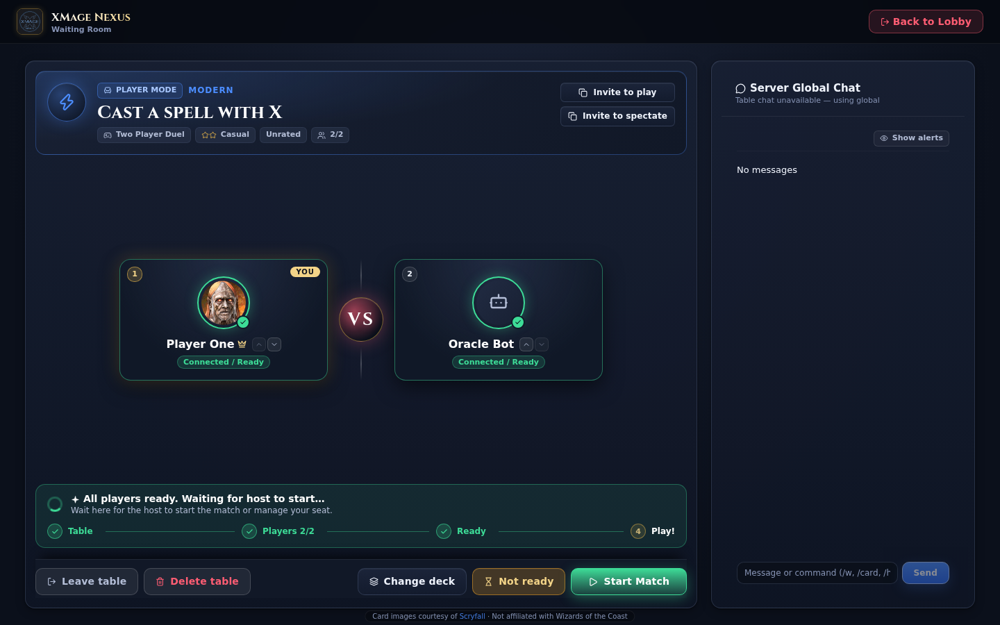

# Joining a game

Joining takes two decisions: which table, and which deck. Nexus makes the second one explicit, because the XMage server matches cards by set and collector number, and a deck list that is legal on paper can still contain a printing the server does not have. The join dialog therefore shows your decks ranked against the table's format, checks the chosen deck with the server before it seats you, and reports exactly which cards would fail.

> **Who this is for:** a player who has found a table in the lobby and wants to take a seat, or to watch a game already in progress.

## Finding a seat

A table card offers **Join (Human)** while it has an empty human seat and has not started. The same action is available by double-clicking the card. Tables marked **Private** ask for a password first; tables with a minimum rating or a quit limit reject players who do not meet it, and the refusal appears in the join dialog.

A table hosted by a player on your ignore list still appears unless you enable **Hide ignored**, but joining it shows a warning that the host is on your list.

If every seat filled between the last refresh and your click, the join fails with **Table has no free seats**. The list catches up within a couple of seconds.

## The join dialog

The top of the dialog shows the table name, the format, the raw game type and deck type, the seat count as dots, the host, and a **Requires password** chip when the table is private. A password field appears above the deck list and is required before the join button enables.

Below it is **Choose your deck**: a grid of deck tiles, each with cover art, name, colour pips, up to two highlighted cards, and a fit badge.

| Badge | Meaning |
|---|---|
| The format name, with a check | The deck's saved format matches the table's format and the deck is big enough. |
| The deck's own format name, no check | The deck belongs to another format. The badge is a warning, not a block. |
| `n/min cards` | The deck is below the format's minimum main-deck size. |
| `n cards` | The table's format has no minimum, or the deck has no saved format. |

Decks are ordered by fit: exact format matches first, then decks that are merely playable, then other formats, then decks that are too small; favourites and recently edited decks break ties inside a group. When the table has a minimum deck size and both groups are non-empty, the grid splits into **Ready for `<format>`** and **Other decks**.

The deck you used the last time you joined this format is preselected, so a familiar table needs one click. The search box appears once you have more than six decks and matches deck names, card names, and commander names. **Paste new deck…** opens an inline importer: a name, a card list, and **Save and Select**, which stores the deck and chooses it without leaving the dialog.

If the browser has no decks at all, the dialog offers the bundled starter decks instead of an empty grid.

The footer repeats **You'll play `<deck name>`**, warns when the selected deck is under the minimum, and the primary button reads **Join with "`<deck name>`"**.

## Cards the server will reject

Pressing the join button does not seat you immediately. Nexus sends the deck to the server for validation and opens the **Deck problems** dialog when the server reports cards it cannot load.

The dialog groups the problems in two sections:

| Section | What it lists |
|---|---|
| **Cards rejected by the server** | Each card with its amount, name, and printing, plus the reason: *That printing (set/number) does not exist* or *Not implemented on the server*. |
| **Cards that load as another card** | Cards whose set and number resolve to a different name on the server, with the name the server will use instead. |

Each row offers up to three suggested printings of the same card, labelled **Use `<set>` #`<number>`**. Choosing one rewrites that entry and validates the deck again, so suggestions can be applied one at a time. **Auto-resolve** applies every available suggestion at once. **Remove `n` and play** drops the rejected cards and seats you with the corrected deck; **Accept and play** is offered when only substitutions remain. **Cancel** returns to the deck picker with nothing changed.

Two habits avoid most of these dialogs: import lists from a recent source, and keep the deck's printings up to date in the builder. The builder's own validation reports the same problems before you reach a table; see [Deck builder](deck-builder.md).

## What happens after you join

The server confirms the seat and Nexus moves you into the table's waiting room. The dialog closes, the table appears in your active-table strip, and the room chat gives way to the table's own chat.

### The waiting room

The waiting room is the room between joining and playing. Its header carries the format emblem, the table name, and chips for game type, skill, rated or unrated, private, and seat count. **Invite to play** and **Invite to spectate** sit on the right.

The roster adapts to the table size:

| Table | Layout |
|---|---|
| Two seats, non-Commander | Two large seat cards facing each other across a **VS** divider. |
| Up to six seats, any other table | A ring around a central table, with the filled count in the middle. |
| Seven or more seats | A grid of seat cards. |

Your own card is marked **YOU** and carries your deck as a card with cover art, card count, and colour pips. Clicking it opens the deck picker with the title **Change table deck**; the new deck goes through the same server validation. As the host, changing your deck recreates the table, and the dialog warns that the other players must join again.

The status line reports what the room is waiting for: **Waiting for table seats to fill…**, **Waiting for all players to confirm ready…**, **All players ready. Waiting for host to start…**, or **Preparing to start…**. A four-step indicator tracks **Table**, **Players `n/m`**, **Ready**, and **Play!**.

The actions along the bottom depend on your role:

| Action | Who sees it | Effect |
|---|---|---|
| **I'm ready** / **Not ready** | Every player | Toggles your ready state. Other players see the change in the roster and in the table chat. |
| **Change deck** | Every player | Opens the deck picker for this table. |
| **Start Match** | The host, once the table is **Ready to start** | Starts the game. If some players have not confirmed, a dialog asks whether to start anyway. |
| **Leave table** | Every player | Gives up your seat and returns to the lobby. |
| **Delete table** | The host | Removes the table for everyone. |
| **Back to Lobby** | Every player | Returns to the lobby while keeping your seat. |

### Starting and leaving

A table becomes **Ready to start** when every seat is filled. Only the host can start it: the server accepts the start from the table's owner, and the button is hidden for everyone else. Bots never confirm readiness; the host's start is enough for them.

**Leave table** removes you from the table and frees the seat. If the host leaves before the match starts, the server deletes the table, and the waiting room has no table left to show; use **Back to Lobby** to return to the list. At any other time **Back to Lobby** is the softer option: you keep the seat, the table stays in your active strip, and you can walk back in.

## Re-entering a table

Three routes lead back to a table you already hold:

- **Return to table** on the table card.
- **Return to staging** in the active-tables strip above the list.
- **My active table** in the top bar, which opens the waiting room directly when you hold exactly one table.

If the match has already started, the same places offer **Join match**, which reconnects your browser to the running game instead of the waiting room. This is the recovery path after a reload, a lost connection, or a browser restart: log in again, find your table in the strip, and press **Join match**. Back to Lobby only leaves the waiting room, so your seat survives it; once the game is running, the game screen's own exit action is what concedes the match.

## Spectating

**Spectate** appears on every table card. It opens the live game of a table that is already playing; a table that has not started has no game to send yet, so the server refuses and the lobby shows an error. Tournament tables behave differently: watching one opens the tournament bracket instead of a board.

While a spectator connection is being set up, Nexus shows the waiting room in **SPECTATOR MODE** with the roster, the table chat, and a note that the board opens when the duel starts. The board then takes over in spectator view: you watch the table without a hand of your own and without an action button.

Spectator view, the board layout, and the controls available to a watcher are described in [Board and controls](board-and-controls.md).

## Joining a tournament

Tournament tables follow the same card actions, with one difference. A limited tournament without a password joins in a single step: you take a seat and draft inside the tournament, then submit the deck you built. A limited tournament with a password opens the join dialog first, and a constructed tournament always asks for a deck before it seats you.

Once the tournament starts, the table leaves the waiting state and the tournament screens take over: the draft or construction phase for a limited event, the rounds for a constructed one. **View Bracket** on the table card opens the pairings and the standings at any time.

## When a join fails

| Symptom | Cause | What to do |
|---|---|---|
| **Table has no free seats** | The last seat filled before your request. | Pick another table. |
| The join button stays disabled | No deck selected, or the password field is empty on a private table. | Choose a deck, type the password. |
| The password is refused | Wrong password, or the host changed it by recreating the table. | Ask the host for the current password. |
| **Deck problems** keeps returning | The deck still contains a rejected card and you cancelled instead of applying a fix. | Apply a suggestion, or remove the card and play. |
| The table disappeared | The host left before the start, or the match finished. | Return to the lobby and pick another table. |
| An invite link says the table no longer exists | The table finished or was deleted between the invite and the click. | Ask for a new invite. |

## Related

- [The lobby](lobby.md)
- [Creating a game](creating-a-game.md)
- [Chat and social features](chat-and-social.md)
- [Board and controls](board-and-controls.md)
- [Troubleshooting](../reference/troubleshooting.md)
