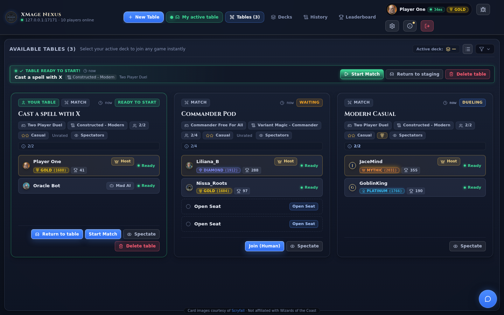

# The lobby

The lobby is the screen Nexus opens after you connect. It shows the server's main room as it changes: every table with its host, format, seats, and state, the players who are online, and the room chat. The room list refreshes about every two seconds while you are in the lobby, so a table appears, fills, and starts without a page reload. While a game is running the refresh slows to every twenty seconds.

> **Who this is for:** a player who has connected to a server and wants to find a table, create one, or return to a game already in progress.

## The top bar

The left side of the bar shows the server address and the number of players in the room. The centre holds the main navigation, and the right side holds your own identity and the application controls.

| Control | What it does |
|---|---|
| **New Table** | Opens the create-table wizard. |
| **My active table** | Appears only while a table holds a seat for you. With one table it opens the waiting room, or the board if the match is already running; with several it takes you to the table list. A count appears when you hold more than one. |
| **Tables** | Shows the table list. The label carries the number of tables in the room. |
| **Decks** | Opens your deck gallery and the deck builder. |
| **History** | Opens finished matches, your own statistics, and saved replays. |
| **Leaderboard** | Opens the ranking panel for the room. |
| **Your badge** | Your avatar, name, latency, and league tier. Click it to open your profile. |
| **Report, settings, about** | The bug icon opens the report dialog, the gear opens settings, and the info icon opens the About panel. A dot on the info icon marks unread news. |
| **Disconnect** | Asks for confirmation, then ends the session and returns to the login screen. |

Latency badges appear only when that player's client has reported a measurement, so many rows show none. Disconnected players are labelled as such.

## The table list

Each table is one card. The card carries the information you need to decide whether to join, without opening it.

| Element | What it tells you |
|---|---|
| Table name | The name the host chose. |
| **Match** or **Tournament** | Whether the table is a single match or a tournament. |
| **Private** | The table requires a password. |
| State chip | What the table is doing right now. |
| Game type and format chips | For example `Two Player Duel` and `Modern`. Long server format names are shortened on the card and spelled out in a tooltip. |
| Seats | Filled seats out of the total, for example `1/2`. |
| Skill stars | The skill level the host expects: one star for Beginner, two for Casual, three for Competitive. |
| **Rated** or **Unrated** | Whether the match counts for ELO. |
| **Spectators** | The host allows other players to watch. |
| Minimum rating | The lowest ELO the host accepts, when a limit is set. |
| Maximum quit | The highest quit percentage the host accepts, when a limit is set. |
| Seat roster | One entry per seat with avatar, country flag, ELO, match count, a crown for the host, and **Ready** for occupied seats. Click a player to open their profile and actions. |
| Age | How long ago the table was created. |

The state chip uses these values:

| State | Meaning |
|---|---|
| **Waiting** | The table still has open seats. |
| **Ready to start** | Every seat is filled; the host can start the match. |
| **Dueling** | A game is in progress. |
| **Sideboarding** | The match is between games. |
| **Drafting**, **Constructing** | Tournament phases before the first round. |
| **Finished** | The match is over. |

A card offers the actions that fit its state: **Join (Human)** when a human seat is open, **Start Match** on a table that is ready (only the host's press starts the game), **Spectate** on any table whose game is already running, **View Bracket** on a tournament, **Return to table** when you hold a seat but left the waiting room, and **Join match** when your game is already running. The host also sees **Delete table** on a table that has not started.

Double-clicking a card picks the same action: it re-enters your own table, joins a table with an open human seat, resumes or watches a running game, and otherwise tries to spectate.

## Filtering and sorting

The filter row is collapsed by default and remembers its state in the browser. A badge on the filter button counts the active filters. **Reset** clears all of them.

| Control | Effect | Default |
|---|---|---|
| Search box | Matches the table name, host name, game type, format, the server's extra table description, and seated player names. | Empty |
| Format chips | **All**, **Commander**, **Modern**, **Pioneer**, **Standard**, **Pauper**, **Limited**. Each chip shows how many tables match. **Limited** covers draft, sealed, and cube tables. | All |
| More formats | A list of every other format present in the room plus common constructed formats. | None |
| **Open only** | Tables that are waiting or ready and still have an empty seat. | Off |
| **In Game** | Tables that are dueling or sideboarding. | Off |
| Sort | **Default**, **Newest**, **Oldest**. Default puts your own tables first, then tables with a free seat, then the newest. | Default |
| Mode | **All**, **1v1**, **Multiplayer**, **Tournament**. In tournament mode you can narrow to **Constructed** or **Limited**. | All |
| Skill | **Beginner**, **Casual**, **Competitive**. | All |
| Restrictions | **Private** hides passworded tables; **Passworded only** shows only them; **Rated** and **Unrated only** split by ELO; **Allow Spectators** keeps tables that allow watchers; **AI Bot** keeps tables with an open bot seat; **Hide ignored** removes tables hosted by players on your ignore list. The paired options are mutually exclusive. | All off |

The list header also holds a density button that switches between card view and a compact row view, and an **Active deck** badge that names the deck you last played or selected.

## Your tables

When you own or sit at a table that has not finished, a strip appears above the list with one row per table. The row shows the state (**Your table waiting**, **Table ready to start!**, **Your match in progress**), the filled seat count, the table name, format, and game type. Its buttons are **Start Match** when the table is ready, **Join match** when a game is running, **Return to staging** to go back to the waiting room, and **Delete table** for the host.

**Back to Lobby** in the waiting room hides the room without giving up your seat. The table keeps showing in the strip and on its card, so you can return at any time.

## The Decks tab

The **Decks** tab is a gallery with two sources: **My Decks**, the decks stored in this browser, and **Meta & Popular Decks**, a browsable library of ready-made lists. The toolbar filters by format or favorites, sorts by recency, name, or size, and narrows the grid by search text and mana colour. The footer edits the selected deck in the builder, exports it, marks it as a favorite, or deletes it. A counter shows how many of your own decks exist and how many the browser can hold. **Import Deck** accepts a paste or a file.

Deck building, import formats, and printing repair are covered in [Deck builder](deck-builder.md).

## The History tab

History has up to three sub-tabs:

| Sub-tab | Contents |
|---|---|
| **Server matches** | Finished matches reported by the server, refreshed every ten seconds, newest first. |
| **Saved replays** | Replays stored by servers that keep them. |
| **My stats** | Games recorded in this browser, grouped by deck, format, or opponent. |

A finished match card shows the game type and format, a **Rated** or **Tournament** chip, the duration, and how long ago the match ended. Two-player matches render as a scoreboard with both players, their game wins, a crown on the winner, and tags for quits, idle timeouts, and clock timeouts; larger pods render as a list. You can search by player, format, or result and narrow the list to rated or tournament matches. When the server holds replays for a match, each game gets a replay button. **Refresh** reloads the list immediately.

Replay playback is covered in [Replay viewer](replay-viewer.md). The **My stats** sub-tab counts only games finished in this browser, so it can disagree with the server list; **Clear history** deletes it.

## Leaderboard

The leaderboard opens on **Top Room**, which ranks the players currently in the room by constructed ELO, highest first, then by fair play. The table lists position, player (avatar, flag, name), league tier, ELO, match history, fair play, and whether the player is **In Game** or **In Lobby**. A search box filters by name, and clicking a row opens that player's **Profile** tab.

The profile tab shows the tier badge, the official ELO, progress toward the next tier, separate constructed and limited ratings, the number of tournaments played, and fair play. Your own profile also lists the players you ignored, each with an **Unblock** button. **Rank Guide** lists the tiers:

| Tier | ELO |
|---|---|
| Bronze | 0–1399 |
| Silver | 1400–1549 |
| Gold | 1550–1699 |
| Platinum | 1700–1849 |
| Diamond | 1850–1999 |
| Mythic | 2000 and above |

Tiers below Mythic are split into four sub-tiers (IV to I). The leaderboard is built from the room's user list, so it ranks the people who are connected, not every player who ever used the server.

## Tournaments in the list

A tournament table carries a **Tournament** chip. **View Bracket** opens the bracket panel with two sections: the rounds with their pairings, and the standings table with points, state, results, and history for every registered player. Each pairing offers **Watch** once it has a game to watch, and a participant can leave the tournament from the same panel after confirming.

Creating and playing tournaments is covered in [Game modes](game-modes.md).

## Invitations

The waiting room of a table you host or sit at carries **Invite to play** and **Invite to spectate**. Each button copies a link that points at the table; the spectator link opens the game without taking a seat. Anyone who opens a link sees the login screen with a note that they were invited, and after logging in Nexus looks for the table and opens the join dialog or the spectator view. If the table is gone, a notice says so; if the link names a different server, Nexus asks before switching.

Link format, password handling, and the full behaviour are described in [Chat and social features](chat-and-social.md#invite-links).

## Related

- [Creating a game](creating-a-game.md)
- [Joining a game](joining-a-game.md)
- [Chat and social features](chat-and-social.md)
- [Deck builder](deck-builder.md)
- [Game modes](game-modes.md)
- [User manual (inherited upstream page)](../user-manual.md) — older upstream-authored description; this guide is authoritative.
