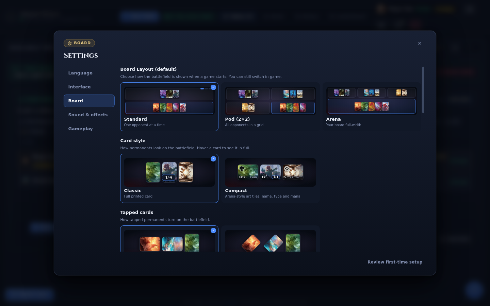
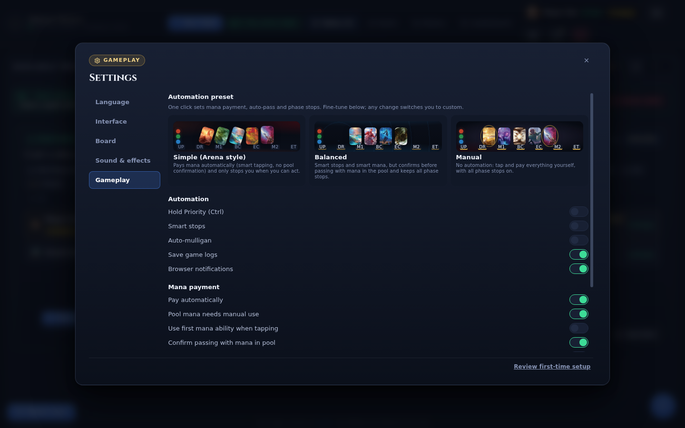

# Settings

Settings is one modal with five sections — Language, Interface, Board, Sound & effects, and
Gameplay — and most changes are saved as you make them. There is no Apply button and no server-side
profile: the values are stored in this browser and apply to whoever uses it.

> **Who this is for:** a player adjusting how Nexus looks, sounds, or handles priority.

## Opening settings

The gear button appears on the login screen and in the lobby. During a game, open the menu and
choose **Settings**; it opens directly on the **Gameplay** tab. Everywhere else the modal opens on
**Language**.

Click a section in the left column to switch tabs. Escape or a click outside the dialog closes it.
The link at the bottom, **Review first-time setup**, reopens the connection wizard for the proxy and
XMage server addresses.

## Language

| Setting | Default | What it changes |
|---|---|---|
| Language | The saved choice; otherwise the browser language when Nexus supports it, otherwise English | Every label, message, and dialog in the client |
| Card language | English | Card names and rules text shown in the client |

Both lists offer English, Español, Deutsch, Français, Italiano, Português, Русский, 日本語, and
简体中文. The interface language and the card language are independent: you can read the menus in
German while viewing card text in English.

Card language affects text the client looks up from Scryfall, such as card names and rules text in
inspectors. It does not change the card art used on the board, and it does not change what other
players see. Card art is described in [Card images and art](card-images-and-art.md).

## Interface

**Interface size** scales the whole client, including dialogs and the board, from 50% to 200%. The
default is 100%. The `−` and `+` buttons step through the presets (90%, 100%, 115%, 130%, 150%) and
then in 10% steps; click the percentage to return to 100%.

For Japanese and Simplified Chinese, 115% to 150% is a practical range because the characters are
denser than Latin text.

**Automatic CJK boost** adds another 15% when the interface is set to 日本語 or 简体中文. It is on
by default and has no effect in other languages. It stacks with the manual scale: 150% plus the
boost gives roughly 172%.

## Board

The Board section controls how permanents and the battlefield look. None of these options changes
game rules.

| Setting | Default | Options and effect |
|---|---|---|
| Board layout | Standard | **Standard** shows one opponent at a time, **Pod (2×2)** shows all opponents in a grid, **Arena** gives your board the full width |
| Card style | Classic | **Classic** draws the full printed card; **Compact** draws Arena-style art tiles with name, type, and mana |
| Tapped cards | Sideways (90°) | **Sideways** turns the card fully on its side; **Tilted (45°)** leans it diagonally |
| Cost symbols in hand | On | Adds mana-cost bubbles to cards in hand, on top of the cost printed on the image |
| Rendered cards (readable text) | Off | Draws cards from their data instead of the printed image, so rules text stays sharp at any size. Forces the full card shape and disables Compact |
| Fit battlefield cards to the space | On | Makes permanents as large as the free space allows; a crowded board shrinks them |
| Hand as a column | Off | Shows the hand as a column on the left with every card readable at once |
| Hand as a scrollable row | Off | Shows full cards in a row with a horizontal slider instead of the fan |
| Card width | 260 px | Width of the hand column or row, from 120 to 460 px; shown when either hand layout is on |
| Power / toughness badge | Always | **Always** puts a numeric badge on every creature, **Only when changed** shows it while a creature is buffed or debuffed, **Never** hides it |
| Summoning sickness indicator | Corner clock | **Corner clock** marks the card with a small clock; **Hourglass over the card** dims the whole card like the classic XMage hourglass |

Until you choose a layout, the client adapts: Standard becomes Pod when a game has two or more
opponents, and Arena falls back to Standard in a duel. A game with more than four players always
uses Standard. Picking a layout in this dialog pins it for later games.

The two hand layouts are mutually exclusive: turning on the column turns off the row, and the
other way round.

The Board section also holds the cosmetic choices:

- **Playmat.** Classic by default, plus Arcane, Verdant, Tides, Ember, Dawn, Abyss, Aurora
  (animated), and Your colours (animated). Your colours follows your commander, or the colours on
  your board when there is no commander. A custom image can be uploaded as a playmat.
- **Your card images.** A grid of every custom card image you have uploaded, with its approximate
  size, a delete button per image, and **Remove all**. The empty state explains where to upload
  one: open a deck, click the palette button on a card, and use **Your image**.
- **Sleeve.** The official card back, five built-in designs, or a custom upload. The sleeve is the
  back shown on face-down cards.

Custom images are stored on this device and are never sent to the server or to other players.

## Sound & effects

| Setting | Default | Effect |
|---|---|---|
| Animation effects | On | Turns board animations on or off |
| Speed | 1× | Animation speed: 0.5×, 1×, or 1.5× |
| Sound effects | On | Master switch for game audio |
| Master volume | 80% | Overall level |
| SFX volume | 80% | Spell, combat, and board sounds |
| UI volume | 70% | Button clicks and interface sounds |
| Priority cue | Every prompt | **Every prompt** beeps on each server ask, **On priority** beeps only when priority comes to you, **Never** disables the cue |
| Music | On | Adaptive soundtrack that intensifies as a game gets close |
| Music volume | 35% | Music level; the slider is disabled while music is off |

Volume sliders move in 5% steps. The music and priority controls are disabled while **Sound
effects** is off.

Browsers block audio until you interact with the page. If a game is silent at first, click once
anywhere; if it stays silent, check **Sound effects** and the master slider.

## Gameplay

The Gameplay tab controls priority, mana payment, and automation. It opens directly from the
in-game menu.

### Presets

| Preset | What it sets |
|---|---|
| Simple (Arena style) | Smart stops on; automatic mana payment with smart tapping and no pool confirmation; every phase stop off |
| Balanced | Smart stops on; automatic and smart mana payment, but confirms before passing with mana in the pool; every phase stop on |
| Manual | Smart stops off; no automatic mana payment; confirms passing with mana in the pool; every phase stop on |

A fresh install has no preset selected: the individual controls below start at their own defaults.
Changing any control a preset owns — smart stops, hold priority, mana payment, or phase stops —
clears the selection, and the picker shows no tick. Selecting a preset replaces those four settings
and nothing else.

Applying a preset during a game sends the new mana mode, pool-confirmation preference, phase stops,
and hold-priority state to the server at once.

### Automation

| Setting | Default | Effect |
|---|---|---|
| Hold priority | Off | Keeps priority after you cast a spell or activate an ability, instead of passing automatically. Ctrl-click or Cmd-click also holds priority |
| Smart stops | Off | Passes priority automatically unless you can play a land, cast a spell, activate an ability, or have a combat decision. Takes precedence over auto-pass |
| Auto-mulligan | Off | Answers the mulligan prompt by keeping the dealt hand, and answers the starting-player roll. It never chooses to mulligan, so you still mulligan manually when a hand is unplayable |
| Save game logs | On | Keeps a log of finished games on this device |
| Browser notifications | On, when supported | Alerts you when it is your turn or a decision is needed while the tab is in the background. Shown only when the browser supports notifications; if permission is denied, a note says so |

**Hold priority** and **Auto-mulligan** apply to the current session and return to off when you
reload the client. The other controls in this section persist on the device.

### Mana payment

| Setting | Default | Effect |
|---|---|---|
| Pay automatically | On | When off, produced mana goes to the pool and you click mana symbols to pay |
| Pool mana needs manual use | On | Mana already in the pool when you start casting must be spent by clicking its symbols |
| Use first mana ability when tapping | Off | Taps a land with its first mana ability rather than another one |
| Confirm passing with mana in pool | On | Asks before passing priority while mana remains in your pool |
| Smart mana payment | Off | Taps sources for the cost being paid while keeping colours open for instants in hand. Clicking a source yourself always takes over |

### Phase stops and auto-answers

**Default phase stops** has a row for your turn and a row for the opponent's turn, with upkeep,
draw, first main, begin combat, end combat, second main, and end step. All stops are on by default.
They are applied when you join each game; changes made during a game, from the phase bar or the
`⋯` menu, affect that game only.

**Auto-answers** lists rules you saved while answering a prompt with **Always answer like this**.
Each row shows the question pattern, the saved answer (Yes or No), and a delete button; **clear
all** removes them. The list is empty until you save a rule.

## Accessibility

The client has no separate accessibility tab, but several controls in this modal do that work:

- **Interface size** goes up to 200%, which enlarges text and controls together.
- **Rendered cards** keeps rules text sharp at any scale instead of scaling a bitmap.
- **Hand as a column** or **as a scrollable row** makes every card in hand readable without hovering.
- The power/toughness badge and the summoning-sickness marker each offer a numeric or icon form,
  so the information does not depend on colour alone.

The settings dialog is keyboard operable, and Escape closes it. Several interface animations honour
the browser's reduced-motion preference; board animation has its own toggle under **Sound &
effects**. There is no separate high-contrast theme.

## Where the values live

Settings are stored in this browser's local storage, separately from your decks. Custom card images
use IndexedDB. None of it is part of your XMage account or follows you to another browser or
device, and clearing site data returns every section to its defaults.

The exhaustive per-setting table, including storage keys, is in
[Settings reference](../reference/settings-reference.md).

## Related

- [Board and controls](board-and-controls.md)
- [Deck builder](deck-builder.md)
- [Card images and art](card-images-and-art.md)
- [Settings reference](../reference/settings-reference.md)
- [Playing in a browser](../getting-started/play-in-browser.md)
